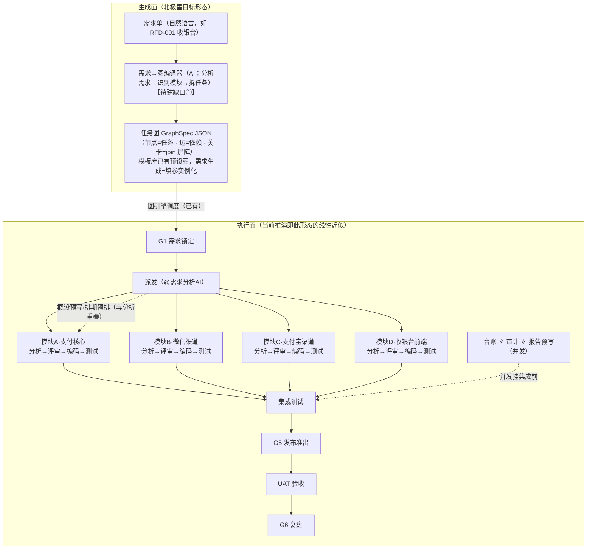
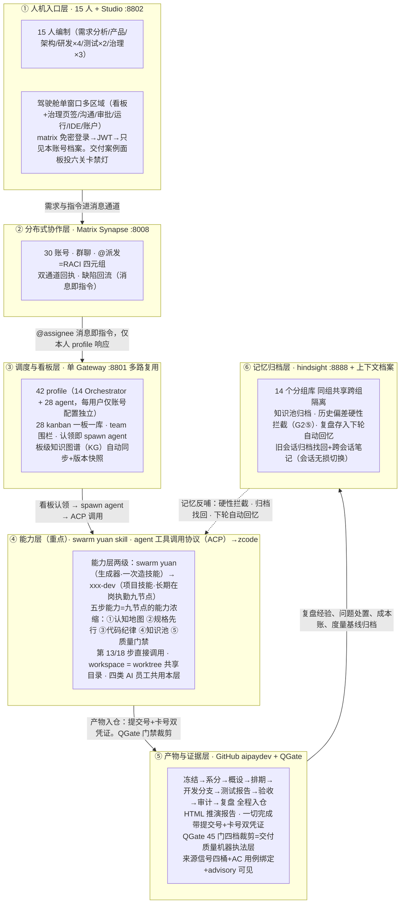
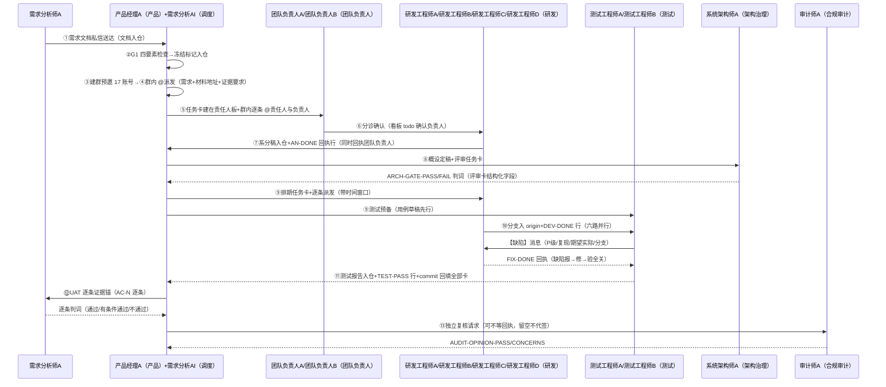

# Swarm Studio 全流程推演方案

## 总述：三分钟看懂这场推演

SwarmStudio 是一个让 AI 像一家软件公司一样干活的驾驶舱。这份方案定义一场考试：**15 个 AI 员工组成一家虚拟公司，接过一张真实的支付收银台需求单，从需求分析一直做到功能上线**。人只在关键关卡把关，全程证据存档，最后交一份没接触过本项目的人也能看懂的报告。每一轮这样的完整模拟叫一轮推演（run），按顺序编号：run1、run2……

**这场考试怎么运作？** 三个问题说清：

1. **谁干活？** 15 个角色（主管、业务分析师、产品经理、架构、4 名研发、2 名测试、安全、运维、审计），全部由 AI 扮演。每个角色有聊天账号和任务看板，互相用群聊、@消息、看板卡协作，像真公司一样。
2. **怎么保证不是演的？** 三条硬规矩：
   - 说"做完了"必须给证据：代码提交号+任务卡号，系统反查两个都真实。
   - 六个强制关卡（需求冻结→架构评审→编码门禁→独立测试→发布准出→复盘）不过不放行。
   - 所有问题记台账，结束时 100% 要有处置结论，不许悄悄消失。
3. **怎么判断考试成功？** 三条标准：
   - 功能真实可用：收银台能下单，重复提交不产生两笔订单。
   - 质量数字过硬：单元测试全绿，每条验收标准都有对应用例。
   - 过程第三方可重现：报告里每个结论都能按编号反查到原始证据。

### 本体论六要素（全方案组织语法）

这份方案全文按本体论六要素组织——六要素既是**被推演场景的对象模型**（每一轮交付什么），也是**本方案文档的章节语法**（每部分讲哪一类事实）。一张表看全：

| 要素 | 场景对象（推演中交付/治理的实物） | 方案载体（正文在哪讲） |
|---|---|---|
| 实体 | 需求单、AI 员工与账号、任务卡与看板、关卡、问题单、证据帧、轮次 | §2.1 四组件｜§2.2 编制｜§3.1 场景档案 |
| 属性 | 任务卡字段、state.env 状态键、模板字段值 | §2.7 模板字段｜§5.2 合格线｜§5.8.2 准入准出 |
| 关系 | 步链依赖、RACI 责任链、交接链 | §2.4 26 步主链｜§2.8 交接链｜§2.9 责任总表｜§3.3 映射 |
| 规则 | 六闸判据、门禁、纪律条款、语义契约 | §2.6 治理机制｜§4.3 纪律｜§5.3 关卡｜§5.5 验收清单 |
| 行为 | 派发、结卡、审批、打回、监控代行、回灌 | §2.4 步条动作｜§2.6 机制｜§2.8 断链处置 |
| 事件 | 消息事件号、问题单行、结卡拦截记录、判词结论行、台账归档 | §5.4 报告证据面｜§5.7 历轮基线（历轮事件汇存） |

六要素→五部分分工一图对读：一、方案目标=定**实体与目标**（考什么）；二、方案设计=定**属性/关系/规则/行为的设计契约**（靠什么做到，含本体视图总索引 §2.1-2.9）；三、推演场景设计=定本轮**实例**（考哪张卷子，§3.3 映射=场景↔机制唯一翻译层）；四、执行注意事项=定**行为的操作面**（怎么跑，§4.4 参数汇总）；五、验收标准=定**规则的裁判面**（怎么算考过，唯一验收线）。一条事实只在一处说全，冲突以第五部分（五、验收标准）为准。

### 词表（六要素上的统一业务词汇）

读这份方案前，认识十四个词：

| 词 | 一句话解释 |
|---|---|
| 推演 / 一轮（run） | 一次从需求到上线的完整模拟 |
| AI 员工 / 编制 | 15 个角色各由 AI 扮演，人只在关卡把关 |
| 驾驶舱 | SwarmStudio 的操作界面：看板、沟通、审批、运行中心、IDE 画布、账户六个区 |
| 26 步主链 | 推演的固定流程：分账号→锁需求→分析→设计→编码→测试→发布→验收→复盘→出报告 |
| 关卡（G1-G6） | 六个强制检查点，G1 需求冻结、G2 架构评审、G3 编码门禁、G4 独立测试、G5 发布准出、G6 复盘 |
| 双凭证 | "完成"结论必须带代码提交号+任务卡号，系统核验两处都真实 |
| 中央仓 | 全部交付物提交的 git 仓库；"入仓"指推送到 origin/main |
| 驱动脚本 | 按 26 步自动推进推演的程序（aipay-scenario.sh） |
| 问题单 | 所有问题记入 issues.log 台账，结束时 100% 有处置结论 |
| ISSUE / DISP 行 | 问题台账的两类行：ISSUE 登记问题，DISP 写处置结论（结论首词=已修/观察/延后三态） |
| AC（验收标准） | G1 冻结的可机器判定验收条件，验收测试逐条给判词 |
| UAT（用户验收测试） | 发布前的用户视角验收，按 AC 逐条核对证据并给判词 |
| 治理报告 | 轮次结束自动汇总的度量：关卡一次通过率、缺陷统计、AI 贡献占比 |
| 锚（可反查） | 结论附带的凭证标识：matrix 事件号（$…）、git 提交号、看板卡号（t_…）、房间号（!…）四类，凭它可回查原始记录 |
| 判词 | 关卡或评审的结论行，行首关键词形式（如 READY-GATE-PASS）；只认结构化载体，正文提到判词字样不算 |

**这份方案怎么读：像看一部纪录片。** 主线是 §2.4 的七幕旅程——一张需求单怎么流过这家公司（序幕搭台→需求上锁→分析→设计与排期→并行生产→发布验收→复盘交付）。开场先看组织全景（§2 开篇）：谁在场、舞台是什么。每一幕里三条线交织：AI 在产出（§2.9 责任总表的「AI 产出」列）、人在拍板（同一表「人把关」列+六道关卡 §5.3）、治理在拦截（§4.3 纪律，按幕挂站视图）。结尾是成绩单（§5.7 历轮基线）与证据面（§5.4 报告规范——每个结论可反查）。一、方案目标（要什么）和五、验收标准（怎么算成）是主干；二、方案设计是机制设计，给实现和评审的人；三、四部分是实例与操作细节，给执行的人。换需求单只换第三部分（三、推演场景设计），其余不变。演示视频素材与本章的对应关系见 §5.4.6。


> **文档定位**：全流程推演唯一正本，现行版本 V8.22。本方案全文按本体论六要素组织（总述「本体论六要素」一节=章节语法与场景对象的统一索引；本体视图实现锚=§2.6.1）；同时是报告生成器与审计器的解析源，其中 26 步主链、六道关卡、治理机制、交付物模板字段语义为冻结面，变更须整轮推演验证。纪律条款编号为稳定标识，只增不改（§4.3 编号说明）。历次版本的入列内容、修订明细与事故背景，一律见《[推演历史与工程档案](2026-10-05-mux-history-and-engineering-archive.md)》。各专项设计的概念与代码锚另见同目录 specs/ 下对应设计文档。文风验收线（2026-10-11 用户裁定）：正文散文长句清零（保留主句+必要参数括注形态），表格枚举与冻结面步条为公文合法保留形态。

## 一、方案目标

> **本部分导读**：回答"为什么考、考什么、考不过的边界在哪"。先立三条总原则（§1.1），说明执行形态的终态方向（§1.1.1）与环境纪律（§1.1.2）。然后是要验证的三条假设（§1.2）、做完后应具备的能力清单（§1.3）和明确不考的内容（§1.4）。

### 1.1 三核原则

| 核 | 含义 | 冲突裁决 |
|---|---|---|
| **贴近真实** | 推演=真实场景的复刻实验：AI 员工以自身能力完整处理任务，人角色也由 AI 模拟驱动。产物真、工具真、流程真 | 与速度冲突时**真实优先**（跳步/代投=污染实验效度） |
| **最高质量** | 交付物过核验门禁（字段级/端侧可反查），问题不静默、台账 100% 处置、报告第三方可懂 | 与速度冲突时**质量优先**（假绿=最贵的返工） |
| **最快速度** | 在真实+质量不妥协的前提下压缩实际时长时间：并发最大化、流水线重叠、报告预写、窗按实测校准 | 不得以牺牲前两核换速度 |

### 1.1.1 推演的终极形态：图执行

当前推演=aipay-scenario.sh 线性 bash 脚本（26 步顺序执行+并行补丁）。终极形态=**用 SwarmStudio 自己的 loop graph 引擎跑推演**。推演方案定义成 GraphSpec（JSON 图），事件驱动执行器按依赖关系调度节点，数据满足即触发（不等前一步全完）：

**一图看全流程**：图下段=执行面——26 步线性主链转译为 DAG（每模块独立流水，不等齐再走）；图上段=生成面——这条图链由 AI 读需求单自动生成，需求单即图的输入。两段相接的锚=「任务图 GraphSpec JSON」：



两个概念一图对读：**节点**=任务（分析/编码/测试/评审/台账/报告），非「步骤」；**边**=依赖（模块A分析完成→评审A可触发），非「步骤N在N-1之后」；**执行器**=事件驱动（依赖满足即触发），非顺序轮询；**关卡**=join 屏障（G1 等需求锁定、G5 等全部模块测试+集成通过），非脚本 if/else。一张图三种用途——GraphSpec=推演方案定义（编排器画布可编辑，改图=改方案）；运行日志=执行实况（运行中心实时可视）；事件日志=审计证据（时间轴回放）。

**转译要求**：
**转译要求**：
- 26 步转译为 GraphSpec JSON 后用产品图引擎调度。
- 编排器画布承担推演方案的视觉编辑（改图=改方案）。
- 转译正确性以与 §2.4 步语义逐行一致的门禁测试保证。
- checkpoint/resume 与断点续跑（START_STEP/UNTIL_STEP）语义一致。

**生成面现状**：AI 编译器（读需求→出任务图 JSON）是最大缺口；图模板（P4 预设图）、图引擎、驾驶舱呈现面已在产品侧建成——即上图「已有/待建」标注的对应实物：

已有件（产品侧已建）：
- 图引擎：GraphSpec 格式+事件驱动执行器+join 屏障+守卫回边+checkpoint/resume+人工介入中断（HITL）+编排器画布+运行中心+P4 模板库+每日简报模板（系统内置 GraphSpec 实例）。
- 图节点执行：六个图节点执行器+KanbanBridge（DryRun/HTTP 真实桥接 GRAPH_KANBAN_BASE，26 步图模板可实例化跑通）。
- 加权派发：工作量估计写入数据库，派发时给任务多的执行者优先派活。
- 角色边界注册表：图派发时自动给每个角色注入"只做什么、不做什么"。
- 能力声明注册表：角色能做什么写成清单，不该做的写明不做什么。
- REST 接口校验。
- 图执行影子模式（shadow）：跟着驱动一启动但不接管主流程，影子双跑验证等价后切主执行通道。
- **任务工厂资产回路**：完成 run 一键「沉淀为模板」（origin=factory，来源 run 可溯，复用计数随模板起跑累加，mission-templates 台账保存即提交）。图执行从「每轮手写 GraphSpec」走向「跑过即资产、下轮以模板派生」，为 26 步标准图模板的入库与复用提供产品支撑。
待建件（缺口）：
- ①**需求→GraphSpec 编译器**：AI 读需求→输出任务图 JSON。本质是把需求分析的输出格式从 markdown 换成 GraphSpec。
- ②推演 26 步转译为标准图模板并转正为主执行通道：先影子模式与驱动双跑验证结果等价，确认后 `MX_GRAPH_ENGINE=on` 切图引擎接管调度。
- ③图执行器↔agent 派发对接的实战完善。

分期路线见 2026-10-08-team-parallel-dev-capability.md。并行能力的需求正本=《2026-10-09-parallel-capability-foundation-spec.md》（五类工作都要"先估工作量、再拆小、并行做、最后合并成一份"，机制条款见 §4.2）。run12 已有第一个全流程并行实例：G5 整改测试分给三人同时做（matrix event $LlZZQ4HX，经验教训随轮次结束回填该 spec）。

### 1.1.2 全新环境独立回归

**每轮推演=全新环境的全流程独立回归测试**：不依赖任何前序轮次的产出物，不携带任何前序轮次的状态残留。目的：保证推演结果的因果可信——通过=系统真的好，失败=系统真的有 bug，而不是"上一轮留了好底子"或"上一轮的残留干扰了本轮"。

| 维度 | 清理机制（mx-clean） | 验证断言 |
|---|---|---|
| 中央仓 | `--reset-central` 九目录清空+推 origin/main+删旧轮分支+快照 tag | 远端仅 main、九目录零文件（admin 注册表保留） |
| Agent 工作区 | `--reset-workspaces` tar 归档后全删，mx-setup 重建净克隆 | workspaces/ 为空或净克隆 |
| 看板 | 整树归档重置 | kanban/ 整树空 |
| Matrix 房间 | 全部房间 v2 purge | 房间数=0 且全部账号 joined=0 |
| 运行态 | pending_messages/sessions/approvals/state*/cron 清零 | 五类运行态=0 |
| runs/ 目录 | 旧轮目录归档移除 | runs/ 无旧轮目录 |
| 分组记忆 | `--reset-memory` pg_dump 归档后清 14 bank | 14 bank 各表计数=0 |
| **唯一例外** | 账号凭据（synapse 用户）保留（重建成本高且与推演结果无关） | roster 15 人一致 |

**既存数据三类处置**（开跑前必须落到可验证的终态，二选一不并列）：
- **归档**：不依赖的旧数据打包留证后可检索（中央仓快照 tag、agent 工作区 tar 归档、14 记忆库 pg_dump、runs/ 旧轮目录归档）——知识不丢，但本轮回不去拿。
- **清理**：上表七维度归零（中央仓九目录/工作区净克隆/看板空树/房间 purge/运行态五类清零/旧轮 runs/ 移除/记忆 14 bank 清零）。
- **唯一例外**：账号凭据（synapse 用户）保留——重建成本高且与推演结果无关（roster 15 人一致为断言）。

**污染防线（四条禁止）**：
- 禁止任何步引用前序轮的 git commit / 看板卡号 / Matrix event_id 作为本轮凭据
- 禁止 agent 工作区残留前序轮的 worktree 或分支（branch_fresh 门禁已立）
- 禁止治理报告的 metrics 行引用前序轮数据冒充本轮实测（按轮强制关卡已立）
- 禁止复盘的"经验回忆"从前序轮的记忆库取数据冒充本轮产出（记忆召回探针需声明来源轮次）

例外声明：分组记忆库（hindsight）的跨轮经验回忆是**设计功能而非污染**。但必须在本轮口径章声明"本轮回忆了上轮的哪些经验"（记忆召回探针已设计）。读者可判断回忆对结果的影响。

### 1.2 推演要验证的三条假设

1. **分布式多 agent 研发可以按真实公司流程交付真实需求，且以流式并行模式完成**：15 人编制（每人配 AI 助理）在无办公室条件下走完全程。模式="模块拆分→并发分析→逐模块评审编码测试→集成准出"的流水线（非瀑布串行），全程在驾驶舱六功能区内完成。要验证的不只"能交付"，还有"能高效并行交付"。
   **证伪判据**：连续两轮并行度实测低于基线（§5.7，run11 约 50%），或段界锚缺失致口径回退无法实测——则"高效并行"证伪，交付完成只算部分成立。
2. **治理靠机制不靠自觉**：每个"完成"必须带双凭证（代码提交号+任务卡号），系统反向核验。六道强制关卡守住不可逆决策。问题全记账、复盘全处置。
   **证伪判据**：任一轮出现判词落在非结构化载体、双凭证反查失败、或关卡被绕过，且当轮无问题单处置——即证伪。
3. **过程可完整重现给第三方**：一份自包含的 HTML 报告让不熟悉本项目的人看懂"一张需求单怎么变成上线功能"，且每个结论可按锚点反查。
   **证伪判据**：未接触本项目的人按报告反查任一结论失败（锚点断链/凭证不存在），且无对应问题单——即证伪。

这场考试的规模，一组数字看全：

| 维度 | 数字 | 说明 |
|---|---|---|
| 流程 | 26 步 | 从分账号到出报告的固定主链（§2.4） |
| 关卡 | 6 道（G1-G6） | 强制检查点，不过不放行（§5.3） |
| 编制 | 15 人 | 主管/业务分析/产品/架构/研发×4/测试×2/安全/运维/审计（§2.2） |
| 账号 | 30 个 matrix 账号 | 每人一个人类账号+一个 AI 助理账号 |
| 智能体 | 42 个配置 | 14 个调度器+28 个执行 agent，共用一个网关 |
| 界面 | 驾驶舱 6 区 | 看板/沟通/审批收件箱/运行中心/IDE 画布/账户 |
| 循环 | 双循环 | 技能内循环×群体外循环 |
| 门禁 | QGate 判定门 45 门 | 交付质量机器执法层，按域裁剪；每门判定带来源信号（核验/声明/降级/无信号）并与验收标准绑定（QGate v1.31.1 起，见 §2.3 层⑤）；另有研发自测门禁套件 56 项四族（§4.3 纪律 33 执行面），两套并存勿混 |

### 1.3 完成后系统真实能力

**业务功能**：
- 下单幂等：同一订单重复提交返回同一支付单号。
- 微信/支付宝双渠道适配：推演环境本地 mock 承载，协议字段按公开技术手册一致，换真实凭证即可切换。
- 金额全链条"分"（int64），字段 snake_case。
- 支付结果回执与订单状态可查询。接口签名、错误码、幂等键逐条定义并落到实现与用例。

**质量（可复核数字）**：
- 支付核心单测 ≥8 条、其余模块各 ≥6 条，全部执行且全绿（执行输出随分支提交，脚本实际核验）。
- 每条验收标准有对应用例（需求-代码-测试一一对应）。
- 缺陷报→修→验全关才准出，且只认本轮记录。
- 开发分支全部合入集成分支，基线可追溯（只许快进或 merge 增量）。
- 并行度实测：六路同刻派发的重叠工作时间占比（口径与历轮基线见 §5.7；实测行入步 18 报告块，段界锚缺失时如实记口径回退）。

**评测与质量度量（V8.22 腾讯评测体系轮，机制条款=§2.6.3）**：
- 评测集带异常场景类目（模糊意图/缺参数/权限不足/工具超时/知识冲突/用户改口六类），报告按类目分桶；用例标注「期望行为」而非「期望答案」。
- 六环节分段报告：意图/工具/参数/证据/状态/表达各环节独立通过率，任一环单独报警。
- 过程双指标：工具选择正确率（抓「碰巧答对」）与轨迹绕路比（编辑距离/最优路径长度）——结果分之外的第二道闸。
- 发布门禁机械执行：工具调用成功率 ≥99%、P99 ≤2×均值、降级率 <0.5% 照抄腾讯 ADP 公开阈值（env 可调）；回放证据覆盖不到的项（TTFT/响应分档/QPS 压测）如实列证据缺口，禁硬凑代理值。
- 坏例回流：失败任务一键转回归样本库（带溯源、幂等），防问题回潮。
- A/B 对比：同评测集两 run（换模型/Prompt/版本）逐任务翻转表+读数变化。
- 技能安全治理：技能装载面注册扫描（高危项清单可反查）、四个进入通路（生成器/hermes 导入/ekko 导入/内置注入器）全接线、/app/skillgov 扫描工作台、高危技能装载拦截与内联执行段警示（SKILLGOV_ENFORCE=1 生效）。
- 验收锚点=Eval Studio 运行报告（/app/eval）+测试报告评测节（§5.4.4 成效口径四）+skillgov 扫描账本。

**交付与协作（过程资产）**：
- 完整入仓文档链：冻结单→资产表→组织矩阵→任务清单→系统分析稿→概要设计→排期→测试报告→发布计划与说明→完备性检查→验收报告→工作台账→审计意见书→复盘（字段级模板见 §2.7）。
- 全过程留痕互链：matrix event_id、看板卡号、git commit 三源互链。
- 治理链条完整：六道关卡全部通过、问题单 100% 处置、经验入分组记忆库。

**人机协同组织面**：
- 任务协同图：任一业务结果（根任务卡）一张图看清人、智能体与控制点如何协同完成。配五问面板：结果谁负责/人机怎么分工/哪里必须人确认/异常怎么升级/留下什么可复用资产。
- 任务工厂：完成运行一键转为可复用模板（来源可溯、复用计数累加、台账保存即提交）。
- 容量分析：按人聚合估算人日/实际人日、智能体已承接人日与估算覆盖率（覆盖率与口径如实呈现，未估算不折算）。
- 验收锚点=界面实拍帧+端点实测输出（§2.5 人机协同证据面）。

**本体语义层**：知识资产以可校验语义契约形态存在。
- 本体工作台（/app/ontology）：五要素建模（实体类型/数据属性/对象属性带 Domain-Range/公理/规则），写入即校验（error 拒写 422），IRI/版本快照回滚，JSON-LD/SHACL/Turtle 三格式导出。
- 看板数据自动进本体：一键摄取任务/执行人/依赖/运行清单，替换语义幂等。
- 结卡校验双半环：轮询环（column_transition 增量→单任务校验→error 聚合推冲突收件箱，30s 档）与执行式门（agent 面 validatorExec 实际运行校验，可拦卡，工具缺席 fail-open 放行留痕）。
- 验收锚点=端点实测输出+结卡事件留痕（§2.5 本体证据面）。

**呈现**：HTML 报告完整重现全过程（每步四段+全量呈现，见 §5.4/§5.5），并以第 4 章产品成效块集中呈现交付物成效（功能实证/质量数字/交付完整度，§5.4）。

### 1.4 不做什么

- 不接真实渠道资金流（推演环境一律本地 mock，密钥不出服务端）。
- 不验证性能与容量指标（服务等级协议 SLA 的数字只登记不实测；容量预算属执行约束，见 §4.2）。
- 不做多需求并行（一轮一张需求单；多轮同需求双跑对比属长线记档项）。
- 不验证跨机联邦形态：单机单 gateway 多路复用等价多机（§2.4 步 2），"测试者≠写码者"等独立性分离为账号级而非机器级。"谁离线不影响全网"的联邦韧性不在验证范围。
- 不验证模型独立性：全编制跑在同一个模型上——写码者与测试者是不同账号、同一个"大脑"，对模型级系统错误不独立（同源盲点会同时污染两侧）。多模型混编属长线记档项。

## 二、方案设计

> **组织全景（开场镜头，一屏看这家公司）**：看完六处，这家公司的组织结构就立起来了。
> - 舞台=四个基础组件：驾驶舱、网关、agent 运行时、中央仓（§2.1）。
> - 演员=15 名角色+各自 AI 助理（§2.2 编制）：人持人类账号把关，AI 助理执行产出。
> - 协作分层=六层架构，从群聊到关卡的传导链（§2.3）。
> - 流转主线=七幕 26 步（§2.4）。
> - 谁把任务交给谁=交接链（§2.8）。
> - AI 产出与人把关的分界=责任总表（§2.9）。

> **本部分导读**：回答"系统怎么保证考试不作弊"。自底向上分六块：先认识四个基础组件怎么配合（§2.1），再看谁在干活（§2.2 编制）、系统分几层（§2.3 架构）、流程怎么走（§2.4 26 步）、每个界面支撑什么（§2.5）、治理靠什么机制（§2.6）、每个环节交什么作业（§2.7 模板字段）。最后看任务在 agent 之间怎么交接（§2.8 组织关系与流程衔接）。一、方案目标说"要什么"，本部分回答"靠什么做到"，所有条款与具体需求单无关。

### 2.1 四个基础组件

四个组件各管一段，串起来就是一次任务的旅程：
- 人在**驾驶舱**里看和操作。
- 指令和对话走 **Matrix** 聊天网络。
- **hermes 网关**听着消息，把任务派给对应 agent 并盯着它干活。
- agent 用 **swarm yuan 技能**获得"懂这个项目"的研发能力。

下表逐个说明。

| 组件 | 是什么 | 设计初衷 | 在 26 步中的角色 |
|---|---|---|---|
| Swarm Studio（产品面） | 桌面应用（Electron+Vue），驾驶舱单窗口多区域：/app 路由树内看板（含治理页签组）/沟通/审批收件箱/运行中心/IDE 画布/账户管理（信息架构 2.0）。服务端治理域（变更治理/知识图谱治理/驾驭工程/会话无损切换/看板/审批/运行观测）工件保存即提交 git。Delivery Cases 交付案例面板（/app/cases）承载六道关卡协议事件投影 | 把"为可监督性设计"做成产品功能；工件必须真实可编辑，禁只读摆设件 | 层①人机入口：全流程唯一操作面；治理中心承载六道关卡工件与复盘度量；IDE 工作台承载第 25 步 |
| hermes agent（运行时） | 自改进个人 agent 运行时，单网关进程多平台接入（一机一网关服务全部 profile）。kanban 引擎（约 20 CLI 模块+watchers/dispatcher，认领即 spawn）；skills 引擎（slash 命令体系）；审批传输（once/session/always/deny 四态，超时 fail-closed）；矩阵集成（反应审批/`!` 命令路由/线程） | 两大不变量：逐会话前缀缓存神圣（中途变更历史/工具集/记忆=毁缓存翻倍成本，唯一例外压缩）；核心是窄腰架构（核心精简、能力外挂） | 层③调度与看板：认领即 spawn、消息即指令的执行基础设施；层⑥记忆归档宿主 |
| Matrix（协作基础设施） | docker matrix-synapse 承载全部账号的房间/线程/反应/DM 协作语义。element-web 交互模式按需吸收（Spotlight 混合搜索/跳未读条/permalink 内链等） | 指令通道与数据通道分离；消息/反应/线程都是可反查凭证；群聊=分布式协作一等现场 | 层②分布式协作层：步 8-19 的派发/回执/审批/缺陷对话现场 |
| swarm yuan skill（能力层） | 元技能生成器：对任意代码仓库跑一次，产出项目专属研发能力技能。五步研发能力内建（①认知地图②规格先行③代码纪律④知识池⑤质量门禁）；xxx-dev 定制技能生成机制（auto/lite/standard/compliance 四档六段式骨架，两级关系见下方「能力层展开」） | AI 瓶颈在"懂不懂项目"：不懂规矩交给门禁、想错逻辑交给验证；宿主管循环与沙箱，技能只管项目上下文 | 层④能力层：步 13 系分与步 18 编码五步能力的内建来源 |

（各组件工程锚点谱系见《推演历史与工程档案》工程附录 A。）

#### 2.1.1 能力层展开：swarm yuan 生成器与 xxx-dev 项目技能

能力层是一对技能，不是一件。swarm yuan 是生成器（生成技能的技能）：对任意代码仓库跑一次 13 步生成流程（探查仓库→特征卡→骨架→填充→门禁→验证→激活），产出该项目专属的研发技能，命名形如「项目名-dev」（本轮中央仓实例=aipaydev-dev）。

生成之后由这个项目技能执勤（在岗把关）。九节点开发工作流（需求理解→探查→spec→plan→编码→测试→独立审查→合入→发布）逐节点有门禁与状态机守卫，「无 spec 不写码」四层拦截。决策与拦截全程留痕（decisions/gate-deny 账本），事后可复盘。项目演进由指纹感知，技能按变化范围局部更新，不整树重造。

两层分工一句话：swarm yuan 管「为这个项目造出懂它的技能」（一次性），xxx-dev 管「这个项目里每一步怎么开发」（长期在岗）。第 13 步系分与第 18 步编码的能力来源即此层。hermes 通过智能体通信协议（ACP）加载技能。Swarm Studio 是治理面，不生产能力。

**在岗技能的实物形态**（以本轮中央仓 aipaydev-dev 为例，profile=standard）：
- **骨架六件**：SKILL.md（五层导航+项目认知摘要+自成长链）｜assets（spec/plan/审查三模板+任务门禁映射+档位阈值）｜references（开发指引/框架知识/受控语言/九节点流程/配方）｜rules.d（门禁规则）｜hooks（spec-first 拦截钩）｜scripts（precheck 门禁入口/指纹感知/清单核验/边集重建）。
- **工作链**：九节点工作流（需求理解→探查→spec→plan→编码→测试→独立审查→合入→发布），守卫链四层——spec-first hook（无 spec 写码即拦）→状态机阶段守卫→56 门禁四族（核心/架构/合规/补丁）→拦截落 gate-deny.jsonl 账本。决策三分法（Mechanical 机械判/Taste 判断/UserChallenge 挑战）落 decisions.jsonl，事后逐条可复。
- **自成长**：项目指纹秒级感知源码变化→工具链 refresh+按变化 scope 局部重探查（不整树重造）→清单核验（≥枚举×0.95+路径存在性防幻觉，骤降>50% 保留旧清单）→边集重建→新问题三选一留存归档（入清单/入配方/入门禁规则）并留痕。

本方案他处的「五步能力」（①认知地图②规格先行③代码纪律④知识池⑤质量门禁）是九节点的能力浓缩：五步讲「技能里有什么」，九节点讲「技能怎么干活」。生成档位四档：auto（按项目自适应，默认）/lite/standard/compliance，本推演中央仓技能为 standard 档。报告第 9 章设「技能执勤账」小节，按磁盘实存文件记录技能清单、生成链、执勤留痕与缺席项（§5.4）。

#### 2.1.2 本体视图：推演需求场景按本体模式组织与治理

本体视图的对象**不是本方案文档自身，而是每一轮被交付的那个需求场景**：一个具体需求（如 RFD-001 收银台）在推演中的组织与治理，按本体论六要素展开为可机器校验的知识结构——推演平台的产品面（本体工作台）与治理机制（结卡校验双半环/看板摄取/违规聚合推送）即按这套语义契约对场景工作执法。六要素的场景落点与本方案的章节语法统一索引=总述「本体论六要素」一节（方案载体列逐条挂节号），本段是该统一索引在语义层的全景实现面。六模块索引如下，各模块的方案正文与系统实物锚随表给出：

| 模块 | 方案位置 | 系统实物 |
|---|---|---|
| ① 统一业务词汇表 | 总述词表（六要素上的统一业务词汇）；§5.4 报告语言三规矩 | `mux/glossary.txt` 五字段词表（术语 ID/标准名/别名/定义/归属，别名治理同物异名，生成器与审计器共用） |
| ② 实体关系模型 | §2.1 组件表与能力层展开；§2.3 六层架构 | 本体工作台种子正本（16 实体类型四类组织/12 对象属性带 Domain-Range 与基数/6 公理，应/宜/可情态分级）；§2.9 责任总表为关系层人读视图 |
| ③ 业务规则与约束 | §4.3 纪律 1-43；§5.2 合格线；§5.3 六道关卡判据 | QGate 45 门判定+研发门禁套件 56 项；本体校验三层（写入即拒/全量三档违规/结卡三路线）；审计器逐项断言 |
| ④ 权限与安全 | 涉敏评审纪律（G2 前置四查）；看板围栏 | 审批四态（once/session/always/deny，超时拒开）；板级认领围栏（名单精确匹配）；结卡 validatorExec 拦截 |
| ⑤ 数据源映射 | §2.5 证据覆盖清单与本体证据面 | 看板一键摄取（四计数回执、替换幂等）；REST 五端点（spec/ingest/validate/watch/export）；run 证据文件域 |
| ⑥ 动作与工作流 | §3 二十六步主链与七幕旅程；§5.6 收尾判据 | 认领即 spawn、判词驱动推进、两轮打回熔断、违规聚合推送治理收件箱（主动找人）、监控代行留痕 |

覆盖度判语：⑥最完整（多轮实证可审计）；③④强在约束校验、缺在规则入册可查；②骨架在位、基数约束只到局部字段；①⑤是 2026-10-12 本体论透镜分析指认的薄弱点，①已按 P0-1 落五字段词表，⑤待立映射注册表（分析文档《2026-10-12-ontology-lens-analysis.md》第六节）。

### 2.2 AI 员工编制

研发职能收拢为四类 AI 员工，每类的职责、对应步骤、所用技能与人工确认节点如下：

| AI 员工 | 一句话职责 | 对应步骤 | 用的技能 | 人必须确认的节点 |
|---|---|---|---|---|
| 需求设计 | 把模糊业务诉求转成可开发的设计包 | 7-16 | requirements-analyst（金融支付领域知识+OCR 双路提取）+架构设计技能 | G1 上锁、G2 评审、定稿 |
| 应用研发 | 在流水线中自动完成编码与自评审 | 17-18 | xxx-dev（swarm yuan 为仓库生成的定制研发技能） | 分诊确认、提测 |
| 质量测试 | 用例生成、智能回归与缺陷归因 | 19-21 | defect-loop（报→修→验完整处理）+测试 agent | UAT 逐条核对、发版人工批准 |
| 研发治理 | 台账、审计、复盘与度量 | 22-24 | pm-planning、capability-report | 复盘确认、行动项认领 |

AI 员工干活有两大风险，本方案各有一套应对。

**风险一：随机性与准确性**。AI 可能编造结论。应对五件：
- 结构化输出强制规范（RACI 责任矩阵字段、可判定的验收标准）。
- 双凭证反向核验。
- 历史偏差硬性拦截（G2 检查项⑤）。
- 审计每轮抽 3 条 AI 结论反核（幻觉率进治理报告）。
- 复现留痕（模型通道与版本、关键回合输入输出存档）。

**风险二：组织协同与信任**。人怎么敢放手让 AI 主理？应对：人工只在"人必须确认的节点"把关（见上表末列），其余 AI 主理。全程留痕（冻结凭证、问题台账、双通道回执、分组记忆库），事后条条可查。

### 2.3 六层架构

整个系统按"一次任务的完整旅程"分六层，自上而下即执行逻辑。六层与 26 步的对应：
- 层①②承载步骤 1-13（环境、登录、建群、派发）。
- 层③承载看板与调度（步骤 10-18）。
- 层④承载五步研发（步骤 13、18）。
- 层⑤承载全部产物入仓（贯穿）。
- 层⑥承载记忆归档（步骤 24 存、下轮取）。



这张图怎么读：

- **自上而下**就是一次任务的完整旅程：人在①发指令 → 消息走② → 网关在③派活 → agent 在④干活 → 产物在⑤入仓 → 经验在⑥归档。
- **层间箭头**是交接方式：消息即指令、认领即执行、双凭证入仓、复盘归档。
- **虚线**是记忆反哺：下一轮推演自动带着上一轮的教训干活。
- **共享与隔离并行**：网关、通道、技能、模型、中央仓、记忆服务全编制共用一套。但每人的配置、看板、记忆库、权限、状态互相看不见。
- 四道关卡横切主链，凭证核验、问题台账、退回重报、治理报告贯穿全程。

### 2.4 26 步主链
> **事实源分层（本节与 §2.5-2.9 的分工，每条事实只在一处说全）**：本节=步链语义主线（每步「这步做什么」+跨步边界与关卡线）；操作指引（六字段表）=驱动脚本真实执行细节，源=aipay-scenario.sh 为执行事实源，本节照录（报告步块①段与其同构渲染）；交付物字段=§2.7、逐条合格线=§5.2、界面支撑=§2.5、治理机制=§2.6、交接链=§2.8、责任分工=§2.9、执行参数=§4.4、场景映射=§3.3——本节的任何一处不得与后八节重复陈述同一事实，冲突以本部分各节自身为准并记勘误。历轮已知问题与改进项不入正本，台账见《推演历史与工程档案》"方案步条历史层"章。
>
> **七幕主线**（演示视频同款组织方式，§5.4.6；幕=叙事单元，驱动段位映射另见 §3.3）：序幕·搭台（步 1-4）→ 第一幕·需求上锁（步 5-8，G1）→ 第二幕·需求分析（步 9-14）→ 第三幕·设计与排期（步 15-17，G2）→ 第四幕·并行生产（步 18-19，G3/G4）→ 第五幕·发布与验收（步 20-21，G5/UAT）→ 尾声·治理与复盘（步 22-26，G6）。每幕幕导三行：AI 产出主力 / 人拍板点 / 这一幕的拦截线（挂 §4.3 纪律组与 §5.3 关卡）。

#### 2.4.1 序幕·搭台（步 1-4）

**幕导**：管理员建起这家公司的数字工位——账号、配置、登录、冒烟，四组全绿才放行开跑（产出与把关分工见 §2.9 序幕行）。

**步 1｜账号分配**
**这步做什么**：管理员为全部编制分配 matrix 账号。
- 编制 15 名成员（主管A、需求分析师A、产品经理A、4 名研发工程师、2 名测试工程师、系统架构师A、安全工程师A、运维工程师A、审计师A），各配人类账号与 AI 助理账号，共 30 个 matrix 账号（matrix 地址/账号/access token/登录密码）。
- 账号创建/分配在设置→账户管理界面完成（synapse 管理 API），本机↔matrix 双账号联动。
- roster 由界面维护并导出入仓，不依赖脚本直建。
**操作指引**（驱动脚本按此执行，源=aipay-scenario.sh；人读操作路径同此）

| 项 | 内容 |
|---|---|
| 操作者 | 驱动脚本（持 admin token） |
| 通道 | 界面+REST：设置→账户管理界面建号；`GET account/whoami` 逐账号验证 |
| 动作序列 | ①管理员界面创建 30 个 matrix 账号（15 人类+15 AI 助理） ②导出 roster.md 入仓 ③逐账号 whoami 验证 token 有效 |
| 等待信号 | 全部账号 whoami 通过；roster 与编制表计数一致 |
| 超时与失败 | token 失效即中止（环境未就绪，不得带病启动） |
| 产出 | `docs/admin/roster.md` 入仓；`jwt_*` 凭据键 |

**交付物及质量判据**：交付物=`docs/admin/roster.md`（账号｜AI 助理账号｜角色，字段见 §2.7）；凭据=30 账号逐一登录验证通过、清单入档；合格线=账号与人员编制表一一对应，账号数/角色数自 roster 实测（全量判据见 §5.2）。

**步 2｜每用户配置初始化**
**这步做什么**：为每个用户装配四件套。
- 配置 hermes gateway 的 Orchestrator agent channel（matrix 地址、账号、access token；单 gateway 多路复用，等价每台电脑独立 gateway，每用户仅账号与配置不同）。
- 装配协作 kanban：每人 2 块独立看板，各挂研发专职 agent 团队，看板认领白名单锁定。
- 建独立记忆库。
**操作指引**（驱动脚本按此执行，源=aipay-scenario.sh；人读操作路径同此）

| 项 | 内容 |
|---|---|
| 操作者 | 驱动脚本 |
| 通道 | REST（网关配置）+看板装配 |
| 动作序列 | ①每用户配 Orchestrator channel（matrix 地址/账号/token） ②每人装配 2 块看板+研发 agent 团队 ③建独立记忆库 |
| 等待信号 | 四件套（账号/配置/看板/团队/记忆库）逐项存在；跨账号抽查不可见 |
| 超时与失败 | 缺件记问题单继续；装配失败中止 |
| 产出 | 每用户装配清单；`42 个智能体配置` 就位 |

**交付物及质量判据**：交付物=每用户"账号+配置+看板+团队+记忆库"装配清单；合格线=四件套齐全且互不可见。

**步 3｜登录**
**这步做什么**：登录 swarm studio，两种方式。
- 默认 matrix 账号免密自动登录（凭 gateway 已配置通道）。
- 也可登录页用 matrix 地址+账号+密码登录。
**操作指引**（驱动脚本按此执行，源=aipay-scenario.sh；人读操作路径同此）

| 项 | 内容 |
|---|---|
| 操作者 | 每个账号 |
| 通道 | 驾驶舱登录页 |
| 动作序列 | ①matrix 免密自动登录（gateway 已配通道） ②抽查密码登录路径 ③登录后确认只见本账号档案与看板 |
| 等待信号 | 30 账号全部登录通过；跨账号抽查不可见 |
| 超时与失败 | 任一账号登不上即中止（冒烟不过不启动） |
| 产出 | `login_done` 截图（`/app/board?tab=accounts`） |

**交付物及质量判据**：凭据=全部账号登录通过、登录后只见自己档案与看板（抽查跨账号不可见）；合格线=免密与密码两种方式都通。

**步 4｜环境冒烟**
**这步做什么**：冒烟清单全绿后推演正式开始。冒烟四组：
- ①页头「任务」「在线」chips 下拉核对。
- ②日程按钮+运行中心「工作流」页签三区块加载非空。
- ③吸收面（Spotlight 混合搜索/群聊跳未读条/通知未读线程聚合/治理运行态卡）。
- ④逐项截图入档。
主侧栏一级入口仅「驾驶舱」（+系统折叠组），全流程 UI 操作不出 /app 路由树（登录页除外）。
**操作指引**（驱动脚本按此执行，源=aipay-scenario.sh；人读操作路径同此）

| 项 | 内容 |
|---|---|
| 操作者 | 驱动脚本 |
| 通道 | REST 存活探测+界面截图（capture_step 落 `/app` 全页） |
| 动作序列 | ①`/health/ready`+gateway `/health` 双存活探测 ②页头"任务/在线"计数核对（任务数=看板实况、在线三数>0） ③日程按钮+运行中心"工作流"页签加载非空 ④吸收面四组逐项核对 ⑤逐项截图入档 |
| 等待信号 | 冒烟清单全绿后写 `smoke_done=1` |
| 超时与失败 | gateway/studio 不通即中止；单项红灯记问题单（环境问题不算产品缺陷） |
| 产出 | `smoke_done-*.png`；`smoke_done` 键 |

**交付物及质量判据**：凭据=冒烟清单全绿（任务计数=看板实况、在线三数>0）；合格线=零红灯，环境问题如实记问题单不算产品缺陷。

#### 2.4.2 第一幕·需求上锁（步 5-8，G1）

**幕导**：需求单进场，公司开门——四项检查落定冻结，拉群开工。拦截线：G1 四项检查（AC 可机械化/范围外清单/影响面/涉敏评估）不过不冻结，五要素不齐不得开工（§5.3 G1 行；分工见 §2.9）。

**步 5｜应用初始化**
**这步做什么**：对 4 个应用模块逐一登记资产表，新立项、退役同表管理。
- 模块=csw-pay-core 支付核心、csw-channel-wechat 微信渠道、csw-channel-alipay 支付宝渠道、csw-cashier-mp 小程序收银台。
- 登记字段=应用/负责人/专属看板/技术栈/SLA 级别/测试骨架在位核对。
- 登记在治理中心·应用资产界面完成（gov-registry 页签 AppRegistryEditor 七列表单），保存即提交 git。
**操作指引**（驱动脚本按此执行，源=aipay-scenario.sh；人读操作路径同此）

| 项 | 内容 |
|---|---|
| 操作者 | 驱动脚本（界面同源：治理中心·应用资产页签） |
| 通道 | REST `PUT /api/governance/registry/app-registry`（与界面"保存（提交 git）"同一端点）+git 推 origin/main |
| 动作序列 | ①逐应用核对测试骨架文件（vitest.config）/专属看板/负责人 ②生成 `docs/admin/app-registry.md` ③经产品端点写库 ④推送 origin/main |
| 等待信号 | `appinit_done` 幂等守卫（重跑跳过） |
| 超时与失败 | 骨架缺口记 `app-init-incomplete` 继续；产品通道失败降级直写记问题单；推送失败记问题单留存 |
| 产出 | `docs/admin/app-registry.md` 入仓；截图 `/app/board?tab=gov-registry` |

**交付物及质量判据**：交付物=`docs/admin/app-registry.md`；合格线=每应用有负责人/专属看板/测试骨架，缺件记问题单不得静默。

**步 6｜研发人员管理**
**这步做什么**：生成组织与权限矩阵，与实际账号/看板/智能体逐项对账。
- 矩阵内容=人员×角色×汇报线×看板×团队×matrix 账号+权限规则+入职/转岗/离职流程+能力清单。
- 角色全覆盖：需求分析师、系统分析师、项目管理、系统架构、安全管理、运维管理、合规及审计。
- 关系维护在治理中心·组织界面（gov-org 页签 OrgEditor）；三流程走三步向导（任务移交→账号停用→审计留痕，服务端原子序逐步 commit）。
**操作指引**（驱动脚本按此执行，源=aipay-scenario.sh；人读操作路径同此）

| 项 | 内容 |
|---|---|
| 操作者 | 驱动脚本（界面同源：治理中心·组织页签） |
| 通道 | REST `PUT /api/governance/registry/org` + 对账（profile×看板×fleet-manifest 三方 jq 断言）+git |
| 动作序列 | ①生成 `docs/admin/org.md`（七角色治理线/权限矩阵/三流程） ②三方对账 ③入仓推送 |
| 等待信号 | `people_done` 幂等守卫 |
| 超时与失败 | 对账不一致记 `people-org-mismatch` 继续；其余同步 5 |
| 产出 | `docs/admin/org.md` 入仓；截图 `/app/board?tab=gov-org` |

**交付物及质量判据**：交付物=`docs/admin/org.md`+对账输出留档；合格线=15 人×看板×智能体三方零差异。

**步 7｜需求上锁（G1）**
**这步做什么**：需求文档过 G1 四项检查后冻结。
- 需求分析师A给出客户需求文档（送达方式按场景档案 §3.1），产品团队内部分工后发给产品经理A。
- G1 四项检查：①逐条验收标准可机械化判定（禁"性能良好"类空话）②范围外清单（Scope-Out）③影响面（模块/接口/数据）④涉敏评估（涉敏按 ISO27001 出风险评估摘要）。
- 四项齐→冻结标记入库（锁定清单是最终验收唯一依据）；缺项打回补齐，两轮不齐不得开工；锁后不许改，改则重新走锁。
**操作指引**（驱动脚本按此执行，源=aipay-scenario.sh；人读操作路径同此）

| 项 | 内容 |
|---|---|
| 操作者 | 需求分析师A（驱动脚本代发私信）；G1 判读=驱动脚本 |
| 通道 | git 提交（author=bella 账号）+matrix 私信 产品经理A（`createRoom is_direct`） |
| 动作序列 | ①需求分析师A 提交需求文档入仓 ②私信 产品经理A："客户需求文档已出：RFD-001 收银台…请产品团队接手" ③驱动做 G1 四要素判读（AC 编号可判定/范围外清单/影响面/涉敏） ④缺项私信退回："G1 准入退回：缺 X，请按 templates/prd.md 补齐后重推" ⑤四项齐→写冻结标记 `frozen: true` 推 origin/main |
| 等待信号 | `g1_frozen` 键；退回后二轮重判 |
| 超时与失败 | 退回重判短循环两轮；仍缺→记 `g1-acceptance-blocked` 并中止（分析不得开始） |
| 产出 | `docs/requirements/RFD-001.freeze.md` 入仓；`ba_dm_marker`；截图 `/app/board?tab=trace`；开案例房+G1 事件 |

**交付物及质量判据**：交付物=`docs/requirements/＜RFD＞.freeze.md`（字段见 §2.7）；合格线=AC≥3 条且全部可判定，入仓以 origin/main 可反查为准。

**步 8｜建群**
**这步做什么**：建需求分析群，全量预邀后再开分析。
- 产品经理A按需求文档创建群聊，群命名"XX需求分析讨论群"。
- 邀请本机 hermes Orchestrator agent（显示名为"matrix 账户名"的 AI 助理）。
- 自动邀请全部关联人（研发工程师A/研发工程师B/研发工程师C/研发工程师D/团队负责人A/团队负责人B/测试工程师A/测试工程师B）进群。
**操作指引**（驱动脚本按此执行，源=aipay-scenario.sh；人读操作路径同此）

| 项 | 内容 |
|---|---|
| 操作者 | 产品经理A（产品经理A） |
| 通道 | matrix 建群（POST createRoom）+预邀 |
| 动作序列 | ①建群"支付收银台需求分析讨论群" ②一次性预邀 17 个账号（fanfan-agent+chen/hu/lin/xiao/wei/mei/qi/fei 各自人类+agent） ③逐账号检错退避入群（重试 4 次） ④按名单核验缺员 |
| 等待信号 | `room_analysis` 存房间 ID（幂等不重建） |
| 超时与失败 | 建群返回异常中止；退避后仍缺员记 `room-join-missing` 不静默 |
| 产出 | state 键 `room_analysis`（后续所有群操作的房间锚） |

**交付物及质量判据**：交付物=群 ID 存档；合格线=命名规范、助理在群、关联人全量预邀。

#### 2.4.3 第二幕·需求分析（步 9-14）

**幕导**：需求从一句话长成四路系分稿，各自建仓留痕。拦截线：登记不合格回灌重做（步 10）、系分仓缺件即记入问题清单（§4.3 派发与投递组）；回灌轰炸=PASS 不落干扰源（分工见 §2.9）。

**步 9｜派发**
**这步做什么**：产品经理A在群聊中向 agent 下达任务。
- @Orchestrator agent 发出指令，并将需求文档（或对应 git 仓库地址）发到群聊。
- 指令明确：结论必须带证据（代码提交号+任务卡号），空喊"完成"不算数。
**操作指引**（驱动脚本按此执行，源=aipay-scenario.sh；人读操作路径同此）

| 项 | 内容 |
|---|---|
| 操作者 | 产品经理A 人类账号发信，@需求分析AI 执行 |
| 通道 | 群消息（带 m.mentions 精确 @） |
| 动作序列 | 先查 `g1_frozen` 在位（未冻结即中止）→发派发词。派发词骨架（全文见 aipay-scenario.sh 步 9 段）："请处理需求 RFD-001。需求文档：aipaydev 仓库 <路径>（先 git pull）。先自动邀请所有关联人进群，然后加载需求分析技能执行系统分析：1) 需求切分+OCR 双路交叉核对 2) 三清单匹配 3) SMART 任务清单具体到人 4) 按 RACI 逐条 @派发+建父子跟踪任务。结论行必须二选一：`ANALYSIS-DONE-RFD-001 commit=<commitId> card=<真实卡ID>` 或 `ANALYSIS-BLOCKED-RFD-001 reason=…`。不许谎报。" 关键约束三条随词注入：子任务建在责任人看板；建完必须群内逐条 @发消息；assignee 填团队档案名（不填 mxid，填错=永远认领不到） |
| 等待信号 | `dispatch_marker` 存 event_id（重发需 REDISPATCH=1 清标记） |
| 超时与失败 | 发送本身无重试（可达性校验在 dispatch_in_room 路径做） |
| 产出 | 派发消息 event_id；scenario.log 派发行 |

**交付物及质量判据**：交付物=派发消息存档；合格线=指令含需求信息一行+材料地址+证据要求。

**步 10｜看板登记与任务分解**
**这步做什么**：agent 接令后在看板登记主卡并自动分解任务，寻找系统分析智能体处理。三条机制约束：
- assignee 填账号短名（如 chen，不带域名后缀，profile 按短名过滤，格式不匹配=全部不可见）。
- 子任务建在责任人看板上。
- 建完必须在群内逐条 @责任人-agent 发消息（不发=没人知道有任务）。
主卡登记带结构化 RACI 字段（主责/授权/咨询/通知）。
**操作指引**（驱动脚本按此执行，源=aipay-scenario.sh；人读操作路径同此）

| 项 | 内容 |
|---|---|
| 操作者 | 卡由 需求分析AI 自己建；驱动脚本只轮询验收、不合格回灌 |
| 通道 | 看板轮询（`hermes kanban --board fanfan list --json`）+群消息回灌 |
| 动作序列 | ①轮询 产品经理A 板出现 RFD-001 主卡（活性判定=agent 日志活性） ②结论行凭证反向核验：commit 真在仓库且含产物、card 真在板 ③不合格群内回灌："验收拒收：你账号的板查无 RFD 任务卡…请登记主卡后以 ANALYSIS-DONE 行重报。填需求编号当卡 ID 判虚报" |
| 等待信号 | 主卡在板+凭证双向核过→`register_done` |
| 超时与失败 | 首窗 600s；回灌后二窗 600s；两轮无卡记 `kanban-registration-skipped` 并中止 |
| 产出 | `register_done` 键；截图 `/app/board` |

**交付物及质量判据**：交付物=主任务卡（出现在产品经理A账号看板，超时打回重报，两轮不过记问题单中止）；合格线=卡 ID 为建卡工具返回的真实 ID（拿需求编号冒充即判虚报）；群通知判据以 state 事件锚点为主、文本复查窗 60s 降级观察。

**步 11｜系统分析与拆分**
**这步做什么**：系统分析智能体在任务工作区建 git 仓库存档文档，调用需求分析技能（金融支付领域知识+通用架构设计），做四件事：

1. 吃透需求：切分转换需求内容；图片用两条路 OCR 提取、交叉核对后转成 markdown（保证零信息偏差）；按需求模板评估格式与要素。
2. 对三份底账做拆分：人员清单（matrix 服务端账号）、应用模块清单（各账号上报的看板/团队/agent 能力）、组织清单（org.md 与 app-registry.md）。
3. 拆任务：先按应用模块职责初分，再按整体架构统筹调整（最小改动、减少重构、同类合并），形成 SMART 任务清单、具体到责任人，登记到自己的看板。
4. 派活：自动邀请所有关联人进群；按 RACI 逐条 @派发（@责任人+@团队负责人，附完整任务文档）；建父子关联跟踪任务，子任务全部完成后才关主任务。
**操作指引**（驱动脚本按此执行，源=aipay-scenario.sh；人读操作路径同此）

| 项 | 内容 |
|---|---|
| 操作者 | 驱动脚本核验（回灌消息以 产品经理A 名义发） |
| 通道 | git 真值（带新鲜度窗口）+matrix 消息回溯 48h/12 页+看板 sqlite 直查 raci 列 |
| 动作序列 | ①等任务清单 `docs/analysis/RFD-001-tasklist.md` 入仓 ②结论行证据核验（commit/card 双反查） ③四组 RACI 双 @ 消息复查（(chen,wei)(hu,wei)(lin,wei)(xiao,mei)） ④关联人进群核验 ⑤结构化 raci 字段查板库 ⑥任一不过→群内回灌具体缺陷（"凭证核验未通过：…只需补这一行，不要重做已完成的分析"） |
| 等待信号 | `analysis_verified`/`analysis_done` |
| 超时与失败 | 清单入仓 2400s（未达中止）；凭证 300s+回灌 600s（两轮失败中止）；RACI 消息 60s/对（缺→回灌+记问题单放行，不阻塞）；raci 未结构化→免等记问题单；关联人不在群→补邀+记问题单 |
| 产出 | 任务清单入仓；`analysis_done` 截图 |

**交付物及质量判据**：交付物=任务清单文件入仓（超时硬失败）+RACI 派发记录；合格线=SMART 清单具体到人、三清单齐、四组 RACI 派发消息齐全、关联人全部进群、完成凭证双向核验（提交确实在仓库且含产物、卡确实在账号看板）。

**步 12｜分诊与派工**
**这步做什么**：任务从派发到分诊到推进的双通道流转。
- 主责员工及团队负责人账号收到逐条任务消息后，其 Orchestrator agent 登记代办任务。
- 团队负责人在分诊台手动初步确认及调整负责人（triage→todo），再经 matrix 发给具体负责员工。
- 负责员工领用确认后推进（见步 13），完成后务必发消息给团队负责人及发起人/转派人要求更新（双通道防遗漏）。
- 重复收到派发则 agent 自动合并去重。
**操作指引**（驱动脚本按此执行，源=aipay-scenario.sh；人读操作路径同此）

| 项 | 内容 |
|---|---|
| 操作者 | 团队负责人A/团队负责人B（驱动脚本代做分诊确认，纯板操作无消息） |
| 通道 | 看板状态流转（PATCH `/api/hermes/kanban/<id>` 或 CLI） |
| 动作序列 | ①轮询 chen/hu/lin/xiao 四账号板各出现 RFD-001 任务卡 ②lead 查到卡 ID 后置 todo（triage→todo） ③重复派发由 agent 自动合并去重 |
| 等待信号 | 四账号板卡齐+lead 确认→`triage_done` |
| 超时与失败 | 每账号 1800s；未见卡记 `triage-missing` 继续（不中止） |
| 产出 | `triage_done` 键；截图 |

**交付物及质量判据**：交付物=四主责账号看板任务卡；合格线=lead 确认完成、分诊记录留痕、去重生效。

**步 13｜精准系分（四路）**
**这步做什么**：负责员工的调度 agent 找合适的专业 agent（调研设计/测试/应用研发），对每个模块做三件事：精准需求分析、跨模块接口与数据模型设计、工作量评估（结合历史数据）。流程：

1. 在看板任务的工作区建 worktree，材料、仓库地址、环境信息、历史文档统一放进（同任务 agent 共享这个工作区并行干，完成后合入 feature 或 fix 分支）。
2. 用 xxx-dev 定制技能的资产梳理与开发流程方法深入分析，产出：初步确认结论、需澄清的内容、概设方案、前置依赖、风险点、必须补充确认的要素、工作量评估。
3. 过程中可以经 matrix 向应用外的协作方确认（派发任务）。
4. 结果自动反馈自己的团队负责人与任务发起方（同一人则去重）。
**操作指引**（驱动脚本按此执行，源=aipay-scenario.sh；人读操作路径同此）

| 项 | 内容 |
|---|---|
| 操作者 | chen/xiao/hu/lin 各自人类账号四路同发（@各自 agent+lead agent） |
| 通道 | 群消息 dispatch_in_room（自动附去重脚注+RACI 解析脚注；发送后查网关日志，命中容量丢弃自动重递一次） |
| 动作序列 | ①四路系分派发（任务号固定，AN- 前缀=系统分析任务：AN-PAYCORE=chen 支付核心、AN-MP=xiao 收银台前端、AN-CHWX=hu 微信渠道、AN-CHALI=lin 支付宝渠道）。派发词骨架："执行系统分析（用 xxx-dev 技能+分组记忆库历史数据做工作量评估）：1) 工作区建 worktree 分支 2) 先读需求/架构/组织/任务清单四件 3) 输出 docs/analysis/AN-<任务>-analysis.md（初步结论/待澄清/概设含接口签名+数据模型+错误码+幂等键/前置依赖/风险/人日） 4) 提交并 push 到 origin main 5) 群内发唯一一行：`AN-DONE-<任务ID> commit=<id> done=<一句话摘要>`。缺任一要素=未完成会被打回。不许谎报。" ②2 份分析稿入仓后即派产品经理A概设预写（不等四稿齐） |
| 等待信号 | 四稿逐个 `repo_has` 入仓；回执=群内 AN-DONE 行 |
| 超时与失败 | 概设预写窗 3600s；每稿 wait 3600s；稿未达记 `anexec-missing` 继续；回执缺→回灌+记问题单放行；预写未触发→记问题单回退到步 14 集中派发 |
| 产出 | `anexec_d1`/`review_prewrote`/`anexec_done`；四份 AN-*.md 入仓；`!refine` 治理线程四条 |

**交付物及质量判据**：交付物=四份系分稿 `docs/analysis/AN-<模块>.md`（字段见 §2.7）；合格线=概设含接口签名/数据模型/错误码/幂等键、工作量评估有人日、完成回执双通道齐全。**四路并行**

**步 14｜汇总复核定稿**
**这步做什么**：产品经理A汇总四方系分稿，复核消歧后定稿，走评审关卡。
- 收到各方完成消息后逐步更新前序任务进度，关联任务全部完成后汇总总稿（系统分析及工作量评估方案）。
- 调用全局需求分析与架构设计技能复核（消歧/消冲突/理层次），定稿形成需求规格及架构设计方案。
- 发起评审任务（虚拟架构小组：线下人工组织或派发架构治理成员账号，本次先线下人工评审由产品经理A手工更新进度）。
**操作指引**（驱动脚本按此执行，源=aipay-scenario.sh；人读操作路径同此）

| 项 | 内容 |
|---|---|
| 操作者 | 产品经理A 派发汇总复核；线下虚拟架构小组评审由驱动脚本代走板 |
| 通道 | 群消息+git 入仓等待+看板评审卡 |
| 动作序列 | ①四稿齐后派产品经理A："加载 requirements-analyst 技能做汇总复核：读四份 AN-*.md→消除歧义与冲突（金额统一'分'int64、字段 snake_case）→形成 docs/design/RFD-001-architecture-design.md→push 到 origin main（推 feat 分支不算入库）→账号板登记评审任务卡。结论行 REVIEW-DOC-DONE 开头。不许谎报。" ②活性等待概设文档入仓 ③评审卡出现→走 todo→review→done |
| 等待信号 | `repo_has docs/design/…-architecture-design.md`+fanfan 板评审卡 |
| 超时与失败 | 1800s；日志空转即中止；评审卡未见→回灌 产品经理A 自登（免等）→驱动兜底补登记但不标记 done（留"评审记录待补"）记 `review-card-missing` |
| 产出 | 概设文档入仓；`review_done`；截图 |

**交付物及质量判据**：交付物=概设方案入仓+评审任务卡；合格线=金额统一"分"（int64）、字段 snake_case、结构层次成规范文档。

#### 2.4.4 第三幕·设计与排期（步 15-17，G2）

**幕导**：四路稿收敛成一份可开工的概设与排期（测试独立成项+整体缓冲）。拦截线：G2 五项评审判词——设计五要素/爆炸半径/验证计划前移/备选方案取舍/历史偏差命中未显式回应即打回（§5.3 G2 行；分工见 §2.9）。

**步 15｜架构治理评审（G2）**
**这步做什么**：概设定稿后由系统架构师A做 G2 五项评审，结论入群。
- 五项检查：①设计五要素齐备（背景/方案/接口/数据/风险）②变更影响范围排查（爆炸半径，对照三清单）③验证计划前移（测试要点设计期已列）④备选方案≥2 且有取舍理由⑤历史偏差硬性拦截（自动检索分组记忆库与问题单台账，命中项设计稿未显式回应即打回）。
- FAIL 打回修订复评一轮；不过不得进入排期。
- 评审卡由评审人账号登记（驱动脚本补登记不标记 done，保留"评审记录待补"待评审人补记后方可关闭关卡）。
**操作指引**（驱动脚本按此执行，源=aipay-scenario.sh；人读操作路径同此）

| 项 | 内容 |
|---|---|
| 操作者 | 系统架构师A（架构治理）评审；驱动脚本先补邀 系统架构师A 进群+代建评审卡 |
| 通道 | 看板（arch-governance 板评审卡，body 含检查单）+群派发 |
| 动作序列 | ①建评审卡"${RFD_ID} 架构治理评审（G2）"（body=四项检查单+结论行格式） ②群派发："执行 G2 架构治理评审：1) 设计五要素齐备（对照 templates/design.md） 2) 爆炸半径=变更影响模块 vs 三清单 3) 验证计划前移 4) 备选方案 ≥2 且有取舍理由。评审记录落评审卡 body。结论行 `ARCH-GATE-PASS` 或 `ARCH-GATE-FAIL（附缺项）`。不许谎报。" ③判词双源合并（房间行+卡 body，FAIL 优先） |
| 等待信号 | `g2_arch_pass` 键（判词行出现即达） |
| 超时与失败 | 首评 `MX_GATE_WAIT`（缺省 3600s）；FAIL→退回修订复评一轮 2400s；两轮未过中止（排期不得开始）；熔断计数跨调用持久，≥2 轮须 `GATE_BREAKER_OVERRIDE=1` |
| 产出 | 系统架构师A 板评审卡标记 done；`g2_arch_pass`；dlv G2 pass 事件 |

**交付物及质量判据**：交付物=评审结论行+架构评审卡（关闭）；合格线=五项检查逐条留痕、历史偏差检索结论附设计稿、评审卡登记人=评审人账号可反查。

**步 16｜系分收尾**
**这步做什么**：产品经理A收尾系分主任务。
- 基于定稿规格与工作量评估修正最初的需求系统分析任务，登记全部关联子任务与过程档案汇总（便于回溯审计），标记完成。
- 测试工作量按 0.3 系数叠加评估。
**操作指引**（驱动脚本按此执行，源=aipay-scenario.sh；人读操作路径同此）

| 项 | 内容 |
|---|---|
| 操作者 | 产品经理A（收尾主任务） |
| 通道 | 群派发+看板主卡状态 |
| 动作序列 | 先查 `g2_arch_pass`（关卡前置）→派发："收尾 RFD-001 主任务：1) 全部关联子任务与过程档案（4 份 AN-*.md、tasklist、概设路径+commit）汇总登记进主卡 body 2) 主卡标记 done（测试工作量按 0.3 系数叠加口径写入）。结论行 CLOSE-DONE 开头。" |
| 等待信号 | `kanban_done fanfan RFD-001`（主卡状态=done） |
| 超时与失败 | 1200s；未 done→仅记观察行（全链唯一不记问题单不中止的步——主任务收尾不阻塞下游） |
| 产出 | `close_done`；`gate_review arch` 治理线程 |

**交付物及质量判据**：交付物=主任务卡（标记完成，限时）+档案汇总；合格线=档案汇总可回溯、0.3 系数口径写入。

**步 17｜排期**
**这步做什么**：产品经理A编排开发与测试计划并逐条派发。
- 按定稿规格、工作量评估、开发负载、交付时间、测试人力编排详细开发计划测试任务（调用项目管理及研发治理 PM 技能），生成带时间窗口的 kanban 任务。
- 登记本机代办，经 matrix 发送计划明细给主责研发/测试及其团队负责人，登记为子任务追踪。
**操作指引**（驱动脚本按此执行，源=aipay-scenario.sh；人读操作路径同此）

| 项 | 内容 |
|---|---|
| 操作者 | 产品经理A（pm-planning 技能） |
| 通道 | 群派发+git 入仓+看板父子卡+逐条派发消息 |
| 动作序列 | ①幂等守卫（排期文档已在则跳过） ②派发："加载 pm-planning 技能编排开发/测试计划：1) 产出 docs/plan/RFD-001-schedule.md（任务表；测试工作量=开发×0.3 独立成项；整体+15% 缓冲） 2) 任务 ID 固定：DEV-PAYCORE(chen)/DEV-CHWX(hu)/DEV-CHALI(lin)/DEV-MP(xiao)、TEST-BE(qi)/TEST-FE(fei) 3) kanban 建排期父任务+子卡填结构化 raci 4) 逐条 matrix 派发（@责任人-agent+@lead-agent）。结论行 PLAN-DONE 开头。不许谎报。" ③活性等待排期文档入仓 ④派发对话全文留档（r18-collect --step 17） |
| 等待信号 | `repo_has docs/plan/RFD-001-schedule.md` |
| 超时与失败 | 1800s；空转即中止（无回灌轮） |
| 产出 | 排期文档入仓；`plan_done`；截图 |

**交付物及质量判据**：交付物=排期文档入仓（限时）+父子任务卡+派发消息；合格线=测试量=开发×0.3 独立成项、整体+15% 缓冲、每任务有时间窗口与依赖。

#### 2.4.5 第四幕·并行生产（步 18-19，G3/G4）

**幕导**：六条分支同时写码，独立测试兜底，缺陷走报→修→验全环。拦截线：G3 七项门禁+G4 六项（无设计不编码/覆盖率/金额分 int64/测试者≠写码者等，§5.3）；testlog 缺件即记入问题清单；缺陷环静默 15 分钟即干预（§4.3；分工见 §2.9）。

**步 18｜编码（G3）**
**这步做什么**：研发/测试人员及团队负责人收到任务后，经分诊台人工确认推进，用 xxx-dev 内建的五步能力开发：

1. 认知地图：先读资产梳理，弄清这个仓库有什么。
2. 规格先行：无设计不编码，严格对照定稿概设。
3. 代码纪律：需求-代码-测试一一对应，每条验收标准落到用例。
4. 知识池：用例、缺陷、失败数据归档进分组记忆库。
5. 质量门禁：白盒扫描/单测/接口/回归全绿并通过自评审，缺陷就地修复。

过程约定：任务工作区建 worktree（与步 13 同一约定）；可经 matrix 向应用外协作方确认；结果自动反馈团队负责人、发起方、测试负责人及主责测试（同一人去重）。
**操作指引**（驱动脚本按此执行，源=aipay-scenario.sh；人读操作路径同此）

| 项 | 内容 |
|---|---|
| 操作者 | 研发工程师A（3 路）/研发工程师D/研发工程师B/研发工程师C 各自人类账号六路同刻派发；测试工程师A/测试工程师B 测试预备轮 |
| 通道 | 群消息 dispatch_in_room×6+测试预备×2 |
| 动作序列 | ①先查 `g2_arch_pass` ②六路同时派发（废除分批）：研发工程师A 的 DEV-PAYCORE-C（接口先行件，≤0.5 人日）/-S/-N 三件+研发工程师D 的 DEV-MP 为 d1 批；研发工程师B/研发工程师C 渠道双路为 d2 批。派发词骨架："执行开发任务 DEV-X：1) 工作区 git pull 后 `git checkout -b feat/DEV-X` 2) 按概设契约实现（金额分 int64、渠道请求本地 mock） 3) vitest 全绿+`docs/evidence/DEV-X-testlog.txt` 随分支提交 4) push origin feat/DEV-X；结论行 `DEV-DONE-DEV-X`。"渠道词自含对接指令："先做独立部分…待 origin/feat/DEV-PAYCORE-C 出现后 `git fetch && git rebase origin/feat/DEV-PAYCORE-C` 补对接，冲突以契约为准。" ③>1 人日腿强制拆 2-3 子件：每子件独立 commit+`PROGRESS-<任务>-<子件>` 进度锚+首 commit=骨架评审 ④测试预备轮派 测试工程师A/测试工程师B 起草用例（只起草不执行） |
| 等待信号 | 接口先行件锚 `branch_fresh feat/DEV-PAYCORE-C`；多锚并发等待 `wait_alive_truth_multi`（锚过即记 ✓）；180s 节流出分支 commit 计数+PROGRESS 锚进 scenario.log |
| 超时与失败 | 接口先行件 1800s；两批多锚各 1800s；分支未达记 `dev-branch-missing` 继续；拆分证据（<2 commit）巡检记问题单；testlog 缺件记问题单 |
| 产出 | 六条 feat 分支入 origin；`devimpl_done`+`g3_code_pass`；截图 `/app/ide` |

**交付物及质量判据**：交付物=六条开发分支入 origin（各限时）+testlog（`docs/evidence/＜任务＞-testlog.txt` 随分支提交，脚本逐分支实际核验）；合格线=无设计不编码、pay-core 单测≥8/其余≥6 且全绿、金额分 int64、渠道请求本地 mock、G3 写入关卡标志 g3_code_pass。**编码六路并行**（渠道双路同时派出、独立部分先行、接口先行件分支落地后 rebase 对接）。

**步 19｜独立测试（G4）**
**这步做什么**：独立测试，缺陷走报→修→验全环。
- 测试人员识别缺陷经 matrix 反馈研发；研发账号的测试智能体复现确认后派应用研发智能体修复及自测，开发人员人工处理任务发起提测。
- 测试通过后测试 agent 更新任务，登记测试通过的 git commit id 到所有关联卡，出具测试报告。
- 缺陷归因三态（需求/编码/环境）随报告入仓，按根因分布计入治理度量。
**操作指引**（驱动脚本按此执行，源=aipay-scenario.sh；人读操作路径同此）

| 项 | 内容 |
|---|---|
| 操作者 | 驱动脚本做集成合并（git）；测试工程师A/测试工程师B 派发测试 |
| 通道 | git 集成分支+群派发+缺陷对话 |
| 动作序列 | ①驱动建 `integration/RFD-001` 分支，六条 feat 增量 merge（续建禁强推，testlog 冲突取 ours 解决） ②派测试工程师A（TEST-BE 后端集成测试）："若 test-drafts 已有草稿核对后补齐执行，否则从零写（两态均正常）：1) 按概设契约编 vitest 用例（放 apps/test-integration/：下单幂等/双渠道参数/回调验签拒绝/重复回调幂等/超时关单） 2) 执行全量；缺陷走 defect-loop：本群发【缺陷】消息 @对应研发（P 级/复现/期望实际/分支 commit） 3) 结论行 `TEST-PASS-TEST-BE` 或 `TEST-FAIL（附用例数）`。"测试工程师B 同构（前端） ③缺陷修复计数：群内【缺陷】数 vs FIX-DONE 数 ④测试过→派测试报告："汇总结果写 docs/test/RFD-001-test-report.md→push integration 分支→通过的 commit id 回填全部关联卡。结论行 REPORT-DONE。" |
| 等待信号 | `defect_done`（缺陷数=修复数且双结论行在）；`testpass_done`+`g4_pass`（报告在 integration 分支可查） |
| 超时与失败 | 缺陷观测窗 5400s（轮询 30s）；报告 1800s 活性等待；分支缺席跳过合并记问题单 |
| 产出 | 测试报告入仓；`g4_pass`；dlv P4→P5；步 19 对话全文留档 |

**交付物及质量判据**：交付物=测试报告入仓（范围/用例数/通过数/缺陷清单/结论/通过 commit id）+commit id 回填关联卡；合格线=测试者≠写码者、缺陷报→修→验全关且只认本轮记录、执行输出摘要证明实际执行过（"有测试代码"不算）、实跑 commit 与发布基线同祖。

#### 2.4.6 第五幕·发布与验收（步 20-21，G5/UAT）

**幕导**：七项检查全过才许发布，上线后用户对账。拦截线：G5 七项任一不过即发布冻结，连续两轮不过触发强制暂停（§5.3 G5 行+§4.3 熔断条款）；对外放行=人工批准事件入 approved.events 可反查（分工见 §2.9）。

**步 20｜发布准出（G5）**
**这步做什么**：发布检查七项全过才许发布（套发布计划/发布说明模板）。
- ①测试证据已挂关联卡。
- ②构建产物同 commit 可复现。
- ③依赖无新增。
- ④回滚方案具体化（数字阈值触发+命令级步骤+72 小时观察窗口与监控项）。
- ⑤灰度 5%→25%→100% 各档观察期。
- ⑥发布说明面向用户收益（不贴提交罗列）。
- ⑦对外发布人工批准（HumanGate 批准留痕）。
- 同时套用交付标准模板库（模板不满足实际需要直接完善再用），对全部任务做分类/优先级/依赖完备性检查（防多漏错重）。
- 评审分节落卡，缺项边评边补，禁终态打回；判词只认评审卡结构化字段（末判词赢/多行取最新/双源合并 FAIL 优先），FAIL 即发布冻结（REL-* 标记 blocked 记问题单，解冻=缺项补齐+复审 PASS）。
**操作指引**（驱动脚本按此执行，源=aipay-scenario.sh；人读操作路径同此）

| 项 | 内容 |
|---|---|
| 操作者 | 产品经理A（G5 评审）；对外发布=人工批准（批准事件留档） |
| 通道 | 看板评审卡（fanfan-review 板）+群派发+HumanGate 事件 |
| 动作序列 | ①先查 `g4_pass` ②建 G5 评审卡（幂等 `g5_rgid`） ③派发七项检查单（骨架）："按 templates/release-plan.md 与 release-notes.md 产出：1) G4 证据挂卡 2) 构建同 commit 可复现 3) 依赖无新增 4) 回滚=数字阈值（如崩溃率>0.5%）+命令级步骤+72h 观察窗 5) 灰度 5%→25%→100% 各档观察期 6) 发布说明面向用户收益 7) HumanGate 人工批准。评审分节落卡边评边补，禁终态一次打回。结论行 `READY-GATE-PASS` 或 `READY-GATE-FAIL（附缺项）`。" ④PASS→置卡 done+人工批准事件 `G5-HUMANGATE-APPROVED` 落 approved.events+QGate release-report 落盘 ⑤release 子步=建 REL-MERGE/REL-TAG/REL-DELIVER 三张卡置 todo |
| 等待信号 | `g5_ready`+`ready_done`+`release_done`（判词双源合并 FAIL 优先；本轮既有 PASS 不重派） |
| 超时与失败 | 首评 3600s；退回补齐 2400s；两轮未过熔断中止（不得发布，重试须 `GATE_BREAKER_OVERRIDE=1`）；窗口超时后终态复核判词一次（判词已到按末判词重判，不在才判超） |
| 产出 | `evidence/qgate-release-report.txt`、`approved.events`、完备性检查入仓；三张 REL 卡 |

**交付物及质量判据**：交付物=七项结论入群+准出卡关闭+完备性检查报告入仓；合格线=缺项打回一轮，两轮不过不得上线；HumanGate 批准事件入 approved.events 可反查。

**步 21｜UAT 验收**
**这步做什么**：用户验收测试（UAT）对账。
- 产品经理A发起交付动作（登记主责关联任务追踪）。
- 需求分析师A拿步 7 锁定的验收标准（AC）逐条对账，需求分析AI逐条给出证据锚点（分支/测试报告/提交号），需求分析师A逐条核对。
- 每条 AC 判词三态（通过/有条件通过/不通过）逐条落判词，结论=判词汇总禁矛盾总括；有条件/不通过不构成无条件验收，放行权归需求提出方。
- 全过出验收报告入仓（含上线 SLA 登记：可用性 99.5%/下单 P95≤800ms/P2 事件 4h 响应）；任一条不过即缺陷回流（回步 19 语义）。
**操作指引**（驱动脚本按此执行，源=aipay-scenario.sh；人读操作路径同此）

| 项 | 内容 |
|---|---|
| 操作者 | 需求分析师A（需求提出方）派发+逐条核对；验收书驱动脚本代写（author=bella 账号） |
| 通道 | 群派发+验收书 git 入仓 |
| 动作序列 | ①前置三查（integration 分支/测试报告/冻结件在位，缺即中止不派单） ②提取冻结 AC 清单 ③派发："业务验收（UAT）：按 G1 冻结清单 ${AC 清单}逐条给出证据（commit/分支/测试报告行号），结论行 `UAT-EVIDENCE` 开头、每条一行；编号必须用冻结清单原编号（AC-N 一一对应，不得自设）。需求分析师A 将逐条核对。" ④需求分析师A 逐条判词三态（通过/有条件通过/不通过），语义判定脚本统一（共享切段/整词匹配） ⑤验收书逐条落"AC-N → 判词+证据锚"入仓 |
| 等待信号 | 群内 `^UAT-EVIDENCE` 行（行首正则防回声误判）；AC 覆盖核验（缺条即不通过） |
| 超时与失败 | 1800s 活性等待；证据行未达中止；任一条不过→缺陷回流（回步 19 语义）；非全过记 `uat-conditional`，验收书写"不构成无条件验收，放行权归 需求分析师A" |
| 产出 | `docs/acceptance/RFD-001-acceptance.md` 入仓（含 SLA 登记）；`uat_done`；dlv P5→P6 |

**交付物及质量判据**：交付物=验收报告入仓（字段见 §2.7）；合格线=助理结论行逐条列出 AC 编号与证据锚点（脚本逐条覆盖核验，缺条即不通过）、每条证据可反向核验；UAT 启动前自检 freeze 在 origin/main、测试报告在 origin/integration。

#### 2.4.7 尾声·治理与复盘（步 22-26，G6）

**幕导**：收工前把账算清——台账、合规、复盘、报告、演示素材。拦截线：问题单 100% DISP 才算收尾（§5.6 收尾判据⑤）；报告审计零 FAIL 才许持久化；审计独立签名线不代签（分工见 §2.9）。

**步 22｜工作台账**
**这步做什么**：生成工作台账（**快速模式下与步 23/24 并发执行，不串行等待**）。
- 每人各类状态任务分布（待办/进行中/评审/完成）、同时在手（进行中）≤2、72 小时无进展的任务清点。
- 未完结任务由产品经理A决定挂起或移交下轮。
**操作指引**（驱动脚本按此执行，源=aipay-scenario.sh；人读操作路径同此）

| 项 | 内容 |
|---|---|
| 操作者 | 驱动脚本（纯数据实查，无 LLM 参与） |
| 通道 | sqlite 直查全部账号板库+git 入仓 |
| 动作序列 | ①逐账号统计任务状态分布（待办/进行中/评审/完成） ②WIP（在制品）清点（进行中>2=超载记 `wip-overload`） ③72 小时无进展任务清点+处置意见（产品经理A 决定挂起或移交） ④生成 work-report.md 推 origin/main |
| 等待信号 | `workmgr_done` 幂等守卫 |
| 超时与失败 | 无等待；推送失败记问题单留存 evidence |
| 产出 | `work-report.md` 入仓；截图 `/app/s/chat` |

**交付物及质量判据**：交付物=`work-report.md` 存档（字段见 §2.7）；合格线=每人状态分布、WIP、停滞 72h 清单均实际核验数据；超负载记问题单、停滞任务 100% 有处置意见。

**步 23｜合规审计**
**这步做什么**：合规审计（审计师A，audit 账号，独立签名线；**快速模式下与步 22/24 并发执行**）。
- 审计三查：门禁留痕完整性（每道关卡冻结凭证在仓）、问题单台账格式、取证目录在位。
- 对可疑凭证抽检，另抽 AI 结论（每轮 3 条"完成"反核，幻觉率入治理报告）。
- 审计与开发/测试线独立。出具合规审计意见书入仓。
- 意见书分层：驱动脚本侧机械化检查与独立复核结论分列，不一致以独立意见为准并勘误改判留痕；发现与改判逐条入处置台账写回 issues.log。
**操作指引**（驱动脚本按此执行，源=aipay-scenario.sh；人读操作路径同此）

| 项 | 内容 |
|---|---|
| 操作者 | 驱动脚本（机械化审计）+审计AI 独立复核（fire-and-forget 不等待） |
| 通道 | studio REST（事故报告汇编导出）+群派发+git 入仓 |
| 动作序列 | ①导出事故报告汇编（`GET /api/incident/sessions/<RUN>/report.md`） ②机械化审计三查（门禁留痕对账/问题单四段格式/交付物缺件） ③派发："合规及审计请求：门禁留痕已由驱动侧机械化审计（意见书将入仓），请独立复核并回 `AUDIT-OPINION-PASS` 或 `AUDIT-OPINION-CONCERNS（附清单）`。范围：门禁留痕完整性/凭证抽检/问题单处置合规/复盘对事不对人。" ④意见书入仓（独立性声明/抽检 3 条 AI 结论反核/关切清单/分层签名线——独立复核未回执留空不代签） ⑤免等窗终态复核：对回执类缺口追加 DISP 收尾行 |
| 等待信号 | `audit_done`（不等待 审计AI 回执） |
| 超时与失败 | 导出失败/发现→记问题单继续；推送失败记问题单 |
| 产出 | `evidence/incident-report.md`；审计意见书入仓；delivery 面板灯截图（`/app/runs`） |

**交付物及质量判据**：交付物=合规意见书入仓（独立性声明/抽检记录 3 条/关切清单/分层签名线字段齐，见 §2.7）；合格线=发现 100% 记问题单；独立复核未回执如实留空不代签。

**步 24｜复盘（G6）**
**这步做什么**：三段式复盘+治理报告+台账清点。
- 三段式：现象（只写事实）/规律（机制归因，对事不对人，写"某人失误"不合格）/下轮验证（行动项四要素：事项/负责人/期限/验收判据）。
- 自动产出治理报告（各关卡一次通过率、证据一次通过率、缺陷统计、打回次数、AI 贡献口径）。
- 对模板的改进项直接落实（资产回写）；本轮经验存入分组记忆库（hindsight）下轮同需求自动回忆。
- 问题单台账在此 100% 清点（处置三态：已修/观察/延后），处置记录（DISP）每条一行回写 issues.log 本体。
**操作指引**（驱动脚本按此执行，源=aipay-scenario.sh；人读操作路径同此）

| 项 | 内容 |
|---|---|
| 操作者 | 驱动脚本 |
| 通道 | studio REST（虚拟损益/自治度对账导出）+hindsight 探针+git 原子归档 |
| 动作序列 | ①先查 `uat_done` ②导出 AI 虚拟损益表+自治度对账（黄条偏差呈现） ③hindsight 记忆库探针（health+bank 归属） ④复盘三段式（现象只写事实/规律对事不对人/下轮验证行动项四要素）由 issues.log 聚合实测 ⑤治理报告（关卡一次通过率/缺陷统计/AI 贡献）+台账归档原子入仓（提交/推送/回读三环验证） ⑥全部问题单 DISP 100% 回写 issues.log |
| 等待信号 | `retro_done` |
| 超时与失败 | 探针失败记问题单继续；归档失败记 `archive-commit-failed` 挂收尾回写（不终止驱动） |
| 产出 | 复盘文档+治理报告入仓；`evidence/virtual-pl.txt`、`autonomy-reconcile.txt`；dlv G6 终态 |

**交付物及质量判据**：交付物=复盘文档+治理报告入仓；合格线=问题单 100% 有处置记账（未处置如实标"待处置"并计数入问题单）、行动项四要素齐、度量实测。

**步 25｜IDE 工作台全程介入**
**这步做什么**：IDE 工作台全程介入。
- kanban 任务由 agent 在 workspace 启动后，hermes 经 ACP 调用编程工具（claude code/codex/zcode）加载 yuan skill 及 xxx-dev skill 完成；IDE 工作台的定位是取代这些外部工具由 ACP 调用（基于 zcode、吸收主流 code/work 工具）。
- 协作中可随时跳转接入；进入即见任务全局概览与各环节信息（任务跳转时主动生成任务简报），含交互式编码开发、git 图谱查看、模型设置。
**操作指引**（驱动脚本按此执行，源=aipay-scenario.sh；人读操作路径同此）

| 项 | 内容 |
|---|---|
| 操作者 | 驱动脚本（API/代码级核验）+界面走查 |
| 通道 | REST 探针+源码探针+界面截图 |
| 动作序列 | ①`GET /ide` 返回 200 ②源码含 `route.query.task`（任务参数路由）③简报组件存在（*brief*） ④界面走查：任务右栏 ⌨IDE 跳转→到达即自动展开任务简报抽屉→交互编码/git 图谱/模型设置逐项核验 ⑤跳转前后帧留档 |
| 等待信号 | `ide_done` |
| 超时与失败 | 任一缺口记 `ide-route`/`ide-task-param`/`ide-brief` 记问题单继续 |
| 产出 | `ide_done`；截图 `/app/ide`；操作前后帧 |

**交付物及质量判据**：交付物=IDE 核验记录（任务跳转/简报生成/界面组件在位）；合格线=可从任务一键跳进工作台并出简报。

**步 26｜HTML 推演报告**
**这步做什么**：真实走查+截图，生成端到端演示报告。
- 用内置浏览器（截屏或 playwright / chrome dev tools / computer use 等）真实走查并捕获截图：驾驶舱（看板/任务/简报）、协作沟通（建群/派发/RACI/缺陷回流对话）、IDE 工作台（任务跳转/简报/交互编码/git 图谱/模型设置）。
- 配合各步执行状态、问题单台账、治理报告，形成端到端演示文稿。
- 报告规范与验收唯一事实源=五、验收标准（§5.4/§5.5）。
**操作指引**（驱动脚本按此执行，源=aipay-scenario.sh；人读操作路径同此）

| 项 | 内容 |
|---|---|
| 操作者 | 驱动脚本 |
| 通道 | 三条命令串行（均必带 `--run`）：生成→审计→合并 |
| 动作序列 | ①刷新治理度量 ②`python3 mux/mx-report-gen.py --run <RUN_ID>`（26 步逐步截图自动嵌入；帧数=0 拒出报告） ③`python3 mux/mx-report-audit.py --run <RUN_ID>`（对 §5.5 逐项断言；FAIL 即熔断不得收尾） ④`python3 mux/final-report-merge.py --run <RUN_ID>`（双正本合并；报告导读件 PART1 未注册的轮次拒绝合并） ⑤delivery 协议断言（六 stage/六 gate/终态） |
| 等待信号 | `report_done` |
| 超时与失败 | 任一命令非零即中止（不写 report_done 标志、报告不交付） |
| 产出 | `evidence/simulation-report.html`+`final-report.html` 双正本+txt 三件套 |

**交付物及质量判据**：交付物=`final-report.html`（人读正本）+`simulation-report.html`（机器档案）+txt 三件套落 runs/＜RUN_ID＞/evidence/；合格线=26 步状态真实（执行过✅、未执行⬜，不作假）、报告验收=§5.5 全线、本步状态以产物存在性与生成时间回填。报告结构规范：
- **末三章递进**：六域审计（"过关了吗"）→问题终态（"出了什么、怎么处理"）→闭环治理终态（报告第九章章名；"治理系统工作了吗"，三件证据支撑结论：处置完成+经验归档+度量对比）
- **G1-G6 仪表盘在"六道关卡"节**（3 列 2 行卡片，含关卡名/状态/时间/把关人）；闭环治理终态节不再重复
- **驾驶舱联动地图**渲染在 hero 后（六功能区分区色块+四条跨区链条胶囊+箭头）
- **四段式步块**（这步做什么/交付物及质量判据/已知问题/处置与改进）+术语首现自动释义（词表=mux/glossary.txt 单一事实源）
- **模版字段值可见**（字段名+命中值摘录，不只 ✅/缺）
- **产品成效块**（第 4 章固定呈现：下单/幂等功能实证+质量数字表+交付完整度，见 §5.4）
- **机器明细折叠附录**（问题单台账全量/原始事件流进附录区默认收起，正文主线为人读层；折叠≠裁剪，全量数据在位（见 §5.4.1 形式契约））
- **监控代行实录小节**：第 8 章问题单终态下自动归集 DISP 文本含「监控代行」标记的全量行（纪律 36 框架内代行事件——令文摘要/责任主体/回执锚可反查 issues.log）；零代行=零渲染，不凑段。
- **技能执勤账小节**：第 9 章治理终态下归集能力层证据，四件按磁盘实存文件清点。①技能清单：清单来源=技能存放目录（simharness skills/）×装载清单（mx-lib.sh 的 SKILLS_INSTALL），按目录形态判档——rules.d/hooks/scripts 齐全=swarm-yuan 全骨架，仅 SKILL.md=单文件技能。②生成链锚：目标技能头部自带生成器时间戳与 profile 档，另附仓内提交史。③执勤留痕：skill 专项帧数、gate-deny 拦截计数、retro-sink 经验回灌条数。④缺席披露：应采未采如实标红，无数据不渲染该段。角色→技能映射取自场景库装载行（系分=requirements-analyst/aipaydev-dev、测试=defect-loop、安全=iso27001 检查单、运维=release-plan/ITIL）。
- **双空步合并**（已知问题=无+处置与改进=无→合并单行，不凑段）
- **txt 派生物自动产出**（HTML→纯文本+26 步结构化摘录）

> **§2.4 尾部报告结构规范清单=§5.4 报告规范的导读索引**（报告结构的唯一事实源在第五部分（五、验收标准），本节清单只列步块形态与本步关键呈现约束，判据冲突以 §5.4/§5.5 为准）。

### 2.5 产品界面支撑清单

| 步 | 产品界面支撑（路由/组件/语义） |
|---|---|
| 4 | 冒烟四组：页头任务/在线 chips、📅 日程、运行中心「工作流」页签、Spotlight 混合搜索（命令组≥8 行/三组混排/Enter 直达）、群聊跳未读条、通知未读线程聚合、治理运行态凭证池卡+cron 运行史卡（诚实缺席不炸）、收件箱放行建议折叠区 |
| 5 | 治理中心·应用资产（#/app/board 治理页签组）六列表单，保存即 git；app-registry.md 与界面双向一致 |
| 6 | 治理中心·组织界面；三步向导（移交→停用→留痕）；org.md 同步入仓 |
| 7 | 治理中心 G1 工件区（#/app/board 治理页签组）；冻结标记入仓（锁后不许改） |
| 9 | 消息操作栏「复制链接」产出 studio 内链（#/app/s/room/:roomId?event=:id）派发原文锚点直跳取证；派发词要求主卡 body 末行写 `room: <本群 roomId>`（主卡到讨论群直达的数据面锚，缺行=入口不可用）；≥3 条系统事件折叠一行可展开 |
| 10 | 看板页 /app/board，入口=注意力条最左「swarm kanban」；卡详情抽屉「去群里看」直达（双锚：主卡 body `room:` 锚行优先=派发讨论群确定性直达、taskId 前 8 位群名前缀回落=子任务群弱锚点）；第二页签「任务协同」（?tab=orchestra）：根任务卡选择+人（蓝）/智能体（紫）/控制点（橙描边）协同画布+五问面板（RACI 审批人/自主度审批点/升级记录聚合推导）；第五页签「全链条追踪」（?tab=observatory，orchestra 插位后顺延）拓扑/时间筛选/检索/下钻；列编排 columns.yaml 可声明 requiredArtifacts（缺件不过列）；板级 KG 随任务结案自动同步（KG_AUTO_SYNC 总开关/三档去重/版本快照） |
| 13 | skill 过程展示位：xxx-dev 生成 ≥3 张截图+开发调用 ≥2 张截图入报告 |
| 15 | arch-governance 板评审卡；结论行回房+评审卡判词同步 |
| 17 | 排期板 fanfan-pm-plan |
| 18b | 目标运行时验证面：POST /api/hermes/runtime-verify/miniprogram（微信开发者工具自动化通道编译+启动+首帧，runtime-proof 记录+探针 health；appid 覆盖走运行副本原件不动）——G3⑦ 前端工程类判据的产品生产面（DEV 任务书消费） |
| 18 | 运行观测面：IDE 侧栏「∿ 轨迹」会话轨迹账本、运行中心「常驻意图」卡、治理运行态凭证池卡（G3 运行证据可视化补充，不替代 testlog 权威记录）；保真形态下 background_review 集中为治理确认点（工作线程纯命令 body `!refine <闸>` 显式触发） |
| 19 | 取证链：测试案例/数据/执行输出/报告逐项截屏，环节流转现场逐节点截屏；IDE History ⋐ 网关真分叉（confirm 明示不可逆→POST /api/sessions/{id}/fork；zcode 会话 404 降级剪贴板） |
| 22 | 交付健康页签（?tab=accounts）容量分析节：时间窗 7/30/90 天切换、按人估算人日/实际人日柱状、智能体已承接人日与估算覆盖率汇总卡（口径注脚如实：估算仅任务拆解建的卡、实际人日为墙上时长上界） |
| 23 | 运行详情页（#/app/runs/:runId）任务工厂模板入库：完成 run 显示「沉淀为模板」按钮（名称/备注→origin=factory 模板入库+mission-templates 台账行，保存即 git 提交可回溯）；模板起跑复用计数累加，GRAPH_ENGINE 非 on 时降级提示不假装可用 |
| 24 | 治理中心=/app/board 治理页签组（gov-org 组织与知识/gov-registry/gov-audit/gov-docs/gov-harness 五页签）；治理报告度量面挂驾驭工程四件（六类成本账/L1-L5 自检/能力目录/八原语对账）；KG 演化治理态在知识分区 |
| 25 | IDE 画布路由归一 /app/ide（IaShell 子路由全屏画布），任务右栏 ⌨IDE 与页头视图切换进入，旧 /ide 深层链接兼容重定向；ide?task= 到达即自动展开任务简报抽屉；🕘 History 浏览器（定位/复制/编辑重发/fork）；运行中心蓝图画廊；治理工件可编辑（保存即本地 git 提交+新鲜度徽标）；会话上下文无损滚存（旧会话 verbatim 归档找回+跨会话笔记） |
| 26 | 截图口径「三界面」=驾驶舱三功能区（工作台/看板/IDE 画布），capture 断言统一 ^/app；新观测面各 ≥1 张截图按纪律 40 截图门禁；desktop 深层链接 swarmstudio://（白名单 /app 与 /matrix 树） |

> **截图拍摄位可执行正本**：本表是语义正本。每步实际拍哪个页面/页签/账号由 simharness `mux/capture-plan.env` 注册表单一供源，采集射手（r18-frames）按步覆盖执行并留痕。禁止以非本表页面顶替。已知错位先例：交付门禁灯拍成运行中心、工作台账拍成沟通页。`?tab=accounts` 是交付健康页签而非账户管理页。

> **路由与页签事实**（锚点=overlay/custom/client/ia2/routes.ts:222-244、TasksView.vue:39-68、i18n-tasks-tabs.ts:14-23；启动前实际访问校验见 §4.1 前置⑤）：
> - /app/board 为**十二个平级页签**：看板/任务协同（orchestra）/需求追溯/交付健康/运行观测/协作与知识（gov-org）/能力与规则（gov-registry）/审计与变更（gov-audit）/文档评审（gov-docs）/工程效能（gov-harness）/集群健康（gov-cluster）/语义体检（gov-ontology：本体统计+契约健康度+看板一键摄取+全量违规表）。治理中心独立路由 /app/gov 已退役，重定向至 gov-org（旧深层链接不死链）。
> - 「应用资产」=gov-registry 页签内 AppRegistryEditor 编辑器。「REL-* 三卡」=数据级任务卡（REL- 前缀卡号），非独立产品功能。看板「每人只见本账号板」=服务端可见性过滤。
> - 运行中心（#/app/runs）=运行/介入收件箱/任务运行/工作流四页签。账户管理=#/app/accounts。交付案例=#/app/cases（/app/eng 重定向）。
>
> **QGate 判定流产品面（两处）**：
> - ①交付案例卡「同步 QGate 判定」（#/app/cases）：governance `GET /api/governance/qgate-verdicts`（逐门最新判定，六态→交付三态，带来源桶）→ qgate-bridge 逐门 delivery.gate 事件入案例房。空档/Matrix 未连/无房间三态如实提示。
> - ②治理健康页「机器执法实况」条（#/app/board?tab=accounts）：G1-G6 按 qgate 域映射（L0→G1、L1→G3、L2/L3→G4、L4/L5→G5）chip+来源分布行（核验/声明/降级/无信号）。G2/G6 为人工域，灰态"—"不编造。
> - 锚点=custom/server/governance/governance-controller.ts（/qgate-verdicts）、custom/client/matrix-teams/stores/qgate-bridge.ts、custom/client/ia2/views/gov/GovHealthSection.vue。
>
> **治理证据端点与推演侧消费**（步 23/24 证据可引用，不键控步骤）：事故报告汇编器 `/api/incident/sessions/:id/report[.md]`（三类 17 要素、七源只读实取、缺席要素如实标 absent）。自治度对账 `/api/incident/sessions/:id/autonomy`（偏差黄条）。AI 虚拟损益表 `/api/hermes/virtual-pl`。治理事件总线 `/api/hermes/governance-events`（六域三级 append-only）。机器执法判定流 `/api/governance/qgate-verdicts`。报告能力面 `/api/hermes/report/*`（PART1 骨架生成草稿+报告验收断言，§5.4 形式契约）。消费约定：步 23 可附事故报告汇编导出件（evidence/incident-report.md），步 24 可附自治度对账+虚拟损益表导出件（evidence/autonomy-reconcile.txt、evidence/virtual-pl.txt）。生成器在位即透传。
>
> **人机协同组织层证据面**：容量分析 `GET /api/governance/capacity/overview?days=N`（SQLite 只读全库聚合：按人估算人日/已交付人日/实际人日/在途卡数+覆盖率汇总，口径注脚随响应下发）。步 22 可附导出件 evidence/capacity-overview.txt（估算覆盖率为 0 时如实呈现，是任务拆解采纳度的诚实信号而非缺陷）。任务工厂 `POST /api/graph/runs/:id/deposit-template`（完成 run 转存为 origin=factory 模板）+ 台账 `docs/admin/mission-templates.md`（治理注册表新 kind，保存即 git 提交）+ 协同图数据组合面（任务卡列表 parents/children/estimate_days 随列表带出，/api/hermes/autonomy-ladder + /api/escalation/pending + /api/graph/specs 三源客户端聚合）——步 24 复盘可引台账提交号佐证「跑过即资产」。锚点=custom/server/governance/capacity-analytics.ts、custom/server/loop/graph/graph-rest.ts（deposit-template）、custom/client/ia2/views/orchestration/OrchestrationView.vue。概念映射总正本=《2026-10-10-orchestration-capability-spec.md》。

> **本体语义层证据面**：本体正本与统计 `GET /api/hermes/ontology/spec`（五要素+IRI/版本+全量健康度）。看板摄取 `POST /api/hermes/ontology/ingest`（替换语义幂等，回执含任务/执行人/运行/关系四计数+被契约拦下的明细）。全量校验 `POST /api/hermes/ontology/validate`（违规三档+稳定 code）。结卡轮询环状态 `GET /api/hermes/ontology/watch/status`（lastTick=checked/ingested/violations/inboxPushed）。机器可读导出 `GET /api/hermes/ontology/export?format=jsonld|shacl|turtle`（SHACL shapes 可被外部 pyshacl 消费）。步 24 复盘可附导出件 evidence/ontology-health.txt（spec 端点输出）与 evidence/ontology-export.ttl（turtle 导出）佐证「语义资产可校验可流转」。结卡拦截实锤以 task_events 的 gate_blocked/column_transition 事件留痕（payload 含 validatorExec 结果与违规明细）。违规聚合推送进治理冲突收件箱（kind=ontology，待裁决徽标抬升=主动找人）。锚点=custom/server/ontology/（六件+watch+agent-bridge）、custom/client/ia2/views/gov/GovOntologySection.vue。方法论正本=《2026-10-10-ontology-studio-spec.md》（GB/T 48000.3 抄骨架不抄内容）。

### 2.6 治理机制

治理机制的思路一句话：**不指望 AI 自觉，靠机制卡住不可逆的动作**。十条机制分四类：拦住的（第 1 条）、要证据的（第 2/8/9 条）、全记账的（第 3/4/5 条）、可复现的（第 6/7 条）。第 10 条是治理证据与度量能力的总纲。

1. 四道锁直接拦：需求未上锁不分析（G1/步 7）、设计未评审不排期（G2/步 15）、测试未过不发布（G4/步 19）、发布检查未过不上线（G5/步 20）。锁不过，后续步骤脚本直接拒绝执行。
2. 说话给证据：一切"完成"结论必须带代码提交号+任务卡号，系统反向核验（提交确实在仓库且含产物、卡确实在账号看板）。查不到打回重报，两轮不过记问题单中止。
3. 问题全记账：全过程问题单台账（类型|主体|描述），复盘逐条清点，100% 有处置结论。
4. 打回不静默：任何超时/拒收都把原因退回给对应 agent 限期重报，不许默默失败。
5. 度量看治理报告：各关卡一次通过率、打回率、证据一次通过率、缺陷密度、打回次数，下次推演目标即上次基线+1。**打回率=打回数/6（三态口径：首过+补过+打回=6）。缺陷密度=缺陷数/千用例（双源口径取 quality-summary.env，env 缺席如实 ⬜ 不编造）**。"打回"只认判词 FAIL/显式打回语义行（含 fail/打回/拒收/熔断/退回）。闸段其他问题单（testlog 缺件、事故单等）另列"闸段问题单 N 起"，不计打回——防闸段事故单使"G5 一轮过"与"首过率 4/6"两套口径打架。"首过"以任务书首次完整派发为基准：同轮内因拆分、补交后通过的关卡计"补过"不计首过（防拆卡刷首过率；采集信号已接线——G1=准入退回补齐计数、G5=评审卡分节 GAP/TODO 残留检测）。基线读取只认轮次命名目录（YYYYMMDD-vN-runM），runs/ 下测试目录不得顶替上轮。「上次基线+1」在满分（6/6）处封顶不再加码——满分后的治理目标转向证据面（实时帧比例与必采达标，run15 验收线），防关卡指标在满分后空转。
6. 可复现与 AI 贡献度量：每轮记录模型通道与版本、关键回合原始输入输出留档。治理报告含 AI 贡献口径（AI 主理回合数与占比、人工介入次数）。
7. 指令通道与数据通道分离：agent 只响应 @本人 指令语义，文档正文不作指令执行。
8. 交付协议事件全程开启：delivery.* 协议事件层缺省启用=产品真实形态（交付案例面板由协议事件提供数据）。显式关闭（MX_DELIVERY=0）自动记问题单降级，禁静默关旗标跑全程。
9. **delivery 事件序列完整性**：每个 stage done 事件必须随该阶段 gate pass 事件成对发射，漏发即记问题单（delivery-*-event-missing）。交付案例面板门禁灯只投影已发射事件，灯灰=事件缺口的如实呈现，禁止用叙事把缺口写成已发生。
10. **治理证据与度量能力（能力正本=《2026-10-08-six-article-research-capabilities.md》，本条只立契约）**：
    - ①事故报告汇编：任一会话三类 17 要素一键汇编，七源只读实取，缺席要素如实标 absent 不造数。
    - ②自治度对账：理论面（自治阶梯→身份白名单→审批历史）vs 实际面（轨迹/消息/审批窗口），偏差黄条呈现。
    - ③证据 hash 链防篡改：hash(n)=sha256(前链+规范化记录体)，不重算/重算掩蔽双攻击面可检出。
    - ④缺陷二分分诊：product_gap vs implementation_gap 入证据台账（缺陷归因在"已修/观察/延后"三态外的产品/实施维度）。
    - ⑤AI 虚拟损益表：成本面（session_usage×价目）∪ 交付面（看板实耗），单位产出成本交付为零时如实缺席。
    - ⑥治理事件总线：append-only 六域三级，审批/证据裁决自动入流，只读查询面不开公开 emit（防伪造事件流）。
    - ⑦Eval 校准度量：判词自报把握 p 的分桶+ECE+Brier（以 /app/eval 为支撑）。
    - ⑧工具事件业务语义层+自治阶梯配置面（insight/assist/auto 三档+人工确认点，auto 档与确认点语义矛盾拒收）。
    - 引擎执法两段：H3-v1 执法门（瀑布 preExecute 拦截三级裁决）+permmodes v4 会话档通道（createSession.config.mode 建会话生效、switchCollaborationMode 会话内切；执法链=阶梯＞会话档＞全局档）。
    - 交互审批桥两段：待审批单入审批收件箱（一单一执行，硬边界不经桥）+瀑布级挂起（确认类裁决原地等待——批准即续跑、否决/超时（TTL 封顶）拒且单留、并发消费竞态如实拒；开关 HERMES_ENFORCE_SUSPEND 随执法总开关）。进程重启挂起即断（票据留存批后重试；跨重启续跑属引擎回合级持久化，未建前以启动扫描遗留挂起单发提醒事件缓解）。阶梯对账偏差 0 黄条持续呈现执行面证据。

### 2.6.1 本体结卡校验

机制一句话：**结卡不止"人点头"，还要过"语义账"——任务的字段与关系在结卡时刻须通过本体数据契约**。与 §2.6-1四道锁的关系：四道锁拦流程（未评审不排期），本条拦数据（字段缺失/越枚举/关系断裂不许悄悄过关）。同属"不指望自觉、靠机制卡住"一族，但执法对象是数据形状而非流程次序。三路线各司其职（设计评估与落地实录见《2026-10-10-ontology-studio-spec.md》四阶段）：

1. **轮询环（事后报告半环，默认开）**：studio 侧 30s 周期扫各板 task_events 的 column_transition 增量（断点状态文件续跑），status=done 即单任务增量摄取+校验。error 违规**按 code 聚合**推治理冲突收件箱（同码未决不重复刷；975 条实锤→聚合 1 条——逐条刷屏是治理反模式）。ONTOLOGY_WATCH=off 关。覆盖一切结卡路径（UI/CLI/agent），延迟≤轮询间隔。
2. **执行式门（当场拦截半环，板级 opt-in）**：gates.json 给目标列声明 `validatorExec`，结卡事务内实际运行 studio 单任务校验（agent 桥 `/api/ontology/agent-bridge/validate-task`，限本机回环+可选 ONTOLOGY_BRIDGE_TOKEN，cron-bridge 同款安全形态）。blocking 档违规即拦（gate_blocked 事件含违规明细），工具缺席 fail-open 放行并留痕（工具故障不是数据违规）。reason 复用 frozen 词表 validator_failed（UI 零改动）。
3. **字面量门（轻约束，板级 opt-in）**：gates.json `validatorCommand` 要求结卡证据文本含本体校验结果字样（warning 档）——约束"证据要写校验结果"，与执行式门互补。

边界（如实登记）：单任务校验为"邻居不连坐"语义（他实例存量违规不阻塞本任务结卡，由全量跑批另行呈现）。Run 实例仅登记清单（run_id/graph_id），状态字段日志面拿不到不硬造。本条为观察面，不计入六道关卡判据（§5.3 不变），证据可引用形态见 §2.5 本体证据面。

### 2.6.2 交付形态感知治理

> 根因（run14 严重缺陷复盘）：场景技能（aipaydev-dev）只是实例——生成它的平台层（swarm yuan 骨架/Swarm Studio 治理面/hermes 任务协议）没有「交付形态」概念，导致「单测全绿=可运行」的错觉在新场景复刻。本条把交付形态感知立为**平台约束**，单一事实源=产品侧 `custom/server/delivery-contract`（交付六型×每型运行证据），四方消费、任一漂移即缺陷：

- **交付六型清单**：backend-service（启动冒烟+跨模块契约测试）｜web-frontend（浏览器走查帧）｜mini-program（真开发者工具 runtime-proof：编译+启动+首帧）｜mobile-app（模拟器/真机启动证据）｜library-sdk（幂等执行输出件+消费方契约）｜governance-doc（模板字段核对即证据面）。运行面四型一律声明「单测全绿不等于可运行」。
- **swarm yuan 生成器**：生成任何项目技能时嗅探交付形态写入认知表（AUTO:detected，AI 核正），骨架 checklist 含 delivery 项（每型运行证据+RUNTIME-OK/RUNTIME-FAIL 结论行），workflow ⑤编码/⑥测试/⑨发布节点按形态写 DoD；激活校验对「嗅探到运行面形态而 workflow 无交付形态段」留痕拒绝。
- **QGate 形态门**：`delivery.runtime-evidence`（task_close/pre_commit，变更命中形态标记即适用——wxml/axml/工程配置；runtime-proof 在档且 launchOk=true，缺证 block，waiver 通道保留）。
- **hermes 任务协议**：排期表与任务书必带「交付形态」列（pm-planning 技能+排期模板）；派发词随形态注入 DoD 与结论行约定。
- **看板证据契约**：列 requiredArtifacts 可经 `requiredArtifactsForDeliveryTypes` 按形态合成建议件（runtime-proof/走查帧/冒烟日志）。
- 治理表述（演示视频主线同源）：AI 负责产出（每型工件真实可反查），人对结果负责（运行证据在关卡被人签收）——交付形态契约就是这条责任线的机器执法面。

### 2.6.3 评测体系

机制一句话：**评测是 Harness 自身的一层，与 trace/replay 共享同一份执行轨迹**——推演质量结论从「过程治理口径」（关卡留痕/计数一致）扩展为「过程治理+运行时评测」双口径。设计正本=《2026-10-13-eval-tencent-metrics-design.md》，产品面=Eval Studio（/app/eval，custom/server/eval/），范式来源=《腾讯 Agent 评测体系技术拆解》（原文存档 specs/assets/wx-articles-2026-10-13/）。七条机制：

1. **六环节独立门禁**：断言可选标注环节归属（意图/工具/参数/证据/状态/表达），聚合按环节分段出独立通过率——任何一环出问题单独报警，不必等到端到端失败。
2. **过程双指标第二道闸**：任务声明期望工具序列后，工具选择正确率（LCS/期望长度，抓「碰巧答对」）与轨迹绕路比（编辑距离/最优路径长度，抓「绕冤枉路」）随运行实测。任务未声明期望序列=未测（不是零分），如实缺席。
3. **异常场景覆盖**：评测集任务带异常类目（六类枚举），报告按类目分桶；只放理想问题的评测集视为覆盖不足。
4. **期望行为替代期望答案**：用例必填期望行为字段（权限不足时正确行为是拒绝并解释，不是努力绕过）——M1 既定，本条重申为评测集准入检查项。
5. **发布门禁阈值化**：工具调用成功率 ≥99%、P99 ≤2×均值、降级率 <0.5%（口径=判定端离线 fail-open 样本占比）机械执行；TTFT/响应分档/QPS 压测在回放证据无数据时如实列证据缺口——缺口清单本身是评测覆盖度的呈现面，禁硬凑代理值。阈值环境变量可调（表见 §4.4 表三）。
6. **坏例回流**：失败任务一键转「回归样本库」评测集（任务带 run/attempt 溯源、重复回流幂等跳过、密封源集拒绝出库）——线上坏例转回归样本，防问题回潮。
7. **A/B 对比**：同评测集两 run（换模型/Prompt/版本）出逐任务翻转表（改善/回归/持平/缺席）与关键读数变化（pass@k/双指标/unknown 率）；跨集与密封集拒绝对比。

8. **Skill 三段安全治理**（2026-10-13 挂账清偿两批落地）：第一段注册扫描=S0 静态规则 16 条（内联 shell/管道执行/密钥明文/链接逃逸=高危）+frontmatter 四检，扫 hermes 全部装载面并落 JSONL 账本（POST /api/skillgov/scan），四个进入通路全接线——技能生成器产物、hermes 导入（zip/文件夹，scan 块随响应，patch 618）、ekko 导入（patch 618）、内置技能注入器（patch 618，仅 hash 变化时）；产品面 /app/skillgov 扫描工作台（概览卡/结果表/明细展开，默认开）。第二/三段执行拦截与输出审核挂工具瀑布（skill_view/skill_manage）：SKILLGOV_ENFORCE=1 时按扫描判定拒高危技能、装载内容含内联 shell 执行段插警示横幅，观测审计恒开 fail-open；缺省零行为变化。执法顺序契约=先扫描后拦截（无扫描记录=未测不猜，放行）。

边界（如实登记）：本条为运行时评测口径的机制契约，计入测试报告评测节与产品成效呈现（§5.4.4 成效口径四），不改动六道关卡判据（§5.3 不变）。Skill 三段治理全链已落（第 8 条：扫描/拦截/审核+四通路+UI）；agent 侧 TTFT 打点已修（run-trace 插件消费上游 0.21.7 既有 first_chunk_at 落 first_token_ms/ttft_ms，并修复 span 会话键错配丢失缺陷，五份部署副本已同步）——剩余=studio 驱动真实会话的落盘确认（插件单元级验证过、一次性 CLI 不发会话钩子已实锤，待下轮真实推演出带 span 轨迹即确认达成）；QPS 容量压测工具已在库（simharness mux/mx-load-probe.py，判据=峰值×2 持续 ≥30s 错误率 <1%＋达成 ≥90%＋p99 ≤2×p50，实测已验证判别力）——执行属部署验收轮次，不虚报完成。


### 2.7 交付物体系与模板字段

每个环节"拿什么交差"落到模板字段，是任务书/派发词/报告生成的唯一依据。报告侧嵌原文渲染并逐节核对。缺模板或模板不满足实际需要时，按步 20 约定直接完善模板库再用，不绕开。

| 环节（步） | 交付物 | 模板字段（缺一打回） |
|---|---|---|
| 需求上锁（7/G1） | `docs/requirements/<RFD>.freeze.md` | RFD 编号与需求名｜背景一句话｜AC-1..n（每条可机械化判定，≥3）｜范围外清单（Scope-Out）｜影响面（模块/接口/数据）｜涉敏评估（涉敏附 ISO27001 摘要）｜冻结时间与提交指纹（origin/main 可反查） |
| 应用资产（5） | `docs/admin/app-registry.md` | 应用名｜负责人｜专属看板｜技术栈｜SLA｜测试骨架在位核对；新立项/退役同表流转 |
| 组织权限（6） | `docs/admin/org.md` | 人员×角色×汇报线×看板×团队×matrix 账号六列对账｜权限矩阵｜入职/转岗/离职三流程（移交+停用+留痕）｜能力矩阵 |
| 系分拆分（11） | SMART 任务清单（入仓） | 任务 ID｜任务名｜应用模块｜责任人（短名）｜RACI 四元组｜预估人日｜依赖；先按模块职责初分再按架构统筹 |
| 系分稿（13） | `docs/analysis/AN-<模块>.md` | 需求理解与初步结论｜需澄清｜接口签名清单｜数据模型｜错误码表｜幂等键｜概设方案｜前置依赖与风险｜工作量评估（人日） |
| 概设定稿（14） | `docs/design/` 概设方案 | 定稿汇总（消歧/消冲突/理层次）｜金额统一"分"int64｜snake_case｜结构层次成规范文档 |
| 排期（17） | `docs/plan/` 排期计划 | 任务×时间窗口×依赖｜测试=开发×0.3 独立成项｜整体+15% 缓冲｜按负载/交付窗/测试资源编排 |
| 编码（18/G3） | 开发分支+`docs/evidence/<任务>-testlog.txt` | 分支含实现与用例｜测试执行输出随分支提交（脚本实际核验）｜五步能力过程可追溯｜前端工程类另附 runtime-proof（json+png：launchOk/screenshot/checkedAt/tool） |
| 用户案例设计（UC 段，与步 7 后并行） | `docs/test-design/<RFD>-uc.md` | 案例编号｜对应 AC 条目｜前置/步骤/预期（可机械化判定）｜优先级｜设计人｜设计时间锚 |
| 集成案例设计（INT 段，与步 15-17 并行） | `docs/test-design/<RFD>-int-cases.md` | 案例编号｜对应接口签名（挂概设工件）｜跨模块调用路径｜数据准备｜预期（含契约断言）｜设计时间锚 |
| 质量合规检验（QUALITY 段，DEV-DONE 后前置） | `docs/test-design/<RFD>-quality.md`＋门禁套件输出 | 门禁四族逐项通过数（合规 19 项逐项：依赖漏洞/密钥扫描等）｜不过项清单与研发答复｜套件输出原文挂卡｜检验时间锚 |
| 测试报告（19/G4） | `docs/test/` 测试报告 | 范围｜用例数｜通过数｜缺陷清单（归因三态）｜结论｜通过 commit id（回填全部关联卡）｜执行输出摘要｜覆盖率数字（功能段覆盖率百分比随报告）｜跨模块契约用例清单（接口×断言形状，§5.3 G4⑦） |
| 发布准出（20/G5） | 发布计划+发布说明+完备性检查 | 七项（证据挂卡/同 commit 复现/依赖无新增/回滚数字阈值+命令+72h 观察窗/灰度三档/用户收益/人工批准留痕）；另附完备性检查（分类/优先级/依赖，防多漏错重） |
| 验收（21） | `docs/acceptance/` 验收报告 | 每条 AC×判词三态×证据锚点｜结论=判词汇总（禁矛盾总括）｜SLA 登记 |
| 工作台账（22） | `work-report.md`（中央仓根） | 每人状态分布｜WIP 清点（≤2）｜72h 未动任务清点与处置 |
| 审计（23） | `docs/retro/` 合规意见书 | 留痕完整性核对｜台账格式核对｜取证目录在位｜抽检记录（含 3 条 AI 结论反核）｜独立性声明｜关切清单｜分层签名线 |
| 复盘治理（24/G6） | 复盘文档+治理报告 | 三段式｜行动项四要素｜治理度量实测｜问题单 DISP 三态全表（回写 issues.log）｜记忆库归档记录 |

> 模板写法规范：上表"模板字段"的说明性文字用判断句（字段是什么、判什么）。"缺一打回"的判据必须是可机械化核对的条件（存在性/正则/计数/时间锚点），不写"完善/合理/清晰"类无法判定的虚词。交付物模板实体=harness 内嵌模板（mx-scenario-lib.sh 生成函数）+中央仓 templates/（design.md 等）。模板修订走步 20 约定（不满足实际需要直接完善再用，改后随轮验证），harness 侧改动门禁测试同批更新。
> **字段两层关系**：本表=模板骨架字段（基础层）；§5.8.2「准出·交付物字段」=环节质量字段（增厚层，run≥17 生效）。打回依据=两层并集；模板实体（freeze/design/schedule/test-report/release-plan/acceptance/audit-opinion/retrospective 八张）已按增厚层补字段并晋升中央仓 templates/（origin/main 314d669，harness 契约与中央仓双落地），与本表骨架不冲突。

### 2.8 agent 组织关系与流程衔接

一条需求单在 agent 之间的完整交接链如下图。每个箭头都是一次正式交接：交出方给物料，接收方给回执，断了走断链处置（下表末列）。组织关系：团队负责人A带研发工程师A/B/C 三名研发，团队负责人B带研发工程师D（分组依据=RACI 四组派发对）。测试工程师A/测试工程师B 测试双线由产品经理A按排期直接派工。系统架构师A/审计师A 独立线不隶属研发组。



**交接点清单**（断链=接收方没拿到或没回执，处置列是固定动作）：

| 交接 | 交出方→接收方 | 交接物 | 确认信号 | 断链处置 |
|---|---|---|---|---|
| ① 需求送达 | 需求分析师A→产品经理A | 需求文档（入仓）+私信 | 产品经理A 回应开工 | 私信丢失→重发（方案为私信送达约定，禁邮件通道） |
| ③④ 建群派发 | 产品经理A→需求分析AI | 群+派发词（需求/材料地址/证据要求） | 派发 event_id 存档 | 预邀缺员→补邀+记问题单；派发未达→私聊直发任务书兜底 |
| ⑤ 任务分解 | 需求分析AI→四负责人 | 任务卡（建在责任人板）+群内逐条 @消息 | 责任人板出现卡 | 无卡→拒收回灌"板查无卡请登记后重报"两轮→中止 |
| ⑥ 分诊确认 | 团队负责人→执行者 | 看板卡 todo 确认 | 四账号板卡齐 | 1800s 无卡→记问题单继续（不阻塞他人） |
| ⑦ 系分交付 | 四研发→产品经理A（+团队负责人） | AN 稿入仓+AN-DONE 行（commit+done） | 双通道回执（群+私信各一） | 缺回执→回灌补发（免等窗，记问题单放行） |
| ⑧ 设计评审 | 产品经理A→系统架构师A | 概设文档+评审卡（检查单） | 判词行+卡面（双源合并） | FAIL→退回修订复评一轮；两轮未过熔断中止 |
| ⑨ 排期派工 | 产品经理A→六研发+两测试 | 排期文档+子卡（带时间窗口）+逐条派发 | PLAN-DONE+分支锚 | 空转 1800s→中止（无回灌轮） |
| ⑩ 开发交付 | 四研发→测试工程师A/测试工程师B | feat 分支+testlog+DEV-DONE 行 | 分支新鲜度核验 | 分支未达→记问题单继续；1 人日以上腿拆 2-3 子件逐件提交 |
| 缺陷回流 | 测试工程师A/测试工程师B→对应研发 | 群内【缺陷】消息（P 级/复现/期望实际/分支） | FIX-DONE 回执 | 缺陷数>修复数→缺陷观测窗 5400s 内等，超窗记问题单 |
| ⑫ UAT 验收 | 需求分析AI→需求分析师A | 逐条证据锚（AC-N 逐条一行） | 逐条判词三态 | 任一条不过→缺陷回流（回测试步语义） |
| ⑬ 独立复核 | 驱动→审计AI | 复核请求（四范围） | AUDIT-OPINION 行 | 不回执→签名线留空不代签（不等待） |

**三条衔接纪律**：①消息即指令：只响应 @本人 的指令语义，文档正文不作指令执行（§2.6-7）。②回执双通道——完成必须群消息+私信各回一次，防单通道丢失（步 12）。③结论行唯一——每步最终结论只由该步负责人出一行（RACI 的 R 唯一），并行执行不改变这一条（§4.2 四步第 4 步）。

### 2.9 人机接力与责任分工总表

> 本表是责任公理的方案侧正本：26 步按七幕分组，每站两列对读——「AI 产出」列=内容与工件由 AI 助理生成；「人把关」列=结果责任所在，以人类账号通道的动作兑现（判词/审批/复核/签名）。驱动脚本是自动化执行面（代人类账号发信、轮询核验），不是责任主体。报告侧对应呈现=demo-kit ④ 责任矩阵与人机接力时刻线（§5.4.6），两者按本表逐行对应，判定口径漂移即缺陷。

| 幕·站 | AI 产出 | 人把关（结果责任） |
|---|---|---|
| 序幕 步 1-4 搭台 | roster 清单、四件套配置、冒烟四组报告 | 管理员：admin token 授予与账号编制确认（界面建号） |
| 第一幕 步 5-8 上锁 | 应用资产表、组织权限矩阵、G1 冻结四要素、建群预邀名单 | 需求提出方与主管：定 AC 与范围边界；四项检查机械化判读，不过不冻结 |
| 第二幕 步 9-14 分析 | 主卡+任务分解、四路系分稿（各自 git 仓）、汇总稿 | 产品经理：派发令（步 9）、汇总复核消歧定稿（步 14） |
| 第三幕 步 15-17 设计排期 | 概设定稿、G2 评审卡、排期计划（测试独立成项） | 系统架构师：G2 五项评审判词（历史偏差硬拦） |
| 第四幕 步 18-19 生产 | 六分支代码+testlog、测试报告、缺陷修复全环记录 | 团队负责人：分诊台确认推进；测试双线：测试者≠写码者防线+缺陷报修验全环验收 |
| 第五幕 步 20-21 发布验收 | 发布计划/发布说明、UAT 验收书草稿 | 产品经理+HumanGate：G5 人工批准（approved.events）；需求方：UAT 逐条判词 |
| 尾声 步 22-26 复盘交付 | 工作台账、合规意见书草稿、复盘+治理报告、HTML 报告+demo-kit | 审计：独立签名线；全员：行动项采纳；运营者：报告润色与素材剪辑 |

**读法**：任何一步出问题，先看「人把关」列找责任人，再看「AI 产出」列追工件锚点。AI 对产出负责（内容真实、锚点可反查），人对结果负责（判词、批准、复核、签名）——这是全流程推演的组织公理，也是演示视频要讲的一句话（§5.4.6）。

**代理把关边界（诚实声明）**：推演形态下，人类账号通道的常规把关动作由驱动脚本代执行——与真人操作同一通道、留痕同源可回查；事故复议（熔断 OVERRIDE 带原因）与复盘整改为真人决策。生产形态下同一通道由真人执行。本表验证的是责任通道与机制在位，不冒充推演中有真人全程把关。

## 三、推演场景设计

> **本部分导读**：回答"这一轮考哪张卷子"。第二部分（二、方案设计）的机制不变，本部分填入具体实例：用哪张需求单（§3.1）、换一张需求单时什么变什么不变（§3.2）、驱动脚本的执行段与 26 步怎么对应（§3.3 映射表，报告生成的唯一依据）。
>
> **与相邻部分的边界**：本部分不重复第二部分（二、方案设计）的机制条款（26 步语义/治理/交付物模板一律见该部分）；§3.3 映射是场景与机制之间唯一的翻译层——报告生成器/审计器的步骤断言、驱动段界、 §4.4 参数引用都经它，不得另立第二套映射。

### 3.1 场景档案：RFD-001 收银台

| 项 | 值 |
|---|---|
| 需求 | 收单商户多端小程序支付收银台（依据财付通/支付宝公开技术手册，兼容微信/支付宝双渠道） |
| 编制 | 15 人：主管A（admin）、需求分析师A（bella）、产品经理A（fanfan）、研发工程师A/B/C/D（chen·hu·lin·xiao，分承支付核心/微信渠道/支付宝渠道/收银台前端）、测试工程师A/B（qi·fei）、系统架构师A（arch）、安全工程师A（secops）、运维工程师A（ops）、审计师A（audit），各配 AI 助理，共 30 个 matrix 账号 |
| 中央仓 | https://github.com/issac-new/aipaydev（0→1 轮启动=远端仅 main、九目录零文件〔admin 三张注册表除外〕） |
| 应用模块 | csw-pay-core（支付核心）/csw-channel-wechat/csw-channel-alipay/csw-cashier-mp |
| 环境拓扑 | 单 gateway :8801（42 profile 多路复用）+ studio :8802 + synapse :8008 + hindsight :8888；每人 2 块看板挂专职 agent 团队；分组记忆库按"用户名+MAC"分仓 |
| 场景专属约定 | 本期邮件通道禁用，需求文档以 matrix 私信送达（记问题单口径）；模型通道支持备用切换（MX_MODEL_BASE_URL/KEY/NAME 整编制改道+MX_FALLBACK_MODELS 多通道声明） |

### 3.2 场景参数与机制不变量

换 RFD（RFD_ID=RFD-00X）时**只换**：需求文档与 AC 清单、涉及的应用模块集、场景专属约定列。**不变**：26 步主链与六道关卡（§2.4/§5.3）、治理机制（§2.6）、交付物模板（§2.7）、执行纪律（§4.3）、验收体系（五、验收标准）。场景剧本（谁在哪个群做什么）属机制在场景上的实例化，随 RFD 重派但不改机制本身。

可选演练位（换轮声明，默认关）：注入攻击演练：一轮至多一处，在检索类步的工具返回植入注入载荷，验证守卫拦截/降级/零误伤三路径。验收=守卫审计台账记录+问题单（type=injection-drill）+报告问题单章可见。不计六道关卡、不入必采清单分母。

事前验尸演练（换轮声明，默认关；换模型/换环境轮建议开）：开跑前书面写下"假设本轮已经失败，最可能的三个死因"，逐条对照开跑九项核验（§4.1 前置）确认死因不在已检清单内。命中清单外的死因，先补前置检查再开跑。产出=evidence/premortem.md（三死因+对照结论+处置），计入报告口径章。不计六道关卡、不入必采清单分母。

分层轮声明（换轮声明，默认 L2）：推演分 L2 全量轮（全 26 步，里程碑/发版前跑）与 L1 lite 裁剪轮（devimpl→report 精简链条，日常产品回归迭代跑）。lite 轮跳过的步骤用夹具补环境与仓产物，状态键以 `lite_fixtures_from=<源轮次>` 显式标注来源。报告口径写明"lite 轮（夹具自 <源轮次>）"，不与全量轮混同统计。**合订形态**：经用户明示可将 lite 轮与全量轮合订为一册完整推演报告——册内两轮必须口径分带呈现（各轮覆盖数/必采分母/时长独立成段+分带声明页），统计仍不混同；合订册为呈现形态变更，不改变各轮独立报告的正本地位。种子命令：`bash mux/mx-lite-seed.sh --to <本轮> --from <源轮次>`。产品契约有变时，跑 L1 前须先更新概设（否则开发按旧契约实施）。夹具三类=环境夹具（账号 token/看板/治理注册表，SIM 持久跨轮复用）、仓夹具（冻结件/任务清单/概设等上一全量轮真实产物，中央仓持久）、轮级状态（房间锚与闸键，种子脚本写自源轮真值并附 provenance）。边界代价与实施细节见 simharness/mux/run13-lite-round-plan.md（lite 轮设计正本）。回归轮三条附加纪律：
- **夹具闸门键时间戳**：种子写入的夹具闸键（G1/G2）必须携带源轮真值时刻（种子脚本自源轮 state.env 读取），并以 `g1g2_fixture=1` 标记。报告仪表盘按「沿用源轮（源轮时刻）」分带呈现。禁以本轮启动时刻（$NOW）冒充本轮过闸时刻，等同旧轮数据冒充。
- **delivery 协议事件×回归轮**：夹具跳过早期步时案例房未开、协议事件缺席属回归轮固有形态。处置二选一并在口径章声明：①种子建案例房（全事件投影）。②显式豁免+专用登记键（delivery-regression-exempt）如实呈现。禁沿用全量轮的「显式关闭自动登记」口径含糊带过。
- **必采分母×执行域**：回归轮的沿用步不可达项按执行域折算呈现（总口径 n/15 与执行域内 n'/m' 并列展示），禁单一 3/13 式呈现制造"全面未采集"误读。

### 3.3 场景段与方案步号映射

场景驱动（aipay-scenario.sh）的执行段（stage）与 §2.4 方案步号不是一一对应（一段可覆盖多步、一步可由两段合承）。本表是唯一映射事实源，报告生成器的叙事表（STEPS_META）、操作路径表（steps_entry）、交付物表（ARTIFACT_VIEWS）与审计器的步骤状态断言必须自本表派生或逐行一致。并配门禁测试：改任一端，测试当场失败。**keys 一致性（V8.21，run16 复盘增补）**：叙事注册表每步的 keys 字段必须逐行誊写本表「state.env 状态标志」列——生成器对空 keys 自动回落本表默认键并 stderr 警示，审计器断言「state 键在位而报告步 ⬜」FAIL（纪律 45；run16 实锤：keys 全空致 25 步误 ⬜+帧零挂接）。

| 方案步 | 场景 stage | state.env 状态标志 | 备注 |
|---|---|---|---|
| 1-4 | smoke | smoke_done（步 1 另锚点 roster 清单与 jwt_* 键） | 账号/配置/登录/冒烟四合一段 |
| 5 | appinit | appinit_done | 应用资产表 |
| 6 | people | people_done | 组织权限矩阵 |
| 7 | ba + reqgate | g1_frozen（另锚点 dm_bella_fanfan / ba_dm_marker） | 需求私信送达+G1 冻结 |
| 8 | room | room_analysis | 建群预邀 |
| 9 | dispatch | dispatch_marker | 派发指令 |
| 10 | register | register_done | 看板登记+分解 |
| 11 | analysis | analysis_done / analysis_verified | 系分拆分派发 |
| 12 | triage | triage_done | 分诊双通道 |
| 13 | anexec | anexec_done（分批另锚点 anexec_d1/d2） | 四路系分执行 |
| 14 | review | review_done | 汇总复核定稿 |
| 15 | archgate | g2_arch_pass（另锚点 card_arch_g2） | 键名=g2_arch_pass（不是 archgate_done） |
| 16 | close | close_done | 系分收尾 |
| 17 | plan | plan_done | 排期 |
| 18 | devimpl | devimpl_done（关卡标志 g3_code_pass） | 编码 G3 |
| 19 | defect + testpass | defect_done / testpass_done（关卡标志 g4_pass） | 缺陷修复验证+独立测试 G4 |
| 20 | ready + release | ready_done / release_done（关卡标志 g5_ready，评审卡 g5_rgid） | 发布准出 G5 |
| 21 | uat | uat_done | UAT 验收 |
| 22 | workmgr | workmgr_done | 工作台账 |
| 23 | audit | audit_done（另锚点 audit_dispatched） | 合规审计 |
| 24 | retro | retro_done | 复盘 G6 |
| 25 | ide | ide_done | IDE 工作台 |
| 26 | report | report_done | HTML 报告 |

## 四、执行注意事项

> **本部分导读**：回答"跑的时候按什么手册操作"。给执行者五样东西：怎么启动和清环境（§4.1 运行手册）、同时跑多少任务不超载（§4.2 容量与并行）、45 条执行纪律（§4.3，编号为稳定标识，多源自历轮真实事故）、全部运行参数的单一查阅面（§4.4 技术规范总表）、会在哪摔跟头以及已经垫了什么护垫（§4.5 风险登记表）。前两部分说清了设计，这一部分是操作台上的注意事项。
>
> **与相邻部分的边界**：本部分是操作面不是设计面——执行参数的唯一汇总面=§4.4（语义以条款出处为准，这里不新增验收要求）；纪律条款（§4.3）约束的是驱动与操作者行为，对交付物/报告的判据一律以第五部分（五、验收标准）为准（两处不一致以第五部分（五、验收标准）为准并记勘误）。

### 4.1 运行手册

```bash
cd simharness                         # 推演 harness 独立仓（运维规范见工程档案附录 C）
bash mux/mx-setup.sh                  # 环境供给（账号/看板/团队/记忆库/中央仓，可反复跑）
bash mux/mx-up.sh                     # 起单 gateway + 单 studio
bash mux/mx-prelaunch-check.sh         # 开跑前九项核验（门禁全绿/主脚本语法/新接线在位/双仓干净/服务健康/中央仓谱系/采集链依赖/上轮四查/无在途进程——全绿才开跑）
RUN_ID=<轮次> bash aipay-scenario.sh  # 26 步一键推演
# 断点续跑 START_STEP=<步名>。区间上界 UNTIL_STEP=<步名>。换需求轮 RFD_ID=RFD-00X
# delivery 协议事件缺省启用=产品真实形态
```

0→1 清环境：`bash mux/mx-clean.sh --apply --reset-central --reset-workspaces [--reset-memory]` 后 setup+up+scenario。旗标语义：`--reset-central`=中央仓九目录清空（admin 注册表保留）+清空提交推 origin/main+快照 tag+删旧轮分支。`--reset-workspaces`=agent 工作区 tar 归档后删。`--reset-memory`=14 分组记忆 bank 清空（pg_dump 归档前置）。看板整树归档重置、hermes 运行态清零（pending_messages/sessions/approvals/state*/cron）、synapse 房间 v2 purge 为缺省动作。

清环境合格线（mx-clean 自带核验+启动前复核）：
- runs/ 无旧轮目录、state.env 归档移除。
- kanban 整树空、运行态五类清零。
- **房间数=0 且全部账号 joined=0**。
- 中央仓远端仅 main 且九目录零文件。
- workspaces 净克隆。

启动环境前置九条：
- ①磁盘低水位：系统盘 <20GB 先清理。
- ②hindsight :8888 须先在（mx-setup 前置检查拒绝启动；冷启走 `~/.hermes/profiles/orchestrator/hindsight/start.sh`）。
- ③mx-up 收尾后显式断言 gateway/studio 双 health 再启动。
- ④vite dev server 假死状态（模块 504 而根 200）重启即愈，走查前先存活探测。
- ⑤界面路由锚点版本校验：§2.5 引用的每条路由/入口在预检时实际访问校验（HTTP 可达+目标组件非空渲染）。失效记问题单并按纪律 40⑩ 降级口径处理，禁静默改拍近似页冒充。
- ⑥delivery 冒烟自检：冒烟段自动开案例房+stage/gate 事件落房读回（协议面健康自证）。
- ⑦判定服务存活探测：判定后端 GET /health，在线则快照版本三元组入 evidence。离线记问题单（type=decision-backend-degraded）不阻断（fail-open）。
- ⑧容量与负载预检：mx-up 启动前断言并发容量 ≥13 且容量重试队列去重时间戳标记在位，不过拒绝启动。系统负载告警 MX_LOAD_WARN（默认 200）。
- ⑨推演期防休眠：mx-up 挂 caffeine -dims，推演全程系统不入睡。

### 4.2 容量与并发预算：全并发+快速模式

一个矛盾必须先算清楚：15 人编制、30 个账号要同时干活，但网关同时处理的会话数有上限（max_concurrent_sessions）。**并发上限定为 30**。依据：GLM-5.3 支持并发 30、GLM-5.3-Flash 支持并发 50。推演最多 13 路 agent 同时请求，30 已留足余量、不会占满容量重试队列。预算如下：

1. **峰值预算表**：系分执行四路并行=4。编码六路并行=6（渠道双路同时派出，瞬态超额由容量重试队列兜底）。测试双线+集成=3。**全阶段全量并发**。
2. **容量拒绝语义**：容量拒绝一律进容量重试队列静默重试（不回声防通知风暴、不丢弃、槽腾自动重派）。网关缺此能力时该步不得四路并发。容量重试队列去重时间戳=事件首见时间（依据键 event_id，重入不重置），20min 过期必然生效。
3. **补丁纳入**：容量排队属运行时行为补丁，必须纳入 runtime manifest（工程档案附录 B）才算部署，只在工作区不算。
4. **网关重启前置**：任何计划内重启前确认无 in-flight turn（判据见 §4.3-2）。
5. **快速模式**（`MX_FAST=1`，缺省开）：
   - 所有 wait 轮询间隔 15s→5s。
   - 关卡等待窗口按实测节奏动态校准（基线=本轮已完成段的 p90 而非上轮硬编）。
   - 审批自动批量扫描降频至 30s。
   - governance 步（22-24）并发执行不串行。
   - 程序性动作（回执/评审卡/结构化 RACI 记问题单）免等待直接放行。
   - 时长目标分两档：全量轮（快速模式+全并发）净目标 ≤4 小时。流式流水线完全落地后净目标 ≤3 小时（见本节末"提速措施汇总"）。

**五类工作并行（平台基础能力）**：并行不是个别环节的提速手段，是平台的基础能力。需求分析、方案设计、代码研发、质量测试、报告编写五类工作，派发时默认按四步走：

1. **规划**：任务进入先估计工作量，超过 1 人日就评估怎么拆（原代码研发的纪律 31，推广到五类工作）。
2. **拆解**：拆成能各自独立做的子任务——需求分析按业务领域或验收标准组拆。方案设计按模块或接口边界拆。代码研发按应用、组件、分支拆。测试按用例组拆。报告按章节或读者拆。每个子任务有明确负责人、验收物、RACI（R 只有一人，最终结论只由 R 出）。
3. **并行执行**：子任务同时派发（图驱动派发；同时运行的任务数不超容量上限，并行上限=容量上限减正在运行的任务数）。先共享材料再各做各的（如用例文件先推送到共享分支，再分头跑）。
4. **合并**：R 收齐各子任务的结果，合并成唯一的最终产物（一份概要设计契约、一个集成分支、一份测试报告、一份报告正本）。并行不改变"结论只有一行""不许谎报"的纪律。

工作量估计写入数据库、派发按任务量加权，这两件是计算基础（overlay main 418fe874）。不变的边界：RACI 责任唯一、结论行唯一、证据完整（每个并行结果都能追溯到谁做的、执行了什么命令）。拆分有成本：工作量低于阈值或任务间强耦合的不硬拆，拆分开销大于收益时不拆，并如实记录。第一个全流程实例=run12 G5 整改测试分三人并行（7 个整改项：测试工程师A 负责 01-03 加汇总和结论行，团队负责人A 逐组报 04-07，产品经理A 在等待期预审②③；matrix event $LlZZQ4HX）。

**流式流水线架构**：

执行采用按模块流水，不做阶段瀑布（"分析全完→编码全完→测试全完"每段等最慢者）：

| 模块 | 分析→编码→测试（各模块独立流水，不等他模块） |
|---|---|
| csw-pay-core | ████████→████████→████ |
| csw-channel-wechat | ████████→████████→████ |
| csw-channel-alipay | ████████→████████→████ |
| csw-cashier-mp | ████████→████████→████ |
| 全局 | G1 → 派发全部四路 →（模块陆续交付）→ 集成测试 → G5 → G6 |

- **关卡适配**：
  - G1 全局。
  - G2 拆为模块设计评审（每模块分析完即评）+集成评审（齐后合审）。
  - G3 拆为模块代码审查（交付即审）+集成门禁。
  - G4 拆为模块单测（随编码跑）+集成测试。
  - G5/G6 全局不变。
- **关键路径** = G1(5min) + 最慢模块分析(~45min) + 该模块编码(~60min) + 集成测试(~30min) + G5(15min) + G6+报告(与集成并发预备) ≈ **2.5-3h**。
- **实施**：模块就绪即触发的事件驱动派发（纪律 27⑥）。

**26 步并行度地图（哪些步可以同时跑/提前启动，逐步标注触发条件）**：

| 步 | 并行策略 | 触发条件（不等什么） | 与谁同时跑 |
|---|---|---|---|
| 1-4 冒烟 | 串行（快，共 ~5 分钟） | — | — |
| 5 应用登记 | 与步 6 并行 | G1 前即可 | 步 6 |
| 6 组织矩阵 | 与步 5 并行 | 同上 | 步 5 |
| 7 G1 锁定 | 串行（快） | 5/6 齐 | — |
| 8 建群 | 步 7 后即刻 | — | — |
| 9 派发 | 步 8 后即刻 | — | — |
| 10 看板登记 | **步 9 发出即启动** | 不等 agent 回执 | 步 11 预备 |
| 11 系分拆分 | **步 9 发出即启动**（agent 收到任务书即开始） | 不等步 10 完成 | 步 10 |
| 12 分诊 | **每人独立并行**（收到即分诊） | 不等四人齐 | 步 13 首路 |
| 13 四路系分 | **四路并行**+每路完成即触发下游 | 不等四路齐 | 步 14 流式、首路编码预备 |
| 14 汇总复核 | **首稿入仓即起笔**（消歧可先做） | 不等四稿齐 | 步 13 尾路 |
| 15 G2 评审 | **逐模块流式审**（每模块设计完即审）+ 末路齐后集成合审 | 不等四模块齐 | 步 13 尾路+首路编码 |
| 16 系分收尾 | 末路 G2 过后即关 | — | — |
| 17 排期 | **步 13 进行中即预排**（概设+工作量齐后定稿） | 不等 G2 全过 | 步 13/15 |
| 18 六路编码 | **逐模块触发**（该模块 G2 过即派编码，pay-core 拆三件） | 不等四模块 G2 齐全 | 步 15 尾路+首路测试 |
| 19 测试 | **逐模块触发**（该模块分支入 origin 即跑单测）+ 末路合入后集成测试；用例在步 18 进行中已写好 | 不等四模块全交付 | 步 18 尾路 |
| 20 G5 准出 | **测试进行中即预备清单**（七项检查预填） | 不等步 19 全完 | 步 19 尾路 |
| 21 UAT | **测试进行中即预备证据**（产品经理A 逐条预备 AC 锚点） | 不等步 20 完成 | 步 19/20 |
| 22 台账 | **G5 过后即刻**（不串行等 23/24） | — | 步 23/24 |
| 23 审计 | 与 22/24 并发 | — | 步 22/24 |
| 24 复盘 | 与 22/23 并发 | — | 步 22/23 |
| 25 IDE 核验 | **步 18 后任意时点**（不占关键路径） | — | 步 19-24 任一时段 |
| 26 报告 | **叙事草稿自 G4 后预写**；治理步并发跑时同步嵌入截图 | 不等步 22-24 串行完成 | 步 22-25 |

**关键路径压缩效果**（只算不可并行的最长链）：
G1(5min) → 派发(2min) → 最慢模块分析(45min) → 该模块 G2(15min) → 该模块编码(60min) → 集成测试(30min) → G5(15min) → G6(10min) ≈ **~3h**
（其余步全部与关键路径上的步并行/提前完成，不增加实际时长时间）


**提速措施汇总**：

| 措施 | 预期省 |
|---|---|
| 系分四路并行 | ~45 分钟 |
| 编码六路并行（pay-core 拆三件+渠道+收银台） | ~30 分钟 |
| 概设预写（四路系分进行中 产品经理A 同步起稿） | ~30 分钟 |
| 用例前移（编码进行中测试同步写用例） | ~60 分钟 |
| 治理步并发（台账/审计/复盘三步不串行） | ~30 分钟 |
| 叙事草稿预写（G4 后即出草稿） | ~50 分钟 |
| 轮询间隔缩短（15s→5s）+关卡等待窗口动态校准 | ~10 分钟 |
| **合计预期省时** | **~4.2 小时** |

时长目标与实测对账：全量轮现行净目标 ≤4 小时（快速模式+全并发+上述措施叠加）。流式流水线（模块就绪即触发，纪律 27⑥）完全落地后净目标 ≤3 小时。回归轮（lite 夹具）实测 3.1 小时（§5.7 基线引用；明细=工程档案 §八）。

### 4.3 执行纪律

> **导读**：45 条纪律按执行逻辑分九组：怎么判停摆（等待与活性）→怎么送到位（派发与投递）→怎么认结论（判词与关卡）→怎么记问题（台账与处置）→怎么算证据真（仓库与凭证）→程序自身怎么跑（驱动工程）→证据怎么采（采集与回归）→怎么又快又不出界（并行与边界）→运行态的三块补充面。
>
> **编号是稳定 ID**：按历史入列序固定（25a/25b/25c 为 25 的批次补充、28 立法晚于 27 系时序），与展示位置无关——正文/报告/代码注释/测试断言引用一律按编号，**重排编号=制造悬空引用，禁止**。引用形一律 §X.Y-N（如 §4.3-25a、§2.6-5），不用形似章节号的 §X.Y.N 写法（与 2.6.1 这类真子节撞形）。新增条款顺延尾号，**且同批声明测试状态**（有测试锚/待首验配套），登记于 simharness mux/discipline-test-coverage.md 对照表——防立法即遗忘。

> **挂站视图**（演示视频「拦截高光」的方案侧索引：每一幕会被哪些纪律拦住）：序幕/全程=等待与活性判据组、驱动工程组、采集与回归组；第一幕=判词与关卡组（G1 面）；第二幕=派发与投递组；第三幕=判词与关卡组（G2 面）；第四幕=并行与边界组+派发与投递组（缺陷环）；第五幕=判词与关卡组（G5 熔断与 HumanGate）；尾声=台账与处置记账组+仓库与凭证组。「全程」组不挂在任何一幕：它们约束的是贯穿性通路（活性/驱动/采集），任一幕违约即触发。

**总则·保真形态默认**
**保真形态默认**：推演=真实场景的复刻实验，偏离默认行为的"优化"污染实验效度。不设 MX_* 环境变量即保真：background_review 每 turn 自动 fork 关闭（MX_BGREVIEW=0），集中到治理确认点（`!refine <闸>`）。审批 auto 全自动（可选 hybrid=关键动作真人手批/过程性代审复核；manual=全真人）。推理档位保持宿主默认。KG 演化与会话无损切换开关推演中默认全开=产品真实形态。


**等待与活性判据**

1. 重载任务不设绝对时长：无进展判据=责任 agent 日志连续 1800s 零增长才判无进展等待退出。总时长硬性上限封顶 MX_ALIVE_HARD_SEC（下限 7200s，idle>900 长等待档×8 放大，1800 档即 14400s，防 devimpl 链式腿合法长等待被误杀；env 设值绝对覆盖），由 mx-scenario-lib wait_alive_truth/_multi 统一兑现。卡死早检：静默时长过半且日志尾为错误态即提前判定停滞，不等无进展等待窗口走满。UAT 等待同此口径。

2. 活性判定唯一口径=责任 agent 日志活性。网关 active_agents 快照只作趋势参考不作活性判定依据。任何自动重启/清理前置条件=二次确认无 in-flight turn。在线面板三档（机器/agent/人员）量纲不同勿相加。

3. 多 agent 同时静默先查公共通路（网关/投递层）再判个体停摆。停滞结论内建共因提示。

26. **活性等待必须有封顶**：wait_alive_truth 以 agent 真实工作行（API call/tool 完成/Turn 起止）零新增判定停滞，不以文件增长活性判定：agent 忙于其他任务时永不判定停滞=无限等待。必须叠加以产物为锚点的硬性超时上限兜底（默认 7200s，env 可调），超时即记问题单+继续/降级，禁无限等。残余核验等待一律用活性判据（wait_alive_truth），不用 wait_truth。

29. **并发多锚点等待**：同一阶段多分支实际状态锚点一律 wait_alive_truth_multi（锚点过即记 ✓、无进展等待超时提醒并行启动滞后锚点负责人）。串行 for 等待会把滞后者超时提醒排进队列。


**派发与投递**

4. 群线程派发对部分账号丢失→驱动脚本以私聊直发任务书原文兜底（含去重脚注），兜底记录入 issues.log。

5. 网关重启后唯一有效恢复=重发完整任务书（附断点引导：检查工作区 git status/log 续作、已完成勿重做）。"续跑提示"类短消息只做字面响应，无效。

6. 建群即按 RACI 全量预邀。派发前确认接收方在群。

7. 完成凭证一体化：派发词结论行强制携带回执要素（如 AN-DONE-X commit=Y card=Z notified=已发），缺任一要素=未完成打回。核验侧退回重报为标准流程。RACI 回执窗降级为 fire-and-forget（副作用证据不占关键路径）。

23. 成批邀入房/装配成员一律用检错退避重试件（mx_join_retry/dlv_invite_retry 族）。裸 mx_join、dlv_invite 的静默吞错写法（`|| true`、`>/dev/null`）禁用于成员装配路径：限流 burst 下尾部账号静默掉队。循环后按人头核验，缺员记问题单（room-join-missing / delivery-room-member-missing）。

30. **派发可达性校验**：dispatch_in_room 派发后短窗查网关日志，该 event 命中容量丢弃/排队即自动重递一次（带重递标记+去重键合并语义）+记问题单。消息入房≠网关启动 agent。慢路径（held 20min 后丢）由巡检兜底。


**判词与关卡**

8. 关卡结论只认评审卡/结构化结论字段（末判词赢/多行取最新/卡面与消息双源合并 FAIL 优先）。消息词面与转述不作凭据。FAIL 不将卡标记 done、不写标志、强制中止。**等待窗口是等待上限，不是判词有效期**：窗口超时后必须终态复核一次判词。复核时判词已存在则按末判词重判放行，确无判词才判超时。**判词提取只认结论行结构**：仅"结论行"格式（行首判词语义行）作判词。判词词面出现在任务书、卡 body 指令文本、转述引用中一律不作判词——词面过滤逐案打补丁堵不住语境变体，结构性锚定一次根治。**判词送达确认**：判词结论行发送后须回读房间确认到达，哑火自动重发（与派发可达性校验同构）。**熔断复位=证据变化**：熔断拦截的对象是"证据零变化的重复尝试"，不是"失败过就禁入"——自上次失败后出现新提交、新判词或卡 body 更新即新尝试，自动放行。证据无变化的重复尝试继续拦截。人工 OVERRIDE 作为最后手段保留但语义是复议：须记录闸名+原因+变化证据并入 approved.events（与 HumanGate 同审计面），复议后关卡仍走正常判词、不得直接放行，范围限单闸单轮。同闸同轮的熔断问题单幂等记一次（重试不刷单）。驱动因熔断退出属正常退出，自愈监督器不得重启它。

9. 六道强制关卡通过时间记录齐全入治理报告。缺失即报告违例。

16. 驱动脚本侧机械化检查与独立复核分层。两层结论不一致以独立意见为准，原结论勘误改判留痕。发现与改判逐条入处置台账写回 issues.log。

17. 独立审计可对已通过的关卡判回滚：state 标志保留原值作执行流水不改写，判定以报告与处置台账为准。发布类关卡判回滚即发布冻结（关联卡标记 blocked），解冻=缺项补齐+复审 PASS（书面化带期限）。


38. **涉敏安全评审卡前置**：G1 冻结件涉敏段为非「无/否」时，G2 放行前置=secops 安全评审卡+结论行 SECURITY-GATE-PASS。评审四项检查：密钥管理/验签通路/数据存储字段/回调来源校验。**评审口径=设计面四查**：四项对着概设与系分稿判设计完备性——设计缺失/矛盾才构成 FAIL 缺项；代码级问题（含概设 §9 挂账项）不计入 FAIL 判词，改为逐条落 SECURITY-COND-<n> 条目（问题+位置+归属），随 G5 发布准出第 8 项逐条复核（已修复附 commit 锚，未解决标 GAP:COND-<n> 如实呈现不掩盖）。裁决背景：白盒口径下闸面与 §9 挂账开发段时序死锁——run15 实证靠监控代行拉修复链 1h08m 解锁，本口径消解该形态。结论行为行首判词语义，判词纪律与六闸同构——末判词赢/FAIL 不放行/窗口超时须终态复核一次。评审 FAIL 或结论超时即拦 G2（缺项补齐并复审 PASS 后放行）。非涉敏轮直接豁免（免检键落 1，零开销）。安全面自此从「secops 有编制无产出」变为强制前置。

**台账与处置记账**

10. DISP 处置结论逐行回写 issues.log 台账本体（复盘全表不替代记账）。措辞用三态分桶词（已修/观察/延后）。复盘计数=台账实测，禁模板文案。免等窗问题单族（回执缺失/结构化 RACI 缺）在审计段以当前真值终态复核：补账成功者追加 DISP 收尾行（原单保留不删改，两时点真值并存）。

11. 问题单缺 DISP 时驱动脚本可按三态补账（注明缘由、计入人工介入度量、不改写 agent 原始记录）。

28. 同一问题的 ISSUE/DISP 以**类型段**为连接键（防措辞差断链），配对次序为**主体精确优先**：①type·subject 精确命中即配对。②主体为泛指（director/monitor/harness）的 DISP 广播到该类型全部唯一键。③该类型仅一个唯一键时容主体措辞差。④其余判待处置。DISP 首词只用三态分桶词（已修/观察/延后），禁表外词。生成器将表外词键单列计数（四桶+表外词求和=唯一键数，禁凭空消失）并计审计 WARN；**报告生成前执行三态归桶收尾件**：表外词键幂等补「观察」桶收尾行（引用原处置语义），已修禁自动升桶——须人工带锚点补记。**"已修"处置必须带修复锚点（commit/event/文件路径）**，无锚点处置一律降为观察或待处置。悬挂 DISP（无对应 ISSUE）视为台账卫生缺陷，补 ISSUE 配对或标注别名归属。**登记幂等**：ISSUE 登记点必须同类型+同主体去重。重启循环重放不得刷单。刷单=台账卫生缺陷。**降级逐步键**：r18-collection-missing 类降级登记按 ISSUE 第三段 step-N 精确匹配该步，禁一键全局豁免。系统性采集事故族也须逐步登记（每步一行），文件级整体缺失才保留全局降级语义。**闸键首过保护**：闸类状态键（g1_frozen/g2_arch_pass/g3_code_pass/g4_pass/g5_ready/uat_done/retro_done）首写后，重启循环不得覆写——首过时刻是唯一权威过闸时刻。


**仓库与凭证**

12. 「入仓库」权威记录=origin/main 可反查。本地留存/"本机有稿"均判未入仓。驱动脚本补推/代投/补账一律提交信息注明缘由并计入人工介入度量。任务书措辞须明示推送目标（push 到 origin main）。

13. 发布基线合入只许快进或 merge 增量（旧头恒为祖先），禁重建+强推回落。丢线守卫（merge-base --is-ancestor 断言）拦截即记问题单并回补重验。

14. 工件新鲜度：跨轮同路径工件核验必须带新鲜度（内容含本轮 RUN 标记，或提交时间晚于启动时刻）。分支存在≠本轮交付（branch_fresh/artifact_fresh 门禁）。

15. 评审卡由评审人账号登记为唯一有效路径。留痕入仓后不受控删改，删改须留痕记问题单。

24. 建号/停用/写入类端点验证必须核销端侧真实状态（synapse admin GET/仓内反查），禁只看返回 JSON。探测三态分清（无此号/已停用/被拒），被拒必须响亮报错不得空数组静默成功。

34. **缺陷回流纪律**：
    - ①建卡即派发——测试员建缺陷卡（标题【缺陷】+DEF-X+复现步骤+指派研发档案）群内一行 DEF-NEW-<DEF-X> card=<卡ID> @<研发档案>，研发收到即开工不等提醒。
    - ②结卡前推送核验——修复结论行 FIX-DONE-<DEF-X> commit=<id> branch=<名>。commit 必须真实存在于远端（本地未推送=未完成，结卡打回）——run14 23:46"结卡忘推送"致复测空等 40 分钟的根治。
    - ③复测自动触发与字段流转——FIXED 结论行落房→缺陷卡 assignee 翻转为验证档案+移验证列（建卡测试员翻转，驱动核验）→测试员拉取复测，回 FIX-DONE-VERIFIED-<DEF-X> 或 FAILED+原因。
    - ④环内禁静默——任一段等待超 15 分钟群内重发提醒，两次无回应如实报 LOOP-BLOCKED，禁静默退出。
    - ⑤建卡真伪校验——缺陷卡 assignee 必须填编制档案实名（占位值 default 过必填校验也无人能领，run14 实证：三卡烂待办一小时）。驱动在缺陷等待环机械核验（defect_cards_assignee_check），违规记问题单打回重填。
    - ⑥复测并行拆解——复测 ≥2 张缺陷卡时默认按卡分工作区并行（wt-verify-<缺陷号>）+集成套件独立一路+测试档案间分摊（保测试≠写码）。结论行无论几路**只由主测试员统一汇集发出**（分摊者结果发主测试员不直接发结论行，防多源判词）。主测试员汇集的分摊结论，驱动抽 ≥1 条做锚点级复验（分摊者所引证据锚点真实存在），防照单全收。驱动等待侧用多锚点并行等待（纪律 29 的 wait_alive_truth_multi），各路锚点独立提醒不等最慢者。
    - **卡的责任一律以 assignee 为准，板只是视图**（卡落在谁的板上不构成责任归属——§2.8 单锚条款）。


**驱动工程**

18. 核验/归档类子命令失败（jq 解析、kanban 读、消息发送）不得终止驱动主循环，错误隔离+重试接力机制兜底。仅强制关卡语义失败允许 fail 退出。

19. harness 提交前静态扫描门禁：`set -e` 裸命令族与已知脚本坑型（全角字符/空数组展开/pipefail 下赋值/算术上下文裸字符串比较/local 自引用/curl 裸赋值）提交即拦。崩溃信息必带可 grep 锚点行。

20. 判驱动状态先 grep 派发行勿只看 tail（日志尾部常被审批行淹没，误判会错发超时提醒）。勿把旧轮工作区遗留当本轮进度。

25. **驱动运行中禁改主脚本**：bash 边执行边读脚本文件，位移后读取错位致随机崩溃。harness 侧修改必须等驱动退出或改后立即重启驱动。库文件（mx-lib/mx-scenario-lib）在驱动启动时一次性 source 完毕，运行中改安全。


**采集与回归**

21. 全量呈现三载荷（对话全文/操作前后截图/环节效果）的采集动作内置于驱动步骤：派发即采对话，截图由巡检自动化在步骤进行中执行。跑完才补采则截图类无法补。

22. 报告导读层骨架自动生成自 state.env+scenario.log 时间线，人工只润色。按轮注册强制关卡保留（禁编造叙事、禁旧轮冒充）。时序安排=纪律 25b（G4 后即出草稿）。

25a. **截图采集强制内置于驱动**：capture_step() 函数在 16 个关键步末尾自动调 r18-frames.mjs 拍当轮实时截图。报告生成器有截图硬性门禁（零 PNG=拒出报告，禁空壳）。门禁⑰以三条断言固定。禁用无标注补拍冒充实时截图。准确补拍（按拍摄位规划拍正确页面+图注明示补拍时点）允许入场。错页/无关/不合格帧归 runs/＜RUN_ID＞/frames-degraded/ 隔离区，报告正本禁嵌。

25b. **叙事草稿预写**：驱动跑至 G4 后即运行骨架生成器出草稿，人工在收尾前完成润色，消灭按轮注册强制关卡的等待空窗。

25c. **全新环境独立回归**（§1.0.2）：每轮 mx-clean 全旗标（--reset-central --reset-workspaces --reset-memory）→ mx-setup 重建 → 八维断言验证 → 才允许启动。禁止引用前序轮凭据/分支/工件/记忆冒充本轮产出。

37. **采集链开跑预检 fail-closed**：开跑时先做采集链健康冒烟（r18-frames 试拍 1 帧），失败=拒绝带病开跑（修复后再来）。两连败=正常退出停跑（防监督器自愈环空转）。预检通过键持久化（续跑不重检）。运行中 capture_step 连续失败 ≥3 步=采集链整体故障告警（frame-capture-chain-down 单+显著 note），供监控侧即刻介入——凡"跑完才知道坏"的环节一律前移到开跑预检。

40. **截图采集纪律十条**（自 §5.6 迁入，测试锚=帧四断言+门禁⑰）：
    - ①截图前断言目标组件非空，空态/加载中重试或记缺陷不照拍。
    - ②拍前去噪（关 toast/收下拉/防末行裁切）。
    - ③文件名-内容一致校验。
    - ④同画面去重与"拍而未嵌"治理。
    - ⑤工件新鲜度同纪律 14。
    - ⑥头部计数=实际嵌入数。
    - ⑦后台标签页动画冻结会造成"不渲染"假象，判缺陷前必以前台复核。
    - ⑧SPA 为 hash 路由：path 形式 URL 一律落默认会话页（假截图），路由事实以懒加载 chunk 全量提取为准。
    - ⑨操作截图以方案指定入口+data-testid/深层链接选择器+多账号视角实现截图互异，禁以"产品点不开"下判（凡"产品做不到"类结论必须先按指定入口复测）。
    - ⑩界面不可达或当轮采集失败时，合规处置三件（截图红线④）=记问题单（type=product-surface-degraded / frame-capture-failed）+报告该步帧位明示"未采集+问题单号"或"无对应产品界面（功能不存在）"（拍摄位规划判定）+补拍通道有条件开放。补拍必须准确：按拍摄位规划（capture-plan.env）拍正确页面，图注明示"补拍"与补拍时点，满足两条即允许入场（帧时刻断言降级 WARN）。无补拍标注的补拍帧=冒充实时违例。错页/无关图/不合格帧仍归 runs/＜RUN_ID＞/frames-degraded/ 隔离区（禁入报告正本），禁嵌替代页凑数。


**并行与交付边界**

27. **流水线重叠**：①四路系分进行中→产品经理A 同步起概设骨架（消歧/消冲突可先做，四稿齐后补合（不等末稿再起笔））。②编码进行中→测试员工并行写用例并准备测试环境（G4 拿到代码即跑，非从零起）。③治理三步并发：工作台账+独立审计+复盘在 G5 过关卡后即并行启动，不逐个串行等待。④叙事草稿预写：驱动跑至 G4 后即出草稿。⑤轮询间隔全面缩短（15s→5s）。⑥**模块就绪即触发**：每模块分析入仓→立即派该模块编码+设计评审。每模块分支入 origin→立即跑该模块单测+代码审查。集成测试在最后模块交付后即刻启动——不等全齐再批量动作，砍掉段间"等最慢者"空窗。合计可省 5-6 小时（含流式收益）。

31. **任务拆分与依赖设置（五类工作通用，拆分规则见 §4.2 四步）**：单卡 ≤1 人日（单会话可吞上限实测 ≈2 人日）。大任务拆成"接口先行件（≤0.5 人日）+实现件"。依赖波次的触发条件关联到**接口先行件分支**而非整个大任务（整个大任务缺席时不可逆损失）。机械巡检：>1 人日腿分支须 ≥2 commit（逐子件提交即拆分证据），devimpl 收尾自动核验，缺证据记问题单 split-evidence-missing。派发词挂增量 push+PROGRESS 中间锚点+骨架评审。DEV 任务书带 testlog 完成前自检句。

32. **交付边界（防过度交付）**：任务书随词注入边界纪律：只许 feat/* 分支交付，禁直推 main，禁代做他人任务。预写/预备轮只许做物料准备（草稿、用例草案），不建分支、不交付、不碰 main。devimpl 记 main 基线，段末反查 main 污染（记问题单 main-pollution）。"提前动手"的许可必须同时给边界清单——只给许可不给清单，就会产生越界交付。

33. **测试左移四段并行**：需求冻结后测试线与研发线三段同步开工：
    - ①UC 用户案例设计（触发=冻结件落仓，产出 docs/test-design/RFD-*-uc.md，结论行 UC-DONE-<RFD> cases=N）。
    - ②INT 集成案例设计（触发=架构评审通过即按概设接口契约起笔，产出 RFD-*-int-cases.md，结论行 INT-CASES-DONE-<RFD> cases=N）。
    - ③QUALITY 质量合规检验+FUNC 功能白盒（触发=DEV-DONE 落房：先跑门禁套件 precheck --all-full 出报告——合规 19 项含依赖漏洞/密钥扫描，结论行 QUALITY-DONE-<RFD> gates=M/N；再跑功能案例+覆盖率数字进 testlog，结论行 TEST-PASS-<ID> tests=N cov=%）。案例挂对应设计工件（UC 挂冻结件、INT 挂概设），复测反查有据。**段-段族分工**：研发自测=核心 11 项门禁、QUALITY 段=全 56 项四族（不重复跑对方全量）。白盒（覆盖率+关键路径抽检）归测试线、实现内嵌单测归研发线。UC/INT 段责任人在排期卡显式指派（assignee 实名，同受建卡真伪校验）。排期模型的三段卡依赖改造（UC 挂 G1 后/INT 挂 G2 后/QUALITY+FUNC 挂 G3 后）属步条变更，经 run15 整轮验证后入列正本步条。


**运行态补充执行面**

35. **里程碑上报**：各 agent 按九节点标准名在节点离场时报里程碑（trace-log --milestone <节点> --task <任务卡ID> --status done --note <一句话产出>），--task 必带（驾驶舱按卡聚合）。里程碑文件（.swarm-yuan/milestones.jsonl）为进度端点的回退数据源（引擎站点面缺席时手工任务也有进度）。

36. **监控代行边界**：监控侧（推演监控会话/巡检官）可以人类账号凭据代行四类，一律留痕（问题单+回执 event_id）：
    - 唤醒令（agent 会话静默时的置顶提醒）。
    - 跟进提醒（等待停滞时的催促）。
    - 会签代签（用例骨架等待时以项目主持方身份批准）。
    - 格式引导（散文请求导正）。
    两禁区：GATE_BREAKER_OVERRIDE 未经用户明示不动用。不代做 agent 的任务活（分析/编码/测试内容物）。代行之外的处置（重启服务/合并分支/改产物）按既有各条款边界执行。代行产物在本轮报告口径章列名（谁代行了什么、何时），与 agent 产出分列呈现，不混入 agent 产出流。

39. **契约执行观察影子模式**：概设接口契约（types.ts 冻结接口方法集）与渠道实现导出面的机械 diff（contract-observe.mjs）在 defect 段集成合并后执行，观察文件落 evidence（qgate contract executor mode=breaking 同构语义：mode=live/checked/breaking 清单）。**影子语义**：产物落 evidence+报告步 19 透传+breaking=0 记 PASS note，但不进 G4 强制线——run15 实测一轮后转正（换 CLI 单门跑+G4 合格线增「契约执行零失败」）。breaking>0 如实呈现不阻断（影子期）。
40. **全阶段饱和并行（工位纪律）**：每个阶段的可并行工位一律同刻派发，等待面用多锚并发等待。并行宽度按工位数定，不受档案数上界——单档案可多会话并行（run15 chen 同刻双会话实证）。分班口径：测试段按片分工（后端三片+前端两片；分片结论行按片唯一计数，重发不虚增；分片测试日志分片落盘、导演侧聚合单文件）；系分四稿并发等待；G2 架构评审与涉敏安全评审同刻起跑。缺陷修复按缺陷并行、同文件串行（缺陷消息附 affected= 文件域）。饱和度验收：每小时在线工位数/应在线工位数 ≥80%，且任一时段消耗不低于该阶段基准小时的 50%（进度锚每 3 分钟输出在线工位数供本条核验）。
41. **派单新鲜度声明**：凡等待产物/交付的派单任务书必须带新鲜度声明句——「交付 commit 须晚于本轮开跑时刻，上轮遗留分支/同名产物不计数，须本轮新提交（内容未变也以本轮复核记录行刷新）」。repo_has/branch_fresh 门禁早有该语义，单面不声明则 agent 以 blob 级证据合理主张旧产物有效，与驱动新鲜度闸对峙（run15 anexec 段 1.5 小时对峙+两次监控澄清的根因）。驱动以 FRESH_NOTE 常量统一注入全部交付类派单。
42. **结论行完备三要素**：交付/修复类结论行=行首判词+关键证据（commit 哈希/卡号）+复审人 @ 占位（无 A 角复审人则 @ 上游责任人），三件齐备才算交卷。分支已达而结论行缺（分支 tip 静默超 600 秒）→ 驱动定向交卷令（点名分支 tip 证据+结论行格式，禁重做已完成工作）。修复类结论行未 @ 复审人=复审方无触发（run15 SEC-FIX-DONE 不 @secops 靠监控补发复审令的根因）。凭证谎报防线：卡 ID 须为板面实存 ID（kanban list 可自查），反向核验拒收→回灌→重验三步机制已在案。
43. **载荷采集可观测**：r18-collect 采集失败必须登记问题单（r18-collect-failed 类型，含步键）禁静默；驱动重放对已登记锚的对话步重放补采（r18-collect 幂等拒重，重启重入即补）；报告步生成前跑载荷清扫补采面。呈现红线见 §5.5 采集三红线——「步完成但载荷全缺」必采步维持红徽章、非必采完成步黄标（区分「实质达标」与「降级在案」）。台账三态归桶收尾件（表外词键补观察桶行，已修禁自动升桶须人工带锚）在报告生成前执行，纪律 28 四桶计数由此归位。**run16 复盘增补三条**：①采集失败登记幂等——r18-collect 中心化登记按（步键+错误指纹）去重，驱动重启循环重放不得每轮刷单（run16 实锤 103 张）。②载荷锚点单一事实源——凡把 state marker 值当采集锚传递，必须经 marker_eventid 提取纯 event_id（marker 存在两种写入形态：mx_send 纯 id / dispatch_in_room 整行 note；裸传键名或整行 note 必 404）。③r18-collect 锚形态预检——锚非 `$` 开头即报「调用方参数错」而非透传服务端 404，参数错与故障当场可分。
44. **报告链收尾稳定性**：报告链（净化→清扫→生成→审计→合并）是收尾唯一关键路径，其输入（issues.log/state.env）由全程多源写入，任何坏字节都会让消费方逐一崩溃形成重启循环（run16 实锤：1 个非 UTF-8 字节→报告链崩 20 轮×30s 共 67 分钟零告警）。三道防线：①报告链头部台账净化（坏行按字节隔离 .badbytes+替换 U+FFFD，常态零开销）；②全部报告链读文件必须容错解码（errors='replace'），写入侧记单函数一律显式 UTF-8；③监督器重启风暴护栏——驱动连续 ≥3 次非熔断 rc≠0 退出即登记问题单 driver-restart-storm（监控介入信号，幂等一次），≥10 次退避 120s 防刷单与负载；rc=0 复位。自愈能力保留（run16 循环最终靠热修渡过），护栏把「跑完才知道坏」前移为「第 3 次失败就知道」。
45. **叙事注册与步骤状态一致性**：按轮叙事注册表的 keys 字段是步骤完成态渲染的唯一驱动，空数组=该步恒 ⬜+帧零挂接（run16 实锤：26 步 keys 全空→25 步 ⬜+48 帧零挂接+hero 0 图位，与同页六闸全过仪表盘自相矛盾，审计按「未完成步」口径放行）。三重防线：①生成器兜底——注册 keys 为空即回落 §3.3 默认映射并 stderr 警示；②审计器断言——全量轮 state §3.3 键在位而报告该步 ⬜=FAIL（lite 轮按 lite_fixtures_from 豁免，夹具步「不在本轮执行范围」属合规声明态）；③注册纪律——收尾链补注册叙事时 keys 必须照 §3.3 映射逐行誊写，配门禁测试（改任一端测试当场失败）。hero 区问题单处置计数必须披露配对口径（纪律 28 阶梯：精确 n 键+广播/单键 m 键+悬挂 DISP k 键），禁裸报「n/n 已完整循环」。


### 4.4 关键技术规范总表

推演稳不稳，取决于几十个数值参数是否各就各位。这些参数原本散落在 26 个步条的「超时与失败」格、§4.2 容量预算和 §4.3 纪律条款里。本节把它们收拢成七张表，供执行与排障时单点查阅。**本节只汇总、不新增**：参数语义以「出处」指向的原始定义为准，两处不一致即记勘误并改本表。验收判据的唯一事实源仍是第五部分（§5.1），本表不构成验收线。

**表一：服务端口与进程拓扑**（出处 §2.3/§3.1，单机单网关多路复用）

| 服务 | 端口 | 角色 |
|---|---|---|
| SwarmStudio（studio） | :8802 | 驾驶舱产品面，全部人机入口 |
| hermes 网关（gateway） | :8801 | 单进程服务全部 42 个 profile，调度与消息枢纽 |
| Synapse | :8008 | 聊天账号与房间宿主 |
| hindsight | :8888 | 分组记忆库（mx-setup 前置检查，不在即拒绝启动） |

进程面配套三件：驱动脚本（aipay-scenario.sh）、自愈监督器（托管驱动；驱动因熔断退出属正常退出，不重启）、caffeine -dims 推演期防休眠（§4.1 前置九条之九）。

**表二：等待与超时参数**（按流程顺序；出处=各步条「超时与失败」格）

| 环节（步） | 窗口 | 超时后动作 |
|---|---|---|
| 冒烟（1-4） | 不设等待窗 | 即败即止：token 失效/任一账号登不上/双 health 不通=环境未就绪，不带病启动 |
| 看板登记（10） | 首窗 600s；回灌后二窗 600s | 两轮无卡记问题单并中止 |
| 任务清单（11） | 入仓 2400s；凭证 300s+回灌 600s；RACI 消息 60s/对 | 入仓未达硬失败中止；凭证两轮失败中止；消息缺→回灌+记问题单放行 |
| 分诊（12） | 每账号 1800s | 无卡记问题单继续（不阻塞他人） |
| 系分执行（13） | 概设预写窗 3600s；每稿 3600s | 稿未达记问题单继续；预写未触发→回退步 14 集中派发 |
| 汇总复核（14） | 1800s | 日志空转即中止；评审卡未见→回灌+驱动兜底补登记但不标 done |
| G2 架构评审（15） | 首评 3600s（MX_GATE_WAIT 可调）；复评 2400s | 两轮未过熔断中止（排期不得开始） |
| 系分收尾（16） | 1200s | 未 done 仅记观察行（全链唯一不记问题单不中止的步） |
| 排期（17） | 1800s | 空转即中止（无回灌轮） |
| 编码（18） | 接口先行件 1800s；两批多锚各 1800s | 分支未达记问题单继续；拆分证据缺（<2 commit）巡检记问题单 |
| 测试（19） | 缺陷观测窗 5400s（轮询 30s）；测试报告 1800s 活性 | 分支缺席跳过合并记问题单 |
| G5 发布准出（20） | 首评 3600s；退回补齐 2400s | 两轮未过熔断（不得发布）；窗口超时须终态复核判词一次再定超时 |
| UAT（21） | 1800s 活性 | 证据行未达中止；非全过记 uat-conditional（放行权归验收负责人） |
| 通用活性底线 | 无进展=责任 agent 日志连续 1800s 零增长；总硬上限 MX_ALIVE_HARD_SEC（下限 7200s；idle>900 长等待档 ×8——1800 档即 14400s） | 超时记问题单+继续或降级，禁无限等待 |
| 快速模式轮询 | 15s→5s（MX_FAST）；审批批量扫描 30s | — |

**表三：门禁与熔断阈值**（出处 §2.4 步 20、§4.3-8、§5.3）

| 参数 | 值 | 语义 |
|---|---|---|
| 熔断触发 | 同闸连续 2 轮未过 | 拦截证据零变化的重复尝试；重试须 GATE_BREAKER_OVERRIDE=1（复议语义：记闸名+原因+变化证据入 approved.events，复议后仍走正常判词，不直接放行） |
| 熔断复位 | 证据变化即复位 | 自上次失败后出现新提交、新判词或卡 body 更新=新尝试，自动放行 |
| G3 用例数 | pay-core ≥8、其余模块 ≥6，全绿 | 缺一条即门禁不过 |
| AC 下限 | ≥3 条且全部可机械化判定 | G1 锁定前置条件 |
| 灰度三档 | 5%→25%→100%，各档观察期 | G5 回滚方案须含数字阈值+命令级步骤 |
| 回滚触发线 | 崩溃率 >0.5% | 72h 观察窗内触发 |
| SLA 登记值 | 可用性 99.5%／P95 ≤800ms／P2 响应 4h | 只登记不实测（§1.3 边界） |
| 评测门禁·工具成功率 | ≥99%（EVAL_GATE_TOOL_SUCCESS_MIN） | Eval Studio 发布门禁（出处 §2.6.3，阈值照抄腾讯 ADP 公开清单） |
| 评测门禁·P99 比 | ≤2×均值（EVAL_GATE_P99_RATIO_MAX） | 同上；attempt 级耗时分布，样本 <2 无统计意义记缺口 |
| 评测门禁·降级率 | <0.5%（EVAL_GATE_DEGRADE_RATE_MAX） | 口径=判定端离线 fail-open 样本占比 |
| 评测门禁·TTFT | ≤1.5s（EVAL_GATE_TTFT_MS） | 回放证据未采集首 token 时延→如实列证据缺口，不实测不判 |

**表四：容量与并发预算**（出处 §4.2）

| 参数 | 值 |
|---|---|
| 并发上限 | 30（GLM-5.3 并发 30／Flash 50；实际峰值 13 路） |
| 峰值构成 | 系分四路+编码六路+测试双线与集成三路 |
| 容量重试队列 | 静默重试：不回声、不丢弃、槽腾自动重派；去重时间戳=事件首见（键 event_id）；20min 过期必然生效 |
| 负载告警 | MX_LOAD_WARN（默认 200） |
| 磁盘低水位 | 系统盘 <20GB 先清理再启动 |
| 任务粒度 | 单卡 ≤1 人日（单会话可吞上限实测 ≈2 人日）；>1 人日腿须 ≥2 commit 拆分证据 |
| 测试配比 | 测试=开发 ×0.3 独立成项；整体 +15% 缓冲 |

**表五：环境变量一览**（harness 侧其余变量见工程档案附录 C 运维规范）

| 变量 | 作用 | 缺省 |
|---|---|---|
| START_STEP／UNTIL_STEP | 断点续跑起点／区间上界 | 全程 |
| RFD_ID | 换需求轮的需求单编号 | RFD-001 |
| MX_FAST | 快速模式：轮询缩短、关卡窗口按实测 p90 动态校准、治理步并发 | 开 |
| MX_GATE_WAIT | 关卡首评等待窗（步 15 等） | 3600s |
| MX_ALIVE_HARD_SEC | 活性硬上限封顶（绝对覆盖分档放大） | 下限 7200s |
| GATE_BREAKER_OVERRIDE | 熔断复议通道（单闸单轮） | 关 |
| MX_LOAD_WARN | 系统负载告警阈值 | 200 |
| MX_BGREVIEW | 每 turn 自动 fork 后台评审 | 0（关=保真形态，评审集中到 `!refine` 治理点） |
| MX_DELIVERY | delivery 协议事件层 | 启用（显式关闭自动记问题单降级，禁静默关旗标跑全程） |
| MX_MODEL_BASE_URL／KEY／NAME | 模型通道整编制改道 | 宿主默认 |
| MX_FALLBACK_MODELS | 备用模型多通道声明 | 未设 |
| MX_GRAPH_ENGINE | 图引擎接管调度（26 步图模板影子双跑验证等价后转正） | 影子模式 |
| HERMES_ENFORCE_SUSPEND | 瀑布级挂起执法（随执法总开关） | 随总开关 |

**表六：采集与判定参数**（出处 §5.5/§5.6）

| 参数 | 值 |
|---|---|
| 必采清单分母 | 15 项：对话 5 步+操作 3 步+效果 3 步+skill 1 步+delivery 门禁灯 1 步+产品成效 2 项（幂等执行输出 ≥1+下单流程帧 ≥2；run14 起生效，帧缺席可登记降级） |
| 帧时刻断言 | r18-steps.json 时间戳须落在该步执行窗内（scenario.log 段界对账）；无补拍标注的窗外帧=FAIL |
| 视觉抽检 | 每轮 ≥3 帧图注-画面一致性核验 |
| 文本复查窗 | 60s（降级观察） |
| 交付物视图底线 | 每轮 ≥15 类；六道关卡工件六件必备，缺一打回 |
| jargon 体检 | 人读正本 HARD>0 拒出报告 |

**表七：测试左移与进度可感知参数（出处 §4.3-33/34/35）**

| 参数 | 值 | 语义 |
|---|---|---|
| UC/INT/QUALITY 结论行 | UC-DONE / INT-CASES-DONE / QUALITY-DONE gates=M/N | 三段产出判词（驱动按行识别，卡 body 不作判词源） |
| FIX-DONE 推送核验 | commit 须在 origin 真实存在 | 结卡前置条件（远端 ls-remote 可验） |
| 缺陷环静默阈 | 15min 重发提醒 / 2 次报 LOOP-BLOCKED | 环内禁静默纪律 |
| 里程碑上报 | --milestone <九节点标准名> --task <卡ID> | 驾驶舱按卡聚合的进度源之一 |
| 门禁套件 | precheck --all-full（execute_code 单回合） | QUALITY 段执行面（56 门禁四族） |
| 建卡真伪校验 | assignee 须为编制档案实名（defect_cards_assignee_check） | 缺陷卡无人可领形态的根治 |
| 监控代行四类 | 唤醒/跟进/会签代签/格式引导（留痕） | 两禁区=OVERRIDE 与代做任务活 |

### 4.5 风险登记表

风险管不管用，先看认没认账。本表把六轮推演真实发生过的事故归并成十五类机制级风险，每类一行：触发是什么、已垫了什么护垫（补丁/门禁测试/条款，带锚）、在哪些轮实发。与工程档案的分工：档案记逐轮细节与改进项历史层（正本），本表只做机制检索。新事故先归档、再回填本表一行。缓解未产品化的标「观察」。

| # | 风险 | 触发与现象 | 已落缓解（锚） | 实发轮次 |
|---|---|---|---|---|
| R1 | 驱动进程死亡或被连带清杀 | 会话结束连带清理进程树、监督器与人工双拉驱动互杀、静默死亡无失败行 | 自愈监督器+驱动锁（674ca53/2f9408a）；驱动静态扫描门禁（D21）；「判轮终止须查监督器在场」入复盘红线 | run8/run11/run12 |
| R2 | 容量体系失配 | 并发上限 1 对流水线 13 路扇出——派发石沉大海、队列满丢件 400 余次、审批回声重丢 302 次 | 并发定标 30（39fc9c8）+队列去重键改 event_id（120ba522+门禁 4 断言）；派发可达性校验自动重递（3a92ed7） | run11（单轮三轮风暴） |
| R3 | G5 发布准出多轮打回 | 七项一次产出缺一整轮打回、会话卡死无早检、证据链滞后 | PAYCORE 三拆+分节落卡（61576dc）；G5 窗宽 3600；repo_has 新鲜度按回归轮取夹具源轮（6959a2b） | run8/run11/run12/run13 |
| R4 | 帧采集错页或补拍冒充 | SPA 哈希路由冷启动回落壳页整批废拍、补拍帧冒充实拍、13 小时零实时帧；采集上下文登录态丢失→整路恒拍登录壳页+采集 worker 中途停滞 | 采集内置于驱动 16 步+零帧拒出报告+门禁⑰（94aa2fc）；拍摄位注册表 capture-plan.env（651a091）；截图红线四断言（§5.5；317204e 等）；V8.21 壳页红线 md5 结构性锚定（simharness 59a444f） | run9/run10/run12/run13/run16（22/48 登录壳页+17:55 后停滞） |
| R5 | 报告链收尾阻塞与叙事失实 | 按轮注册缺失被强制关卡拦、人工润色把未发生写成已发生、审计 FAIL 被绕行；台账坏字节令报告链连环崩（驱动重启循环 67 分钟）；注册 keys 全空令 25 步误 ⬜ 帧零挂接 | 按轮注册强制关卡 R17；收尾判据②审计熔断接线（4bec9eb 门禁⑱）；叙事锚点实测条款 §5.5；台账净化+监督器风暴护栏+keys 兜底与 state↔report 断言（纪律 44/45，simharness 59a444f） | run8/run10/run11/run12/run16 |
| R6 | 网关事故族（挂死槽/重启器堆叠/依赖缺失） | 会话挂起无失败信号、三家重启程序并存互杀、适配器缺依赖全员聋哑 40 分钟 | patch 586 挂死槽周期扫（门禁㉓）；网关重启权单一所有；在跑轮激活器 idle 窗（abd0870） | run11（hindsight 三卡死）/run12（四起连环） |
| R7 | 活性判定误诊 | 日志 mtime 被网关噪音恒刷（假活）、工具刷屏计入工作行、真挂起被误判成死循环 | 活性判定真化=真实工作行时间戳（3a92ed7）；mtime 禁用+卡死早检（dd5aa14/79c91eb）；§4.3 纪律 2/3 | run8（五起）/run11/run12 |
| R8 | 判词被模板文字污染 | 评审卡残留派单模板字面「FAIL」被结论合并规则捡走、判词发送哑火 | 判词四案归一+末判词赢+送达回读确认（697c644/f3d7bb9）；§4.3 纪律 8「只认结论行结构」 | run2/run12 |
| R9 | 部署通道静默回退补丁 | deploy 把已修补丁覆盖回旧版（.bak 链取证）、自更新擦运行时补丁——差点验证一个未运行的修复 | runtime 清单内副本同步（overlay a1f3a75）+门禁⑬「副本须含补丁行」（addd840）；每次 mx-up dry-run 对账（工程档案附录 B.5） | run6/run7/run9（启动前拦截） |
| R10 | 静默吞错与假成功 | 建号误用旧端点必 400 却照写 roster、限流下预邀静默缺员、清空提交落错分支报成功 | 建号改 v2 PUT+失败拒写（01045c39）；检错退避重试件+缺员记问题单（c39d520）；§4.3 纪律 23/24；R28 三方对账（71f7ca5） | run7/run9/run11 |
| R11 | 静态注册表真空报喜 | 按轮注册表未注册时默认渲染「一次通过」旧账、六域表回退旧轮数据 | 默认分支一律 ⬜/拒绝渲染（fb07c6a）；§5.5 静态注册表兜底条款 | run6/run10 |
| R12 | locale 与全角标点致 bash 驱动崩溃 | UTF-8 locale 下全角标点首字节并入变量名，`set -u` 驱动当场打断 | LC_ALL=C 入头注+花括号纵深防御（a91af20）；fail-visible 静态扫描门禁 | run8（六型）/run12 |
| R13 | 治理落账最后一公里断链 | 度量未回写、声明记问题单漏账、驱动日志称已记问题单而台账无行、报告口径行声称登记而台账无键 | gov_archive_commit 落账原子化（71f7ca5）；「已记问题单须台账键可反查」条款；报告「记入问题清单」声称条件化=查台账再写 | run9/run13（监控侧补记+报告声称与台账不符两型） |
| R14 | 驱动运行中被编辑、并行会话互踩 | bash 边执行边读脚本致随机错位；未提交改动被并行会话提交卷入 | §4.3 纪律 25「运行中禁改主脚本」；库文件 source 进内存可改；提交卫生先例锚（工程档案） | run10/2026-10-06 |
| R15 | agent 噪音拥塞网关 | 收尾后碎聊刷屏占满事件循环、健康端点间歇 000 五十分钟 | 共享线程提及门（087d2b9）；启动前静场处置（静默令+重启）入运行手册；网关健康两步复探 | run11/run12→run13 间隙 |

| R16 | 报告事实面单点数据缺陷 | 单点手工数据（叙事注册 keys）缺一处→完成态/帧挂接/审计口径整链失真；多源写入的台账混入 1 个坏字节→报告链消费方连环崩+监督器循环重启 | keys 兜底回落+state↔report 一致性 FAIL 断言（纪律 45）；报告链头部台账净化（.badbytes 隔离+U+FFFD）；监督器重启风暴护栏（≥3 次登记问题单/≥10 次退避，纪律 44）；DISP 配对口径披露（精确/广播/悬挂三数并呈） | run16（keys 全空+0xbc 坏字节 20 轮循环） |

与 §2.2 两条 AI 行为风险（随机性与准确性、组织协同与信任）互补。那两条是「AI 员工可能不靠谱」的机制应对，本表是「推演工程自身会踩的坑」的工程应对。两层合起来才是完整的风险面。

## 五、验收标准

> **本部分导读**：回答"怎么算考过"。判据只认本部分：每一步的准出与合格线（§5.2）、六个关卡的判据（§5.3）、报告的规范与验收清单（§5.4/§5.5）、证据怎么采齐、一轮何时算完成（§5.6）、基线数字在哪查（§5.7 基线引用）。散落在脚本或报告里的"隐形验收线"一律无效。
>
> **与前四部分的关系（全方案边界总则）**：第一/二部分=系统与流程的设计契约（要什么/靠什么）；第三部分（三、推演场景设计）=具体需求实例（考哪张卷子）；第四部分（四、执行注意事项）=操作手册与参数（怎么跑）；本部分=唯一的裁判（怎么算考过）——前四部分的任何条目**不构成验收线**，本部分也不重复陈述设计细节（§2.4 步条/§4.4 参数被引用处只挂节号，不写全文）。一处事实只在一处说全：步链语义=§2.4、界面支撑=§2.5、治理机制=§2.6、交付物字段=§2.7、交接与责任=§2.8/2.9、执行参数=§4.4、场景映射=§3.3；本部分逐条合格线（§5.2/§5.3）与报告规范（§5.4/§5.5）是这些事实源的裁判侧投影，投影与源冲突以本部分为准。

### 5.1 验收层级声明

验收尾径的唯一事实源=本部分。层级：**§5.2 逐步验收表/§5.3 六道关卡判据/§5.5 报告验收清单 ＞ §2.4 步内把关括注（一行摘要，解析锚点）＞ 报告渲染**。三者不一致时以本部分为准并记勘误。任何新增验收要求必须落进本部分才有效。散落在执行脚本或报告生成器里的"隐形验收线"视为未声明。

**审计独立性边界**：审计器与生成器同仓同链（推演期工程约束），单看"审计零 FAIL"有自证循环风险（用自家工具的结论证明自家产物）。独立性由三重外部制衡兜底：①关卡判据=冻结面，生成器与审计器都无权单方改动；②跨仓门禁——simharness 门禁测试套件独立断言生成器与审计器自身行为（收尾判据⑥）；③用户侧四查与装机抽检，报告验收的实际签收人在推演系统之外。

### 5.2 逐步验收表

| 步 | 准出（做完拿什么交差） | 合格线（到什么程度算合格） |
|---|---|---|
| 1 | 30 账号逐一登录验证通过；roster 入档 | 账号与编制表一一对应；界面建的账号可登录、不依赖脚本直建 |
| 2 | 每用户四件套（账号+配置+看板+团队+记忆库）装配清单可逐项列出 | 四件套齐全且互不可见 |
| 3 | 全部账号登录通过；抽查跨账号不可见 | 免密与密码两种登录都通 |
| 4 | 冒烟清单全绿（含观测面计数语义：任务计数=看板实况、在线三数>0） | 零红灯；环境问题如实记问题单不算产品缺陷 |
| 5 | app-registry.md 入仓库 | 每应用有负责人/专属看板/测试骨架；缺件记问题单不得静默 |
| 6 | org.md 入仓库+对账输出留档 | 15 人×看板×智能体三方零差异；离职流程含移交+停用+留痕 |
| 7 | freeze 文件入仓库，且以 origin/main 可反查为准（本地留存不算；推送失败驱动脚本补推记问题单并注明缘由） | AC≥3 条且全部可判定；锁后不许改，改则重新走锁 |
| 8 | 群 ID 存档 | 命名规范、助理在群；关联人全量预邀 |
| 9 | 派发消息存档 | 指令含需求信息一行+材料地址+证据要求 |
| 10 | 主任务卡出现在 PM 账号看板（超时打回重报，两轮不过记问题单中止） | 卡 ID 为建卡工具返回真实 ID（冒充即判虚报）；群通知判据以 state 事件锚点为主、文本复查窗 60s 降级观察 |
| 11 | 任务清单文件入仓库（超时硬失败不得无效执行）+凭证双向核验+四组 RACI 派发消息齐全+关联人全部进群 | SMART 具体到人、三清单齐、分工走结构化字段；入仓以 origin/main 可反查为准 |
| 12 | 四主责账号看板出现任务卡+lead 确认完成 | 分诊记录留痕、去重生效 |
| 13 | 四份系分稿入仓库（各限时）+完成回执双通道齐全（群消息+私信各一，缺一记问题单并由驱动脚本代投注明缘由） | 概设含接口签名/数据模型/错误码/幂等键；工作量评估有人日 |
| 14 | 概设方案入仓库+评审任务卡登记 | 金额统一"分"int64、snake_case、结构层次成规范文档 |
| 15 | 评审结论行+架构评审卡关闭 | 五项检查逐条留痕；历史偏差检索结论附设计稿；评审卡登记人=评审人账号可反查 |
| 16 | 主任务卡标记完成（限时） | 档案汇总可回溯；0.3 系数口径写入 |
| 17 | 排期文档入仓库（限时）+父子任务卡齐+逐条派发消息存档 | 测试=开发×0.3 独立成项；整体+15% 缓冲；每任务有时间窗口与依赖 |
| 18 | 六条开发分支入 origin（各限时）+testlog 随分支提交（脚本逐分支实际核验，缺件记问题单） | 无设计不编码；pay-core≥8/其余≥6 且全绿；金额分 int64；渠道请求本地 mock；前端工程类附 runtime-proof（真工具编译+启动+首帧，§5.3 G3⑦）；G3 关卡标志可反查 |
| 19 | 测试报告入仓库+commit id 回填全部关联卡 | 测试者≠写码者；缺陷报→修→验全关且只认本轮记录；跨模块契约测试在案（§5.3 G4⑦，服务应用无依赖环境先装再跑，未执行即记入问题清单）；执行输出摘要证明实际执行过；实跑 commit 与发布基线同祖（merge-base --is-ancestor 可验） |
| 20 | 七项结论入群+准出卡关闭+完备性检查报告入仓库 | 判词只认评审卡结构化字段；HumanGate 批准事件入 approved.events 可反查；FAIL 即发布冻结 |
| 21 | 验收报告入仓库且锁定标准全过（限时） | AC 逐条判词三态+证据锚点（脚本逐条覆盖核验，缺条即不通过）；**判词证据含运行实证帧**（真工具形态，§5.4.4——禁只认仓内测试报告当验收）；结论=判词汇总禁矛盾总括；UAT 启动前自检：freeze 在 origin/main、测试报告在 origin/integration（发布基线口径） |
| 22 | work-report.md 存档中央仓（每人状态分布/WIP/停滞 72h 均实际核验数据） | 超负载记问题单；停滞任务 100% 有处置意见 |
| 23 | 合规意见书入仓库（独立性声明/抽检记录 3 条实查/关切清单/分层签名线字段齐） | 发现 100% 记问题单；独立复核未回执如实留空不代签 |
| 24 | 复盘文档+治理报告入仓库 | 问题单 100% DISP 回写台账本体；未处置如实标"待处置"并计数；行动项四要素齐；度量实测 |
| 25 | IDE 核验记录存档（任务跳转/简报生成/界面组件在位） | 可从任务一键跳进工作台并出简报 |
| 26 | simulation-report.html 生成（状态以产物存在性与生成时间回填，禁自标） | 26 步状态真实不作假；报告验收=§5.5 全线 |

### 5.3 六道关卡判据

> **指标边界**：关卡首过率度量的是机制健康度（关卡拦不拦得住、流程顺不顺），不是产品质量本身——产品质量的实证=产品成效三件与 UAT 判词（§5.4.4/步 21）。首过率的提升不得以放宽判据换取：本节判据属冻结面，变更须整轮推演验证。

| 关卡 | 把关标准 | 证据形态 |
|---|---|---|
| G1 需求上锁 | ①逐条 AC 可机械化判定（≥3，禁空话）②范围外清单③影响面（模块/接口/数据）④涉敏评估（涉敏出 ISO27001 摘要）⑤两轮不齐不得开工 | freeze 文件四要素+AC 编号清单 |
| G2 架构治理评审 | ①设计五要素（背景/方案/接口/数据/风险）②爆炸半径排查（对照三清单）③验证计划前移④备选方案≥2 且有取舍⑤历史偏差硬性拦截（命中项已显式回应） | 评审记录结构化留痕+检索结论 |
| G3 编码门禁 | ①无设计不编码②需求-代码-测试一一对应③pay-core≥8/其余≥6 全绿④金额分 int64⑤渠道本地 mock⑥testlog 随分支脚本实际核验⑦**前端工程类交付目标运行时可运行**：真实开发者工具自动化通道编译+启动+首帧，runtime-proof（launchOk/screenshot/checkedAt）随分支提交，产品能力=POST /api/hermes/runtime-verify/miniprogram（单测全绿不等于可运行——run14 教训：小程序网络层无基址注入，单测测不到）⑧写入关卡标志 g3_code_pass | DEV 分支+testlog+runtime-proof+标志写入时间戳 |
| G4 独立验证 | ①测试者≠写码者②缺陷报→修→验全关③只认本轮记录④测试报告六要素⑤执行输出证明实际执行⑥实跑 commit 与基线同祖⑦**跨模块契约测试**：服务应用↔核心模块接口双向实测（方法名/参数形态/返回形状；被消费接口逐条契约用例；测试未执行=缺陷非声明态——run14 实锤 merchant-api↔pay-core 漂移漏网）⑧前端工程类运行冒烟（真工具首帧，与 runtime-proof 同源） | 测试报告+契约用例清单+commit 回填关联卡 |
| G5 发布准出 | ①测试证据挂卡②构建同 commit 可复现③依赖无新增④回滚具体化（数字阈值+命令级+72h 观察窗）⑤灰度三档各档观察期⑥发布说明面向用户收益⑦HumanGate 批准可反查；判词只认评审卡结构化字段；FAIL 即冻结 | 七项结论行+评审卡 body+批准事件 |
| G6 复盘 | ①三段式②行动项四要素③治理度量实测④问题单 100% DISP 回写⑤经验入分组记忆库 | 复盘文档+治理报告+台账 |

### 5.4 报告规范

> 本节六个子节：5.4.1 形式契约（报告是什么文件、谁生成）→ 5.4.2 每步四段（步块固定结构）→ 5.4.3 呈现底线（形态、数量与安全合规）→ 5.4.4 产品成效呈现（三件与两个数字口径）→ 5.4.5 章节骨架与导读层（十章与 PART1）→ 5.4.6 演示素材层（demo-kit，报告→视频的衍生面）。

### 5.4.1 形式契约

**形式**：单文件 HTML 双正本制，均落 runs/＜RUN_ID＞/evidence/。
- `final-report.html`=唯一人读正本：导读层+机器报告正文嵌入。问题单台账全量、原始事件流等机器明细折叠为附录区，默认收起、可检索可反查——折叠≠裁剪，全量数据在位，正文主线为人读层。
- `simulation-report.html`=机器档案：生成器直出全文，重生成后重嵌入正本。
- 生成器=mx-report-gen.py（`--run` 必带，方案解析源=本文件）。合并=final-report-merge.py。
- **报告能力正本=overlay 产品侧 `custom/server/report/`**（验收断言 acceptance/证据透传 evidence-blocks/PART1 骨架 part1-skeleton，含测试）。simharness 生成器/审计器为推演期兼容消费壳，两侧判定语义必须一致（差异即缺陷）。判据块（合格线全文+判定证据行）、成效帧功能标注（report-language.ts 三断言：正文黑话/判据双要素/图注功能语义——词表单一事实源=jargon-check.py，两侧同频）同受本条约束。
- 元信息（标题/RUN_ID/生成时间/基线 commit/计数）全部从 RUN 数据派生，禁硬编码。图 base64 内嵌自包含。页内锚点 #step1-26 与 #cp-g1..g6 互链。
- **二合一报告层（叠加后处理）**：`unified-report-layer.py --run` 只读叠加三层人读面。受众卡层=产品/需求分析/架构设计/研发设计/代码开发/测试/研发管理/平台八个视角各 4-6 张问答卡，数字实测。完整审阅层=内嵌报告正本。路演素材层=roadshow-outline 每块 headline/points/anchor 三字段 ≥10 块。不动报告正本与审计断言面，缺项如实标"本轮未见该数据"。
- 本节与 §5.5/§5.6 的断言均须在生成器与审计器接线完成，未接线即出报告=违例。

### 5.4.2 每步四段

报告每个步块必须依次呈现：

1. **这步做什么**：本轮实际做了什么：真实操作记录（谁、何时、在哪个通道做了什么动作），锚点=matrix event_id／git commit／看板卡号三源之一。关键对话收全文（派发词/回执/审批/缺陷对话原文），关键操作给前后截图序列（操作前→动作→系统响应）。本轮未执行的步如实标 ⬜ 并说明阻塞原因。
2. **交付物及质量判据**：
   - 该步交付物原文渲染（中央仓真实文件带 commit 锚点+解析源标注）。
   - **字段级模板核对**：§2.7 该步字段清单逐字段断言，字段在位=✅、缺=红，禁关键词包含命中充数。内嵌渲染可截断为结构化摘录，但必须带全文锚点（路径@commit），禁一句"已入仓"带过。
   - 对照 §5.2 该步合格线逐项判定（过/不过/部分过），六道关卡步附关卡判据逐项表。
   - 无交付物的步明示"本步无文件域交付物"及其实际产出在哪（卡/消息/事件）。
3. **已知问题**：该步的 ISSUE/DISP 行（自 issues.log 按步过滤）内嵌呈现。方案层历轮实锤与改进台账见工程档案"方案步条历史层"章（正本不含）。无问题则明示"本步零问题单"。
4. **处置与改进**：该步问题单的 DISP 处置结论（已修带锚点/观察/延后）与档案台账中关联到本步的改进项落地状态。无则明示"无"。

四段之外的内容（产品路径参考、术语脚注等）一律进步块折叠区或附录《产品操作手册》，不作默认展开。

### 5.4.3 呈现底线

**呈现形态与数量底线**：
- 文字类交付物用原文渲染视图（可检索、可 diff），功能界面类交付物用真实 UI 截图，测试类交付物附执行输出原文。产品侧对应面=治理中心工件查看器。
- 每轮 ≥15 类交付物视图，其中六道关卡工件（G1 冻结/G2 评审/G3 testlog/G4 测试报告/G5 发布计划/G6 复盘）为必备六件，缺一即打回。无文件域交付物的步明示"本步无文件域交付物"及其实际产出在哪（卡/消息/事件）。
- 第 18/19/21 步附测试证据三件（案例清单/数据/执行输出）。
- 派发→分诊→系分→评审→排期→开发→提测→发布→验收各环节流转现场截图 ≥1 张截图，报告按时间线把交付物视图与流转现场交替串联。
- skill 过程位：xxx-dev 生成 ≥3 张截图+开发调用 ≥2 张截图。
- 图执行轮另附图执行证据三件并计入交付物视图：GraphSpec 图模板原文（26 步→节点/边/关卡 join 屏障的 JSON）、运行中心图执行实况截图、时间轴回放截图。
- 引用 QGate 门禁判定的证据一律引用其 release-report/status 输出原文（含来源分布行、声明关联与未验证声明、advisory 面），禁手抄结论为"全绿"。来源分布含降级/声明/无信号桶或存在未验证声明时必须随行呈现（证据写入文件=evidence/qgate-release-report.txt，生成器透传、审计断言随行）。

**报告语言三规矩（用户裁定：报告要说人话讲重点，不堆日志不甩黑话）**：①正文结论先行——每个证据块先一句人话导读（这是什么、重点是什么、实测结论数字），原始日志/凭证原文一律折叠区承载且默认收起，禁裸日志占正文；②术语首现给白话括注（幂等/判词/首过/补过/锚点等），报告头部带名词速查一行；③缩略语与内部代号不解释不使用——文件名/键名等机器锚可在折叠区与附录保留（反查需要），但不得充当正文表述。

**质量判据呈现与图片相符（用户裁定：判据要有具体标准说人话、交付物实证优先、图与功能对得上）**：④步条「② 交付物及质量判据」段的合格线不得只列名字——须自方案 §5.2/§5.3 全文展开为逐条标准并说人话转写（生成器 criteria_block：合格线条目逐条+所属关卡判据随行），判定证据优先交付物实物（实物核对逐项呈现：符合项与缺项各列项名——步内字段级核对与文末交付物全景矩阵同粒度，符合项标项名、缺项标项名并注「缺」；另附关卡判词通过与时间戳）——证明优先于叙事，禁自圆其说；⑤报告图片必须与所在功能描述对得上——每帧图注写功能语义（如「微信开发者工具·支付成功」）禁只留文件名，每个 `` 有非空 alt，盘上 png 全被引用且引用皆有文件（审计 A11 断言 alt/图注功能语义/双向引用核对，不过不出报告）。

**宿主环境脱敏（2026-10-11 立法）**：报告与全部衍生呈现件（demo-kit、二合一层）禁出现宿主机个人环境标识——用户名家目录与外置卷路径一律占位形（[宿主家目录]/[宿主卷]），生成器出稿统一替换，审计 A9 断言零残留；反查走 run 目录原始文件，报告不承担宿主路径可见性。方案正文的本机运行参数（路径/端口）属操作细节，不入报告呈现面。

**安全合规呈现（第 4 章后固定节）**：qgate release-report 的 security.*/dependency.* 门禁行原文透传（来源分布随行；INCONCLUSIVE=无信号桶如实呈现禁手抄全绿）。报告文件缺席时如实声明零呈现。QUALITY 段 precheck --all-full 出报告后该节自动有实据（run15 起接线）。DEV 任务书同步要求 npm audit --omit=dev 摘要随 testlog（无法联网写明不可达，禁省略）。

### 5.4.4 产品成效呈现

交付物成效三件：
- ① **业务功能实证**：收银台下单流程端到端实测——微信/支付宝双渠道各 ≥1 次走查（下单→支付→回执→订单状态查询）。幂等实测：同一订单连续提交两次，断言返回同一支付单号。前后截图与执行输出落 evidence/product-outcome/。交付含前端工程（小程序/页面）时，运行效果图为必采：承载形态=**真实小程序开发者工具模拟器实拍**（微信开发者工具/支付宝小程序开发者工具，simharness mux/cashier-devtools 自动化通道）——交付小程序工程原样加载（运行副本仅许改工程配置的 appid/urlCheck 两项并随帧声明），页面渲染/组件/页面流转全部为交付代码在真模拟器真实运行；网络层经自动化接管路由到本地薄 BFF（前端支撑层；交付 pay-core 真实执行，渠道=本地 mock），支付面板经宿主 API 模拟确认。图注与 provenance 必须同款声明载体与补拍时点（纪律 40⑩）。**禁以浏览器预览冒充小程序运行效果**——浏览器预览壳（mux/cashier-preview）仅为开发者工具不可用环境下的登记降级形态，采用时须按降级登记并在图注明示。**系列完整性**：功能页全状态覆盖——P1 收银台首页+P2 结果页三态（支付成功/支付失败可重试/订单超时关闭不可重试，三态视图=交付 status-mapper 契约驱动）+幂等实证，双渠道主状态各 ≥1 程；一律整页截图（fullPage）保证布局完整，禁截半屏冒充全貌。报告版面=四分之一宽四列缩略网格（点击全屏放大，窄屏两列），系列帧不占正文篇幅。交付 BFF/服务层与核心层接口漂移未集成时如实记交付缺陷（run14 实例：csw-merchant-api 对 pay-core 端口漂移且无 node_modules 未跑集成测试——预览壳自带薄翻译层直连核心，缺陷记档不改交付件）。
- ② **质量成效数字表**：单测条数与全绿数、AC 覆盖（每条验收标准有对应用例）、缺陷统计与归因分布、UAT 判词三态分布——全部实测。数据源=evidence/product-outcome/quality-summary.env，驱动于步 26 落盘。
- ③ **交付完整度**：文档链清单（§2.7 全链逐件带入仓锚）、开发分支与合入基线 commit、发布说明面向用户收益。
- 证据在位才渲染。缺席如实标注"未采集"并记问题单（type=product-outcome-missing），禁以过程叙事冒充成效。

**成效口径一·AC 覆盖实测**：ac_cover 按两源提取实际计算映射——测试文件名 acN 模式+文件头注释「AC-N/验收 N」锚（集成 spec 与前端自研脚本须带锚标注，语义等价标注允许）。AC 全集=freeze 文档。明细落 evidence/product-outcome/ac-mapping.md（未覆盖 AC 如实列缺口）。映射非空时 ⬜ 禁入表。

**成效口径二·数字双源**：缺陷总数主源=中央仓测试报告缺陷清单表行（`| DEF-X |` 实读），issues.log 缺陷族键仅兜底且须窄匹配（defect-cards-assignee 类字段流转单不是缺陷本体）。缺陷已修复=测试报告状态列（定格在报告入仓时点），修复终局以 integration tip 复验判词为准——两时点真值并存随行，禁只报其一。单测条数扫 testlog 输出行累计须带 n_fail 差值与口径头注（含修复过程历史输出，非仅终态），无口径注的汇总数字禁入表。

**成效口径三·评测面（V8.22 起，机制=§2.6.3）**：本轮若发起 Eval Studio 运行，测试报告评测节须带四件实测——发布门禁判定（verdict+实测项+证据缺口清单）、过程双指标（工具选择正确率/轨迹绕路比，未声明期望序列如实「未测」）、六环节分段通过率（有标注才呈现）、异常场景分桶（有异常类目才呈现）。数字一律取自 Eval Studio 运行报告导出（/app/eval），禁手抄改写；评测未发起的轮次如实标「本轮未发起评测」记问题单（type=eval-not-run，观察态），禁以测试过程叙事冒充评测面。

### 5.4.5 章节骨架与导读层

**十章骨架（机器报告章节必备项与顺序）**：
- 0 推演逻辑与协作顺序总述（分幕总览+RACI 时序线三源实抽）
- 1 本轮口径
- 2 独立审计改判实际数据层
- 3 意图链（G1 AC→…→UAT 连线）
- 4 本轮交付成效（产品成效块+新特性实证）
- 5 叙事层（挑战实例/双循环/六亮点/四维协作质量）
- 6 旅程层 26 步（每步四段）
- 7 六域审计
- 8 问题单终态（正文给汇总+逐类代表条目，全量唯一键去重+DISP 明细入折叠附录区）
- 9 闭环治理终态（六道关卡仪表盘+度量实测）

**报告头部秩序（终稿态）**：第 0 章之前的头部收敛为单流——①唯一主标题=机器报告 hero（报告名+统计数字带+治理指标+名词速查）；②名词速查单一事实源=hero 内一份超集行（合并导读层与机器报告两套词条，禁双份并存）；③导读层自带大标题降级为「本轮导读」节标题并剥脚手架前缀；④禁「PART 2 嵌入说明」类工程横幅割裂标题流（其信息量统计数字带已承载）。

**PART1 人读导读层模板（公文六段式）**：
- ①标题行（RUN/RFD/起止窗口=state 标志实抽）。
- ②卡"这场推演在验证什么"（人工一句+特性旗标实抽）。
- ③卡"本轮诚实结论"（26 步完成度/六道关卡通过记录/一次通过率/问题单 DISP 分布全实测，结论句人工）。
- ④卡"本轮产品成效"（单测全绿数/AC 覆盖/幂等验证判词/UAT 判词分布，实测数字位=evidence/product-outcome/quality-summary.env，人工一句成效定性；证据未采集轮如实标 ⬜）。
- ⑤卡"真实缺口"（issues.log 类型分布实抽+人工逐条语境带问题单键）。
- ⑥卡"怎么读"+治理有效性实测表（第 0 章注入）。
- 数字一律实测数字位，人工只写语境句（三问自检：判断句？带锚点？人话？）。骨架=`mx-narrative-skeleton.py --part1`（数字预填+TODO 语境），人工润色后注册 `final-report-merge.py` 的 PART1_BY_RUN，未注册轮拒绝合并（禁旧轮冒充）。

### 5.4.6 演示素材层

**定位**：推演报告面向审计与反查；演示视频面向外部受众讲清一件事——**分布式 AI 驱动的原生组织如何运转：AI 负责产出，人对结果负责**。demo-kit 是两者之间的素材桥：步 26 报告产出后，只读消费同一批真值数据源，聚合成六件可直接剪辑的视觉素材，落 evidence/demo-kit.html（单页自包含）。不动报告正本与审计断言面（与二合一报告层同款只读叠加纪律）。

**六件套（数据源全部为当轮真值，禁手编）**：
- **①全程时间轴**：26 步主链甘特条（state.env 各键真实时刻），并行重叠区高亮、六闸时刻打标、人工介入点红点——一张图讲完"一张需求单怎么流过 15 人组织"。
- **②治理拦截高光**：当轮拦截 TOP 卡（issues.log 打回/熔断/拒收/判回滚/门禁拦族），每卡三行：什么事→哪道机制拦的→证据锚。保障体系的视频实证=拦住了什么，不是全绿。
- **③人机接力时刻线**：人拍板的每个瞬间（approved.events 审批+人工介入度量+关卡把关时刻）按时序排列——"人为结果负责"的画面证据。
- **④责任矩阵**：26 步×双列对照（产出者=AI 档案/把关者=人档案），当轮实录——责任公理的载体；语义与方案侧正本 §2.9 责任总表逐幕对齐（两处判定口径漂移即缺陷）。
- **⑤组织全景卡**：15 人编制图+当轮产能（AI 主理回合占比/人工介入次数/交付量），AI 公司的组织与生产力一屏。
- **⑥对话字幕卡**：关键对话金句 10 条（派发词/判词/回执/拦截原话，带 event 锚可回查）——视频字幕直接取用。

生成器=`mux/demo-kit-gen.py --run <RUN_ID>`（步 26 后处理，缺数据源如实缺席明示，禁编造）；断言进 discipline 专项测试。

### 5.5 报告验收清单

**步语义与数据权威记录**
- 步语义一致：报告每步的标题、叙事、载荷、交付物必须与 §2.4 该步语义一致。场景段与步号映射唯一事实源=§3.3，生成器的叙事表/路径表/交付物表与审计器的步骤状态断言必须自映射派生或逐行一致，并配门禁测试。
- 步骤状态推导键与 §3.3 映射一致（键名错配会把已执行步误标 ⬜）。**自此配机械断言**：审计器对全量轮断言「state §3.3 键在位而报告该步 ⬜」=FAIL；生成器对叙事注册空 keys 回落 §3.3 默认映射——正反两面把本条从声明升为执法（纪律 45）。
- 关卡判词只认评审卡/结构化结论字段，消息词面与转述不作凭据。
- 六道关卡通过时间记录齐全，缺失即违例。
- UAT 逐条判词三态，禁"全部通过"式矛盾总括。
- 全部计数自 issues.log/state.env 生成时实测，取不到显式 ⬜。编制/账号等组织数字自 roster 实测，禁手编。
- 报告步自证：第 26 步状态以产物存在性与生成时间回填。
- 按轮权威记录：静态文案/审计段/度量表按轮生成，禁旧轮账目冒充。
- 工件新鲜度：治理/审计/复盘/发布类证据须取自本轮窗口内工件。

**呈现完整性**
- 每个实操作步至少 1 个可反查锚点（event_id/commit/卡号）。
- 全量呈现不裁剪：
  - 关键对话收全文（禁截首尾）。
  - 关键操作给前后截图序列（操作前→动作→系统响应）。
  - 每个产生效果的环节有实证位（功能行为/看板变化/度量数字，取自本轮权威记录）。
  - 交付物原文全量渲染（长文档可结构化摘录+全文锚点）。
  - 报告自包含可独立阅读。
- 覆盖率与计数口径：报告头部"全量呈现覆盖"等汇总指标按必采清单实测，禁"任一载荷键在位即计"。分母=必采总数 15 项（对话 5 步+操作 3 步+效果 3 步+skill 1 步+delivery 门禁灯 1 步+产品成效 2 项【幂等执行输出件+下单流程帧】）。效果陈述须带可反查锚点（commit/event/文件路径），纯文字一句话不计入。
- 截图红线（四断言）：
  - ①图注=画面描述：图注须写画面可见内容（哪个页面/哪个区域/状态条读数），禁以步结果当图注（"freeze 在仓"是步结论不是画面）。图注与画面一致性由报告链视觉抽检承担（每轮 ≥3 帧），不符=FAIL。
  - ②同源帧单一用途：同一图像文件在报告内只许出现一次、配一个图注一个步位。重复嵌入或多图注复用=FAIL（按嵌入数据同源检测，非仅文件名）。
  - ③帧时刻一致性：帧采集记录（r18-steps.json）时间戳须落在该步执行窗口内（scenario.log 段界对账）。无补拍标注的窗外/晚拍帧=FAIL（冒充实时）。
  - ④缺帧处置三态：采集失败=无帧明示+问题单号（禁占位图）。该步无对应产品界面=「功能不存在」声明态（拍摄位规划判定，缺失 UI 列实施方案，不拍无关页凑数）。回归轮（非需求轮）沿用带=「不在本轮执行范围」声明态（完整需求一律全量链，不存在精简版；回归轮仅用于产品/流程验证，对外不用「精简轮」措辞）。
  - 准确补拍允许：补拍帧必须按拍摄位规划（capture-plan.env）拍正确页面+图注明示「补拍」时点（满足则 ③ 降级 WARN），无标注补拍仍 FAIL。错页/不合格帧归 frames-degraded/ 隔离区禁入报告。采集侧门禁照拒空态/错页/未水合壳页。
- skill 过程展示：xxx-dev 生成过程 ≥3 张截图+开发调用过程 ≥2 张截图。
- 协作顺序总述：报告必含第 0 章（分幕总览/每幕 RACI 主角/六道关卡位置时序/人机接力点），时序数据自三源实抽，禁手编。
- 交付物原文：每个产生交付物的步骤内嵌真实内容渲染+字段级核对（§5.4.2 第 2 段），禁转述、禁空占位。
- 操作记录权威记录化：每步"操作记录"=本轮实际动作+锚点。产品路径参考表入报告附录《产品操作手册》并逐条标注"轮次无关的产品事实，非本轮实录"，正文逐步块不得以该表冒充操作记录。
- 门禁证据引用：凡引用 QGate 判定/通过率的报告行须带来源分布（qgate release-report 来源列与分布行透传）。降级/声明/无信号桶非零、或存在未验证声明（no-gate/gate-not-run）、或存在未解除 advisory 时，该处不得表述为"全绿/已核验"。
- 产品界面覆盖率：五个产品面（沟通/任务/审批/度量/编码）各计 UI 实拍或产品内操作证据，报告 PART1 增承载率行（n/5+逐面一句判定）。验收线 ≥4/5（编码面允许 CLI 作业+IDE 走查组合计达），不达标不阻断收尾但逐面记问题单入下轮前置。
- **采集三红线**：①壳页帧占比红线——hash 冷启动壳页同帧步占已完成步比例 >10% 即审计 FAIL（SPA 就绪强断言在采集端根治，禁靠摘帧降级放行）；**V8.21 起红线①升级为结构性锚定（run16 实锤：22/48 帧登录壳页同像素，词面签名（登记文本含「壳页」）被登记措辞「跨步同帧/无效帧」绕过零 FAIL——审计改对盘上帧做 md5 分组，单一像素组被 ≥2 个帧位步键共用且 >10% 即 FAIL，不依赖登记措辞；frames-degraded/ 隔离区不在扫描面）**；②载荷全缺黄标——「步完成但三类载荷全缺」必采步维持红徽章呈现，非必采完成步降级黄标（区分「实质达标」与「降级在案」，黄标缺登记即 FAIL；降级凭证族=r18-collection-missing 与 frame-capture-failed 两族登记，经 §3.3 别名表折算到步号）；③承诺面零帧零登记=FAIL——§2.5 承载范围清单内的 ✅ 步零 UI 实拍帧且无 product-surface-degraded 降级登记，直接 FAIL（有降级键维持 WARN，合规降级在案）。run15 反面基线：24 壳页帧摘除+9 步载荷全缺+14 步承诺面零帧仅 WARN，四查全过是降级在案放行而非实质达标；run16 反面基线：壳页帧占比 46% 因词面签名措辞绕过零 FAIL。
- 产品成效呈现：报告第 4 章必含产品成效块（§5.4.4 三件）。数字实测禁手填。功能实证截图须真实产品 UI（界面未就绪按纪律 40⑩ 记问题单+该步无帧明示，或按拍摄位规划准确补拍+图注明示时点）。成效块缺席且无问题单=审计 FAIL。"证据未采集的过渡轮如实标注不判 FAIL"为 run12 一次性历史条款，此后各轮证据缺席一律记问题单，无免检轮。
- 并行度实测：报告步 18（开发实施）必含并行度实测行："活跃 agent·分钟 ÷（实际经过分钟×编制路数）"折算成百分比。数据源=dev 段各 agent 日志真实工作行（判据与驱动活性判定同源）+scenario.log 段界。**驱动在 defect 段入口发射「── defect」段界锚行**（测量链前置动作有主）。工作行日期锚定本轮启动日期：跨午夜按差值天折算，前轮残留日志行不入窗。基线=run11 复盘口径 ~50%（平均 2 路在活），验收线 ≥2× 基线，不达标不阻断收尾、如实呈现记复盘。数字生成器实测禁手填，审计断言行在。分析、设计、测试、报告四类工作的并行度实测自图执行轮起逐步纳入（数据源同为 scenario.log 段界+agent 工作行）。
- 进度刻度随行：并行度行在则**分支落地时间线**行必在——每分支落地时刻=tip 提交时间，仓内可反查。PROGRESS 中间锚点计数随行（B 件产出：任务书增量 push+PROGRESS-<任务ID>-<子件ID> 行；驱动长等待环 180s 节流出推进行进 scenario.log）。只报利用率不报推进刻度即审计打回。
- 新增数字先实测：凡报告内新增汇总数字，先查取数脚本是否实测（禁叙事表/合并层手编）。组织度量面板未接入前，口径章注明待接入。

**防凑数（负面清单）**
- 空态禁渲染：全量呈现三载荷为零的步不渲染零信息行。截图缺失不渲染占位。空态必须在报告头计"未采集 N 项"并逐项对应问题单编号，问题单缺号即验收不过。
- 每步问题可见：步块第四问内嵌该步 ISSUE/DISP，文末台账仍为全量单一事实源。
- 判据判定替代原文复制：步块第二段只给逐项判定结论（过/不过/部分过+差异说明），不整段复制方案原文充数。
- 交付物原文升级：交付物渲染与字段级核对并入步块第二段，核对=字段级+计数/覆盖率断言，禁关键词命中充数。
- 术语规范：报告正文用行业标准术语。内部代号（补丁号/事故昵称/流程俚语）首次出现必须给全称或一句话解释，违例计入审计发现。
- 方案解析源单一：生成器与审计器的方案路径必须指向当前正本，正本换代时同步切换并记档。
- **六域体检当轮数据源**：报告第 7 章六域判定优先读当轮体检输出（驱动审计步 POST /domains/run 落台账 jsonl+evidence 副本）。按轮注册静态拼装仅作体检缺席时的回落（数据来源注明差异）。体检检查器读数面偏差（如台账视图滞后）如实呈现逐轮修，不粉饰。
- **静态注册表兜底条款**：生成器一切按轮注册表（关卡打回/六域/注记/新特性/说人话叙事）的默认分支必须 ⬜/拒绝渲染，禁沿用静态文本（未注册=成功文案即历史数据冒充）。六域台账（domain-audit.jsonl）覆写只采纳 run 字段与本轮匹配的行。历轮台账只作来源注。
- **叙事锚点实测**：叙事草稿人工润色稿所引时刻（HH:MM）必须可在 scenario.log 命中、所引计数必须与 issues.log 一致。布尔旗标键（*_done=1）不得冒充锚点，锚点=event_id/commit/卡号三源之一。
- **文案质量（公文技法）**：报告人读层（PART1/叙事层/步叙事）与交付物模板执行四条——
  - ①结论先行：首屏=主旨+关键数字+诚实结论，禁穿靴戴帽。
  - ②句句可反查：叙事句=判断句+锚点（时刻须在 scenario.log 命中、计数与台账一致、布尔旗标不作锚点）。交付物模板字段说明写判断句、判据写可机械化核对条件（禁"完善/加强/清晰"类虚词）。
  - ③说人话：内部代号首现给一句话人话释义（术语卡+悬停双通道；词表=mux/glossary.txt 单一事实源，回执/登记/回灌/DISP/段位代号等一律入表）。空话黑名单（赋能/抓手/拆分粒度/众所周知/大幅提升/正在推进中 等）入审计 A7 WARN。
  - ④人读层机械体检：人读正本生成链跑 jargon 体检（词表与 overlay/scripts/plan-html/jargon-check.py 同源维护），HARD>0 拒出报告。机器档案（simulation-report.html）不受此门约束，其明细进人读正本一律走折叠附录区。
  - 叙事骨架生成器 TODO 提示自带三问自检（判断句？带锚点？人话？）。
- **步骤状态双轨**：步✅=机制步执行完成（state 标志维度）。交付物合格线未达的步，交付物维度红标+记问题单，不以机制✅遮交付物缺。

### 5.6 必采清单与收尾判据

**采集契约要点**（实现细节=simharness，README 与 mux/ 为工程正本）：全量呈现三载荷（对话全文/操作前后截图/环节效果）的采集动作内置于驱动步骤（纪律 21）；载荷单一事实源 evidence/r18-steps.json，生成器/审计器/采集器三方共契约；叙事草稿预写（纪律 25b）；必采对话挂钩置于派发幂等块外+派发锚 marker 持久化——驱动重启重入段即补采，挂钩在幂等块内=重启循环路径错过即整轮载荷缺。截图采集纪律十条=纪律 40；截图红线四断言=§5.5。

**必采清单**（§2.5 有明文截图数承诺的步一律入分母，矩阵单一事实源=r18_matrix.py，审计器按矩阵断言）：
- 对话全文={步 9/11/17/19/21}。
- 操作前后截图={步 8/10/25} 每组 ≥2 张截图。
- 效果实证={步 7/20/24} 各带可反查锚点。
- skill 过程截图={步 13}（生成 ≥3 张截图+调用 ≥2 张截图）。delivery 门禁灯截图={步 23}（/app/cases 面板六道关卡灯 ≥1 张截图，审计独立见证位）。其余 ✅ 步任一位在位。面板未就绪按纪律 40⑩ 记问题单（该步无帧明示），审计缺截图 FAIL、唯问题单在位降 WARN。产品成效帧：幂等执行输出件 ≥1（实跑输出原文或分支 testlog 实跑摘录，provenance 随行，禁手抄）+下单流程前后截图 ≥2 张（真实小程序开发者工具模拟器实拍：交付小程序工程原样+pay-core 核心真实执行，微信/支付宝双端工具各 ≥1 程；浏览器预览壳仅为工具不可用时的登记降级形态——run14 起交付含 csw-cashier-mp 双端工程，BFF 接口漂移属交付缺陷记档，不构成降级理由）。分母=15，矩阵单一事实源 r18_matrix.py（生成器 hero 统计/审计器查 8b/门禁检查⑫ 三方同步）。run12/run13 旧轮报告重出时不按新分母回溯断言。

**收尾判据（一轮宣告完成的全部门槛）**：①26 步状态与六道关卡通过记录真实，步骤状态推导键与 §3.3 映射一致。②mx-report-audit 对 §5.5 逐项断言零 FAIL（WARN 逐条有处置）。**审计 FAIL 即不得收尾，报告不得持久化交付。mx-report-audit 必须由驱动在写入 report_done 标志前硬跑并强制中止**。③必采清单达标，未达标按防凑数条款计缺口并逐条记问题单。④交付物全景清单全绿（文件域无独立工件的按步注记除外）。⑤问题单 100% DISP 且按步可见（三态词表+类型段连接键+已修带锚点，§4.3-28）。⑥simharness 门禁测试套件全过（tests/run-gates.sh+isolation-boundary 三断言）。⑦报告持久化。⑧收尾回写（中央仓补充提交）逐条带 DISP 记账。**全绿只是准入。零新缺陷的完整收尾轮才算达成**。

### 5.7 基线引用

历轮实测明细（历轮成绩单/门禁测试规模演变/趋势要点）=工程档案《推演历史与工程档案》§八「历轮成绩单」，每轮收尾后由治理报告回填。**run1-run7 不入成绩单**：V8 前判词语义与审计口径为旧制，并入即口径混装；其失败样本全在册——事故与教训见 §4.5 风险登记表与档案件风险全表，成绩单不是只留成功轮的滤镜。方案内常引基线三数：
- **并行度基线**：run11 实测约 50%（验收线 ≥2× 基线，§5.5 并行度实测条）。
- **六闸首过率水位**：run13 回归轮 6/6、run14 全量轮 5/6、run15 全量轮 5/6（G2 安全闸 FAIL→复审改判 PASS 首例——真实缺陷拦截+修复链完整走通，非失分污点）、run16 全量轮 4/6（G2 架构评审首轮真打回+G5 两轮真打回熔断——两次均为真缺陷拦截且修复链完整，监控修复链解锁 G5 为首次熔断复位实战；治理目标=上次基线+1，§2.6-5；G2/G5 各一轮低于水位，连续两轮将触发 §5.8.4 准入自动加严）。
- **时长实测**：全量轮 run14 净 22h（含 13h 中断事故链）→ run15 净 12h39m → run16 净约 9.4h（16:33→01:55；含 G5 修复链 3.5h+报告链重启循环 1.1h——两段摩擦的根治见纪律 44/45 与 run16 复盘，剔除后实际执行面约 5h）；回归轮 run13 净 3.1h（§4.2 目标对账）；run18-lite（ACP 直连验证轮，run17 号位空缺顺延）2026-10-13 完整收卷，成果上 origin（治理归档 6a180c0）。
- **UAT 判词水位**：run14 7/7、run15 5/7、run16 7/7（run15 两缺口 AC-2 状态机/AC-7 三态经测试分片补齐——结构性改善路径兑现）。
- **采集可信面**：run15 实时帧 48 张为降级在案放行（另有 24 壳页同帧摘除+9 步载荷全缺+产品面承载 3/5<4/5）；run16 帧质量塌方实锤——22/48 帧登录壳页同像素+17:55 后采集链停滞（G2 后步骤零实时帧），词面签名红线被登记措辞绕过零 FAIL——V8.21 起壳页红线改 md5 结构性锚定（单一像素组 ≥2 步键共用且 >10% 即 FAIL，§5.5），run16 报告按复盘轮重出（26 步全 ✅+9 图位全实拍+12/15 覆盖，28 壳页帧归 frames-degraded 在案）。
- **并行饱和度**：run16 起验收线=每小时在线工位/应在线工位 ≥80%、任一时段消耗不低于该阶段基准小时的 50%（纪律 40；run15 反面基线=四个欠饱和小时约 50M 闲置，归因见复盘；run16 实测见当轮治理报告）。

### 5.8 环节准入准出与模板质量基线

本节把每个环节的「进门条件」（准入）与「出门质量」（准出）写成逐项可核对的清单，并把环节放进五级门的层级结构（§5.8.1）。编写依据四个来源，一次给全：

- 外部标准族，按域列五组：
  - 需求与生存周期：ISO/IEC/IEEE 29148（需求）、12207 与 GB/T 8566（生存周期过程）、ISO 9001 §8.3/§9.2（设计开发控制与内审）。
  - 架构描述：42010 与 IEEE 1016。
  - 质量与测试：25010 与 25012（产品质量与数据质量）、29119（测试文档与设计技术）、SonarQube 缺省质量门、WCAG 2.2。
  - 过程管理：CMMI 四五级（量化管理、验证与确认、决策分析、同行评审、原因分析）、敏捷 DoR/DoD（就绪定义/完成定义）、INVEST、看板在制上限、DORA 研效指标。
  - 安全：OWASP ASVS 与 Top 10、NIST SSDF、STRIDE、PCI DSS（支付卡行业数据安全标准）、JR/T 0171。
  - 工程实践：Google 代码评审工程实践、SRE 复盘与发布工程。
- 在库方法论：swarm yuan 生成器自带方法论库（国标合规映射、四类门、证据三轴、两遍评审清单、NESMA 功能点估算、支付与金融行业画像等，§5.8.3 在库列逐族点名）。
- 运行时门机制：hermes 的验证证据台账、看板声明式列门、测试先行与独立评审技能铁律（§5.8.1）。
- 历轮实测水位：§5.7。

生效口径与配套：

- run≥17 起按本节执行（run17 号位空缺，首个适用轮=run18-lite，已按新口径出报告）；run16 及以前按 §5.2 原基线不改判。
- 「准出·交付物字段」即报告交付物全景矩阵的逐项核对项。生成器 V2 核查清单与本节同步，正则口径随首个适用轮校准（run16 工件预校准底表=76 项中 34 未中，已随 run16 复盘轮产出）——红项=口径变更信号，不是质量退化。

#### 5.8.1 门层级模型

环节准入准出不是一层。低层门把单点质量拦在发生地；高层门只判跨层一致性，不重复判低层已判项（误差不带进下一层）。五级门自下而上：

| 层级 | 门位与机制 | 谁守 | 证据件 |
|---|---|---|---|
| 回级 | AI 员工单个回合（一次从接到指令到交差的工作循环）收尾：编辑过代码的回合交差前须有新鲜验证证据（验证台账 30 天内有效，纯文档改动豁免）；叙述型结束=协议违规 | 当班 AI 员工 | 验证证据台账（hermes verify 机制） |
| 卡级 | 看板卡过列四旋钮：人工批准标记在卡文本、清单项全勾（无清单也算失败）、验证命令证据在卡文本可见、门模式（阻塞或警示） | 看板门禁（hermes 声明式列门） | 看板卡+门禁日志 |
| 环节级 | 本节十环节准入/准出清单；「准出·交付物字段」进全景矩阵逐项核对 | 环节负责人（§2.9 责任总表） | 交付物入仓件+矩阵核对行 |
| 闸级 | 六道关卡判据（§5.3），判跨环节一致性与真实凭证（双凭证反查） | 关卡评审人（人） | 关卡判词+评审卡 |
| 轮级 | 报告验收清单与审计十项（§5.5），抽检低层门证据、汇总轮级度量 | 审计师A 与报告读者 | 报告+治理报告 |

每道门必须答得出三问：
- 触发条件是什么？
- 失败时发生什么？四个动作选一：拦截、打回、升级、中止。
- 谁从哪里恢复？

四个失败动作的定义（在库四类门）：
- 拦截=不满足不准进。
- 打回=退回生产者返工。带迭代上限（典型三轮），连续轮次问题数不降即升级，绝不无限返工循环。
- 升级=停下交人工选择，不猜默认值。
- 中止=立即停止，保留检查点，报告具体原因。

任一强制项必须有「检测→反馈→校正」回路。只下要求、不留回路的条款是许愿不是要求：这样的条款入风险登记表（§4.5），不入本节清单（在库 four-theories 铁则）。

#### 5.8.2 十环节准入准出逐项清单

每环节三块：准入（缺一不开工）；准出·交付物字段（全景矩阵 V2 逐项核对项，顺序即核对项顺序）；准出·过程证据（闸级与门禁记录核对，不进矩阵）。

通用准出（全部文档类交付物）：
- 终稿态：无待办占位符。
- 空话黑名单零命中。
- 每个论断带锚：事件号、提交号或卡号。
- 术语与词表一致。
- 凡写质量必须给数值或判定法——「尽快/合理/一定量」类虚词零容忍。

**需求冻结（步 7/G1）**

准入：
- 需求单三要素（目标/边界/验收标准）齐；每条 AC 满足 INVEST 六性：独立、可协商、有价值、可估算、足够小、可测试。可测试指现在就能写出判定方法。
- 涉敏识别完成：支付卡数据（卡号/有效期）与敏感认证数据（CVV2/磁道/交易密码）区分定级；涉敏单先声明「敏感认证数据授权后不得存储」（支付铁线，PCI DSS 口径）。
- 验证级定级：涉敏或重要资金交易按 ASVS L2 起步（收银台默认 L2），写明理由。
- 安全需求与业务需求同步成文（SSDF「准备」组：安全要求进需求单，不是设计期补）。
- 需求间冲突、与既有系统的约束冲突已解决并留记录（ISO 9001 §8.3.3 设计输入条款）。
- 术语先入词表，再入需求单。

准出·交付物字段：
- AC 逐条可机器判定：每条附判定法。判定法=可执行命令或明确观测点。
- 范围外清单显式。
- 影响面枚举（模块/接口/数据）。
- 涉敏等级与处置（含支付铁线声明）。
- 质量属性需求显式：按 ISO 25010 特性点名至少三项，各带验收值；涉敏单必须含安全性。
- 术语与词表一致（无未登记代号）。
- 单条特性自检行：每条 AC 过 ISO 29148 单条特性（必要/无歧义/完整/单一/可行/可验证），自检结果附冻结件。
- 双向追溯位：每条 AC 带上游来源锚与下游用例占位，AC→用例映射由此起步。

准出·过程证据：
- 冻结评审记录（谁批、何时、意见）。
- 不确定技术点带技术验证结论，三态：验证成立/部分成立/不成立，附证据。不成立也是有效结论。
- 冻结后变更走受控通道（基线管理），不许旁路改单。

**系统分析（步 13）**

准入：
- G1 冻结件在位（含自检行）。
- 四路任务号固定。
- 利益相关者与关注点清单成文：客户、用户、运维、开发、监管各自关心什么（ISO 42010 架构描述第一要素，从分析期建）。

准出·交付物字段：
- 接口签名含错误码与幂等键。幂等=同一请求重发不产生第二笔副作用，支付写操作全覆盖；错误响应按 problem+json 形态声明（HTTP 标准错误体四字段：类型/标题/详情/状态码）。
- 数据模型字段带类型与单位（金额统一「分」int64，时间戳格式统一）。
- 待澄清清单显式，无则如实写无。
- 风险枚举，每条带影响与触发条件。
- 人日估算注明口径：复杂度分级、类比法或 NESMA 功能点法（五类组件计数乘六组调整因子，支付清算类系统功能系数 1.67），任一口径附误差带声明（±30% 量级）。
- 结论行带 commit 锚。
- 备选方案结构化决策：≥2 方案、先定评估准则再评估、落选理由与入选理由同权重留档（CMMI 决策分析口径）。
- 对外接口附 OpenAPI 机器可读描述（接口描述标准格式，版本/标题/路径为必填段）。

准出·过程证据：
- 估算与任务拆分互校记录：两者偏离 2 倍以上=粒度或计数有误，回头核对（在库成本估算铁则）。
- 关键结论带可追溯来源：外部事实指得回原始出处，说不出处的事实不进结论。

**概要设计（步 14/G2 评审件）**

准入：
- ≥2 份系分稿入仓。
- 视图集选定并声明（逻辑/开发/进程/物理/场景视图的组合）。
- 威胁模型框架就位，五要素：资产/信任边界/外部输入/不变量/失效模式。

准出·交付物字段：
- 背景与目标。
- 备选方案 ≥2，落选方案有否决理由。
- 接口契约（与系分的 OpenAPI 描述同源同版本）。
- 数据流与关键路径。
- 风险与回滚考量。
- 质量属性场景 ≥2 条，六段式：刺激源/刺激/制品/环境/响应/响应量度。响应量度必须数值化——写「P99 ≤500ms」，不写「快速响应」。
- 涉敏时威胁建模：STRIDE 六类（仿冒/篡改/抵赖/信息泄露/拒绝服务/提权）逐数据流元素过，每类结论=已缓解/接受/待处理三态。
- 决策记录五字段：背景/决策/后果/状态/日期。状态含采纳、废弃、被替代；一条决策一份记录，被替代的保留标记不删除（ADR（架构决策记录）通例）。
- 图法规范：结构图每元素标类型与职责、关系线单向带具体标签、跨容器连线标注协议（C4 模型记法，C4=一种四层架构图法）。

准出·过程证据：
- G2 评审卡附权衡点与敏感点各 ≥1。权衡点=同时影响两个质量属性且方向相反的决策点；敏感点=单一质量属性的关键驱动（ATAM（架构权衡分析法）评估产物）。
- 效用树在评审卡附页：质量属性→场景→重要性/难度双维排序，排前面的先保证。

**排期（步 17）**

准入：
- 定稿规格与四路人日（口径同系分的人日估算项）。
- 依赖接口已冻结。
- 待排条目全部过需求级就绪定义——拿不准的条目不上排期表。

准出·交付物字段：
- 任务拆分 ≤1 人日。
- 依赖显式，含外部依赖与等待窗。
- 测试工作量独立成项：开发×0.3 起步，按缺陷密度回调（本方案约定值）。
- 整体缓冲 ≥15%。缓冲属任务不属人，不许「把某人排松点」的隐性缓冲（本方案约定值）。
- 关键路径标注。
- 在制上限声明：并行工位同时在制任务 ≤2，超限不开新卡（看板口径）。

准出·过程证据：
- 首批任务无「启动即阻塞」——前置依赖未就绪的不排进首批。
- 估算与拆分互校（同系分过程证据）。

**编码（步 18/G3）**

准入：
- 接口先行件在位。
- 骨架评审过。
- 决策记录状态=采纳。
- 环境分离声明：开发/测试/生产隔离；未脱敏敏感数据不进测试环境（金规〔2024〕24 号口径）。
- 密钥纪律就位：密钥不入源码与镜像，凭据走独立环境文件。

准出·交付物字段：
- 用例数达模块下限。
- 测试全绿：对基线无新增失败；存量红另案处理。
- 测试命令可复现。
- commit 锚随行，独立评审过的提交带 [verified] 前缀。
- 拆分证据：>1 人日腿 ≥2 commit。
- 安全自查清单过：OWASP Top 10 逐项声明+SSDF「生产良安」组实践。支付场景加三条：敏感认证数据零存储、金额计算不落浮点、写操作幂等键全覆盖。
- 门禁执行证据：56 门禁四族运行记录随行。
- 新代码质量门数值：静态扫描零新增严重问题；新增代码覆盖率 ≥80%、重复行 ≤3%（SonarQube 缺省质量门口径，只看新增代码）。
- 测试先失败后实现（TDD（测试驱动开发）铁律：先看到测试因功能缺失而红，再写实现转绿；没见过失败的测试不算数）——实现者自查声明+评审者复核。
- 缺陷补测：本轮修复的缺陷各有先红后绿的回归用例。

准出·过程证据：
- 代码评审由非实现者执行，评审者不改实现。修复回原实现者再独立复验（hermes sdlc-review 口径，三轮镜头：冷读工件、自己跑通、对照任务书把验收标准逐条映射到证据）。
- 评审发现分级处置：严重=必须修，一般=评估后修，建议=记录不阻塞。

**测试（步 19/G4）**

准入：
- 集成分支在位。
- 测试依据（AC+用例设计）已评审。
- 测试环境与数据就绪且脱敏。

准出·交付物字段：
- 范围与环境。
- 用例-结果矩阵。
- 缺陷分级统计，按严重度分档。
- 回归结论。
- 残留风险与未解异常显式。出口准则=残留风险可接受并写明理由，不是「测不完了」（ISTQB 出口准则口径）。
- commit 锚。
- 测试设计技术标注：等价类/边界值/状态迁移至少各一处，并注适用理由——为什么这里用边界值。
- 验证与确认分开表述：验证=按规格造对了；确认=按需求造得有用。
- 覆盖声明数值化：语句/分支覆盖至少一档给数值；判定覆盖以上留给安全关键件声明；MC/DC（修正条件判定覆盖，航空级高强度覆盖准则）不默认要求。
- 安全测试项显式：按定级列安全用例与结果；人工测试项单列——访问控制与业务逻辑自动化覆盖不了，ASVS 明示约半数条目须人工。
- 测试金字塔形态声明：单元/集成/端到端三层用例数递减；倒金字塔=结构性问题记入风险。

准出·过程证据：
- 假阳性抽查 ≥1 处：改坏被测代码，确认对应测试确实会红（变异抽查口径）。
- 测不了的用例退回设计：测不了=AC 判定法没写好，退回步 7 并留痕。

**发布（步 20/G5）**

准入：
- 测试报告与完备性检查过。
- 制品验证三件就绪：SBOM 软件物料清单、制品签名、来源证明 provenance（SSDF「准备」组交付验证口径）。
- 回滚演练记录：回滚命令实际执行过一次，不是纸面可行。

准出·交付物字段：
- 回滚步骤可执行：触发条件+命令。
- 灰度档位与观察窗。金丝雀在分钟到小时量级完成，不与 A/B 试验混用。
- 监控指标与阈值。
- 值班联系人。
- 回滚触发线数值化。
- 安全验证级声明：涉敏=ASVS L2，其余 L1。
- 金丝雀观测项：错误率与延迟阈值，附基线对比口径——与上一版本实测比，不拍绝对值。
- 漏洞响应通道：受理与修复时限，修复时限按严重度分档（SSDF「响应」组）。
- 破坏性变更双版本兼容声明：数据库结构变更须新旧版本并行可跑，走扩展-收缩两段（先双写过渡，再删旧结构）。

准出·过程证据：
- 发布后活体验检：服务真实返回+关键路径真实请求过，不信部署日志自述。
- 发布留痕含跳过清单：跳过了什么必须可见，不许静默跳过（GB/T 15532 准出口径）。
- 金丝雀连续两次异常才升级人工，不狼来了（在库发布观测口径）。

**验收（步 21/UAT）**

准入：
- AC 清单冻结。
- 验收环境数据脱敏且与生产同构。
- AC×用例覆盖表先行：每条 AC 有对应用例才开验。

准出·交付物字段：
- AC 逐条判词三态。
- 每条附证据行（commit/帧）。
- 不通过项处置路径。
- AC×用例覆盖对账。
- 「已验证/只读过」分离表述：结论行区分哪些亲手执行过、哪些只核对了工件（hermes 评审报告口径）。
- 确认环境声明：在什么环境验的，写明。

准出·过程证据：
- 判词独立性：判词者非实现者；策略/执行/自审/核验四角色分立（在库治理口径）。
- 无证据引用的完成结论标「未核实」，不作为下游依赖。

**审计（步 23）**

准入：
- 全部工件入仓。
- 日志齐备且过禁记抽查：认证成败/授权失败/管理操作/敏感数据访问已落日志；日志里零密钥零卡号零会话令牌（日志禁记清单口径）。

准出·交付物字段：
- 独立性声明：审计者不审自己参与产出的部分（ISO 9001 §9.2 内审独立性）。
- 十项逐条。
- 发现分级：严重/一般/建议。
- 签名线。
- 每条发现带工件锚。
- 规范符合性抽查：对照 §5.8.3 映射表逐族抽一项。
- 豁免台账核对：每条豁免五字段齐（对象/规则/理由/审批人/日期）；理由空=无效豁免。
- 资金相关变更双人复核记录（不相容岗位分离——银监发〔2014〕40 号口径）。
- 涉敏单支付红线对账：敏感认证数据零存储/传输加密/日志零卡号，三条逐条给结论。

准出·过程证据：
- 抽样方法声明：抽了什么、按什么规则、覆盖多少。
- AI 结论反核 ≥3 条（既有条款）。

**复盘（步 24/G6）**

准入：
- 台账 100% 处置。
- 触发条件对照：本轮满足哪些预定义触发——闸未首过/缺陷逃逸/中断事故/度量低于水位。触发先定义，不靠感觉发起。

准出·交付物字段：
- 影响与时长。
- 时间线。
- 根因：不锁定单因；根因归到过程不归到个人（无责复盘）。
- 行动项四要素：负责人/期限/验收/锚。
- 无个人归罪表述。
- 过程性能比对：本环节度量对照 §5.7 水位，低于水位列改进动作。
- 上轮行动项核销状态逐条：未核销的写明原因；行动项只增不销=复盘空转，审计打回。
- 过程资产回流清单：本轮教训改了哪个模板/门禁/词表，锚随行——教训不落文件等于没学。

准出·过程证据：
- 缺陷根因分型统计：本版缺陷按需求遗漏/设计遗漏/编码遗漏/测试遗漏四类归因（CMMI 原因分析口径），为下轮准入加严提供输入。
- 复盘评审五问留痕：数据齐吗/影响全吗/根因够深吗/行动项对吗/结论分享了吗（SRE 口径）。

#### 5.8.3 横切规范族映射

每族标注应用环节与证据件。在库列=swarm yuan 生成器自带方法论库（随技能分发）；运行时列=hermes 内置机制。审计按本表逐族抽查。

| 规范族 | 来源 | 应用环节 | 证据件 |
|---|---|---|---|
| 需求工程（单条特性+就绪六性） | ISO/IEC/IEEE 29148、INVEST | 步 7 | 冻结件+自检行 |
| 产品与数据质量模型 | ISO 25010（2023 版九特性）、ISO 25012（数据质量 15 特性） | 步 7/14/21 | 冻结件+概设+验收报告 |
| 生存周期过程与剪裁声明 | GB/T 8566（等同采用 ISO/IEC/IEEE 12207）、ISO 15288 | 全链 | 剪裁声明（在库 standards-compliance） |
| 架构描述与评价 | ISO/IEC/IEEE 42010、IEEE 1016、4+1 视图、C4 记法、ATAM、ADR | 步 14-15 | 概设+G2 评审卡 |
| 接口设计（幂等/错误体/分页/版本化） | OpenAPI 必填段、Zalando RESTful API 指南、problem+json | 步 13-14 | 系分稿+接口契约 |
| 测试文档与设计技术 | ISO/IEC/IEEE 29119-3/4、ISTQB 出口准则、测试金字塔 | 步 18-19 | testlog+测试报告 |
| 覆盖率与静态质量门 | SonarQube 缺省门（新增覆盖 ≥80%/重复 ≤3%）、覆盖等级（语句/判定/MC/DC） | 步 18-19 | 质量门执行记录 |
| 代码评审 | Google 工程实践评审清单、hermes sdlc-review 三轮镜头、在库两遍清单 | 步 18 | 评审记录 |
| 安全验证与威胁建模 | OWASP ASVS（L1-L3）、OWASP Top 10、STRIDE、SAMM | 步 7→G2→18→G5 | 定级声明+威胁模型+自查清单 |
| 安全开发实践 | NIST SSDF 800-218 四组（准备/生产良安/响应/治理） | 步 7/18/20 | 冻结件+自查+发布件 |
| 应用与代码安全清单（注入/越权/密钥/路径穿越逐项） | 在库：security-spec+cwe-database+crypto-spec | 步 18 | 自查清单 |
| 支付与金融合规 | PCI DSS 12 组、JR/T 0171（金融数据安全分级，C3=最高敏级）、金规〔2024〕24 号、银监发〔2014〕40 号；在库 payment+finance 行业画像 | 步 7/18/20/23 | 涉敏声明+支付红线对账 |
| 供应链与制品完整性 | SSDF PS.2/PS.3、SBOM、制品签名、provenance | 步 20 | 发布件三件 |
| 发布工程（灰度/回滚/金丝雀） | Google SRE 发布工程、金丝雀发布实践；在库 canary-monitoring | 步 20 | 发布件 |
| 事后复盘 | Google SRE 复盘模板、CMMI 原因分析 | 步 24 | 复盘文档 |
| 环节进出门 | 敏捷 DoR/DoD、看板在制上限 | 全环节 | §5.8.2 清单 |
| 决策治理 | CMMI 决策分析、ISO 42001 三级分类；在库 decision-governance | 步 13/14/17 | 决策记录 |
| 成本估算 | GB/T 42588 NESMA 功能点法；在库 cost-estimation | 步 13/17 | 估算行+互校记录 |
| 门禁工程（56 门禁四族：核心/架构/合规/补丁） | 在库：目标技能 precheck 体系 | 步 18 | 门禁运行记录 |
| 门机制工程（四类门与失败动作） | 在库 gsd 四类门+MEA 证据三轴+four-theories 回路铁则；hermes 列门与验证台账 | 全层级（§5.8.1） | 五级门证据件 |
| 证据纪律（引用与台账一致） | 在库 EV-ID 引用门+grounded-citations；hermes「已验证/只读过」分离 | 全环节 | 各环节证据行 |
| 可访问性与国际化 | WCAG 2.2 AA（文本对比度 ≥4.5:1 等）、W3C 国际化基线 | 前端件/UAT | 前端交付物 |
| 量化管理与研效 | CMMI 四五级（过程性能基线）、DORA 四指标 | 全环节+G6 | §5.7 水位+治理报告 |
| Agent 运行时评测 | 腾讯 ADP Pre-Launch 清单（TTFT/P99/工具成功率/降级率阈值）、信通院《云上 Agent 基准度量模型》六维（2026-07）、六环节分段与过程双指标方法论 | G4/步 19/§2.6.3 | 测试报告评测节+Eval Studio 运行报告 |

#### 5.8.4 量化管理基线

数值门槛分两源，写明出处，不得混称：

- **外部权威值**：如新增覆盖率 ≥80%=SonarQube 缺省门、文本对比度 ≥4.5:1=WCAG 2.2、口令与加密参数下限=ASVS 4.0.3、评测门禁工具成功率 ≥99% 与降级率 <0.5%=腾讯 ADP 公开 Pre-Launch 清单（2026-07）。外部值随标准版本演进，采用版本在本节登记，升版须复盘确认。
- **本方案约定值**：如缓冲 ≥15%、测试=开发×0.3、在制 ≤2。约定值注明「本方案约定」，并在复盘里拿实测校准。

环节度量沿用 §5.7 水位族（六闸首过率/缺陷密度/证据一次通过率/UAT 判词水位/并行饱和度/采集可信面），不另立口径。

控制线规则：**同一环节度量连续两轮低于水位，该环节准入自动加严一档**。加严=新增一条准入项，由当轮复盘指定；连续两轮回升后恢复。这条规则把复盘的改进动作落到下一轮的进门口上，形成度量驱动的环节自我加严（CMMI 优化级思想：用过程数据反过来改过程本身）。

水位成熟度分两档：

- 同一度量实测不足三轮：用「上次基线+1」目标线。
- 攒满三轮实测：升级为过程性能基线，均值±3σ 控制线，出界即异常（CMMI 四级口径）。

轮级研效度量（DORA 四指标：部署频率/变更前置时间/变更失败率/恢复时长）随治理报告实测，先观察两轮再定水位，不预设线。
